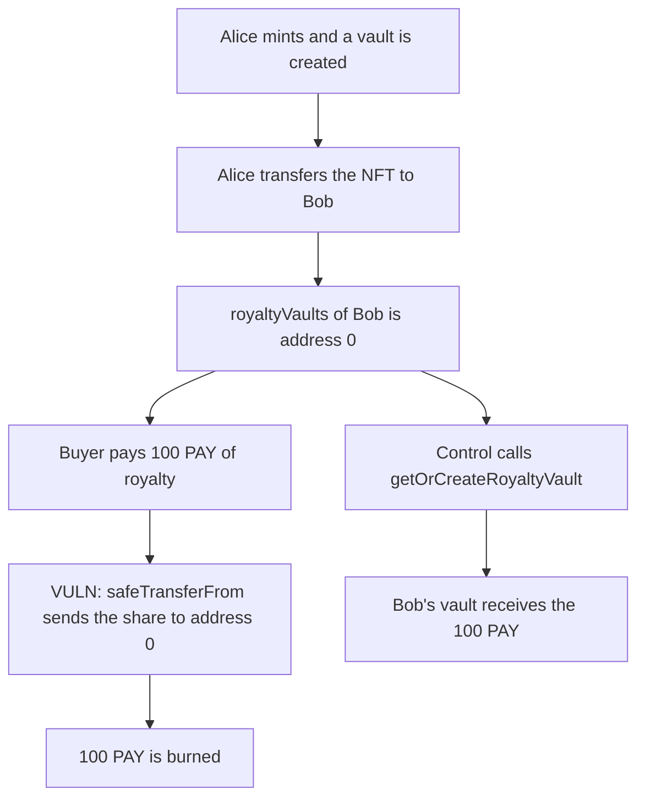

# Camp sends a transferred NFT's royalty to the zero address

> **Vulnerability classes:** vuln/logic/missing-check · vuln/dos/frozen-funds

<!-- non-defihacklabs -->
<!-- source-auditvault: https://github.com/Auditware/AuditVault/blob/main/findings/62793-transferred-nfts-may-be-missing-royalty-vault-quantstamp-cam.md -->
<!-- date: 1970-01 -->

## Key info

| Field | Value |
|---|---|
| **Loss** | 100 PAY royalty burned at address(0) because the new owner has no RoyaltyVault |
| **Vulnerable contract** | `Marketplace.buyAccess` |
| **Attacker EOA** | `0x1111111111111111111111111111111111111111` |
| **Attack contract** | `Exploit` |
| **Attack tx** | `Exploit.run()` |
| **Chain / block / date** | Ethereum model · block 0 · 1970-01 |
| **Compiler** | solc 0.8.27, cancun, via IR |
| **Bug class** | Royalty payment uses a vault mapping that is filled only at mint |

## TL;DR

Royalty vaults are created when an NFT is minted. A later transfer does not create one for the new holder. The quoted payment sends the share to `royaltyVaults(recipient)`. For Bob that address is zero, so 100 PAY is burned. `getOrCreateRoyaltyVault` before the transfer creates Bob's vault and the same 100 PAY lands there instead.

## Background

Quantstamp, Camp NFT, `IpNFT.sol`. Owners are paid subscription and dispute royalties through a per-owner `RoyaltyVault` so a reverting recipient cannot block the payment. Those vaults are created only in mint. Nothing creates one after `transfer`, and neither the new owner nor the contract owner can register one.

## The vulnerable code

```solidity
if (token == address(0)) {
    SafeTransferLib.safeTransferETH(ipToken.royaltyVaults(recipient), share);
} else {
    SafeTransferLib.safeTransferFrom(token, payer, ipToken.royaltyVaults(recipient), share);
}
```

`buyAccess` reads that vault and `payShare` performs the ERC-20 `transferFrom`.

## Root cause

`royaltyVaults` is written in `mint` and not in `transfer`. The payment trusts the mapping. An unset entry is `address(0)`, and the token allows that credit, so the funds are not returned and the new owner cannot claim them.

## Preconditions

- Alice minted the token, so Alice has a vault.
- Alice transferred the token to Bob, who has never minted.
- A buyer pays an ERC-20 royalty share for that token. The buy is permissionless.

## Attack walkthrough

1. Alice mints. Her vault is deployed.
2. Alice transfers the token to Bob. `royaltyVaults(Bob)` is still zero.
3. The buyer approves 100 PAY and calls `buyAccess` with Bob as the recipient.
4. The ERC-20 branch calls `payShare` with the zero vault.
5. `transferFrom` credits 100 PAY to `address(0)`.

## Diagrams



## Impact

The new owner loses the 100 PAY royalty. The payer's tokens are stuck at the zero address. Alice's old vault is not the recipient, so she is not paid either. The control creates Bob's vault on the purchase and his vault balance is 100 while `address(0)` stays at 0.

## Remediation

Do not read `royaltyVaults` directly on the payment path. Use `getOrCreateRoyaltyVault(recipient)`, which deploys a vault when the mapping is empty, and pay that address. The report's factory helper is the same idea.

## How to reproduce

```bash
cd 62793-transferred-nfts-may-be-missing-royalty-vault-quantstamp-cam_exp
forge test -vv
```

`test_royalty_for_new_owner_is_burned` asserts 100 PAY at `address(0)`, a zero paid-to address, and no vault for Bob. `test_control_getOrCreate_pays_the_new_owner` asserts nothing is burned and Bob's vault holds 100 PAY.

## Sources

- AuditVault finding: https://github.com/Auditware/AuditVault/blob/main/findings/62793-transferred-nfts-may-be-missing-royalty-vault-quantstamp-cam.md
- Report: https://certificate.quantstamp.com/full/camp-nft/94cdb738-1a01-4f6c-8632-3bdec427161e/index.html
