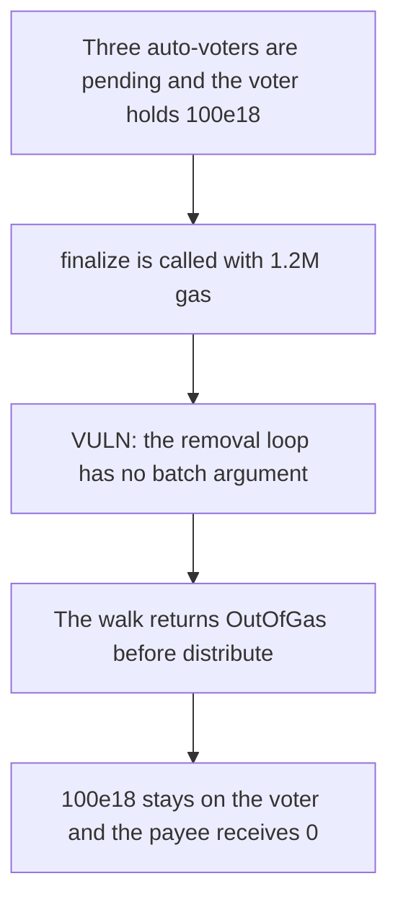

# BMX — pending removals make finalize run out of gas

> **Vulnerability classes:** vuln/dos/unbounded-loop

<!-- non-defihacklabs -->
<!-- source-auditvault: https://github.com/Auditware/AuditVault/blob/main/findings/62810-h-3-dosed-voterfinalize-due-to-unbounded-pending-removals-la.md -->
<!-- date: 2025-09 -->

## Key info

| | |
|---|---|
| **Protocol** | BMX Deli Swap |
| **Finding** | Sherlock H-3, AuditVault 62810 |
| **Vulnerable code** | `Voter._processPendingRemovals` |
| **Harm** | finalize runs out of gas. 100e18 of rewards stays on the voter. The payee receives 0. |
| **Chain** | local synthetic |

## TL;DR

`finalize` distributes rewards only after `_processPendingRemovals`. That helper copies `pendingRemovals[ep]` and walks every entry. It takes no batch argument. Three auto-voters are queued. Each removal rewrites a checkpoint page. A 1.2M gas stipend enters the walk and returns `OutOfGas` before `_distribute`. The 100e18 minted onto the voter stays there. The control takes `batch = 3`, finishes the same three accounts, and pays 100e18 to the payee.

## The vulnerable code

```solidity
function _processPendingRemovals(uint256 ep) internal {
    address[] memory toRemove = pendingRemovals[ep];
    // @> VULN: no batch argument. The whole pending list is walked here.
    for (uint256 i = 0; i < toRemove.length; i++) {
        address addr = toRemove[i];
        uint256 idx = autoIndex[addr];
        if (idx > 0) {
            _removeAutoVoter(addr, idx - 1);
        }
    }
    delete pendingRemovals[ep];
}
```

The fix passes a batch size and stops after that many removals so finalize can still pay.

## Root cause

The rest of finalize is batched. This loop is not. Its cost grows with the pending list, and the reward transfer sits after the loop. The list here is three addresses so the playground stays small. The inner call still dies inside the walk.

## Preconditions

Three auto-voters are enrolled and pushed onto `pendingRemovals`. The voter holds 100e18. finalize is called with 1.2M gas. One block. No warp.

## Attack walkthrough

1. Three addresses are enrolled. `pendingCount` is 3.
2. 100e18 is minted onto the voter.
3. `finalize` is called with a 1.2M gas stipend.
4. The loop starts with no batch bound and runs out of gas on the checkpoint writes.
5. The inner call reverts. `distributed` is 0. The payee balance is 0. The voter still holds 100e18.

## Diagrams



## Impact

Epoch rewards are not paid. 100e18 remains on the voter. The payee receives 0. The batched control pays that 100e18.

## Remediation

Pass a batch size into `_processPendingRemovals` and distribute after the bounded pass.

## How to reproduce

```bash
cd 62810-h-3-dosed-voterfinalize-due-to-unbounded-pending-removals-la_exp
forge test -vv
```

## Sources

- AuditVault finding: https://github.com/Auditware/AuditVault/blob/main/findings/62810-h-3-dosed-voterfinalize-due-to-unbounded-pending-removals-la.md
- Sherlock contest: https://audits.sherlock.xyz/contests/1154
- Quoted function: `Voter._processPendingRemovals` in the finding, from `deli-swap-contracts/src/Voter.sol`.
