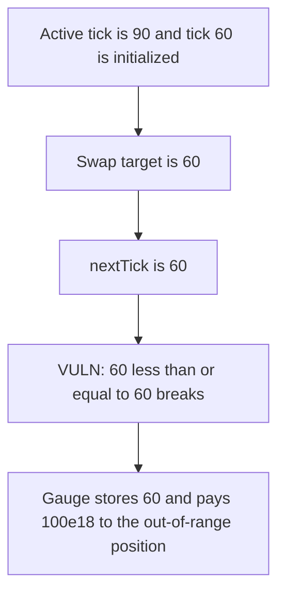

# BMX — adjustToTick stops when nextTick equals the target

> **Vulnerability classes:** vuln/logic/incorrect-calculation · vuln/logic/wrong-condition

<!-- non-defihacklabs -->
<!-- source-auditvault: https://github.com/Auditware/AuditVault/blob/main/findings/62812-h-5-rangepooladjusttotick-desyncs-when-nexttick-tick-leading.md -->
<!-- date: 2025-09 -->

## Key info

| | |
|---|---|
| **Protocol** | BMX Deli Swap |
| **Finding** | Sherlock H-5, AuditVault 62812 |
| **Vulnerable code** | `RangePool.adjustToTick` |
| **Harm** | The gauge stores tick 60. The out-of-range position is paid 100e18. The in-range position is paid 0. |
| **Chain** | local synthetic |

## TL;DR

A swap from tick 90 lands on initialized tick 60. `nextInitializedTickWithinOneWord` returns 60. The break is `nextTick <= tick`, so 60 <= 60 leaves the loop before the cross. The gauge stores 60. Position `[60, 120)` is still in range and is minted 100e18. Position `[0, 60)` receives 0. Uniswap would store 59 after the cross. The control uses `nextTick < tick`, stores 59, and pays the 100e18 to the honest position.

## The vulnerable code

```solidity
(int24 nextTick, bool isInit) =
    this.nextInitializedTickWithinOneWord(currentTick, tickSpacing, true);
// @> VULN: nextTick == tick_ breaks, so tick 60 is not crossed
if (nextTick <= tick_) {
    break;
}
```

The fix breaks only when `nextTick < tick`, so equality still crosses and the active tick becomes `nextTick - 1`.

## Root cause

The gauge and the pool disagree on whether a price that sits on an initialized tick has crossed it. The `<=` break treats "arrived on the tick" as "stop before the tick". Fee payment then uses the wrong in-range position.

## Preconditions

Active tick starts at 90. Ticks 0, 60, and 120 are initialized. The attacker is `[60, 120)`. The honest LP is `[0, 60)`. The swap target is 60. One block. No warp.

## Attack walkthrough

1. The pool is configured at tick 90.
2. `onSwap(60)` calls `adjustToTick(60, 60)`.
3. The bitmap returns nextTick 60.
4. `60 <= 60` breaks. `crossed` stays false. The stored tick is 60.
5. `pay(100e18)` mints 100e18 to the attacker. The honest LP receives 0.

## Diagrams



## Impact

The attacker is paid 100e18 of fees. The honest in-range position is paid 0. The control stores tick 59, which is below 60, and pays the honest position 100e18.

## Remediation

Break only when `nextTick < tick`, and store the post-cross tick `nextTick - 1` when moving down.

## How to reproduce

```bash
cd 62812-h-5-rangepooladjusttotick-desyncs-when-nexttick-tick-leading_exp
forge test -vv
```

## Sources

- AuditVault finding: https://github.com/Auditware/AuditVault/blob/main/findings/62812-h-5-rangepooladjusttotick-desyncs-when-nexttick-tick-leading.md
- Sherlock contest: https://audits.sherlock.xyz/contests/1154
- The break `if (nextTick <= tick)` is the line quoted from `RangePool.adjustToTick`. The fixed pool in `morphex-labs/deli-swap-contracts` compares the sqrt price and crosses when the price reaches the tick.
