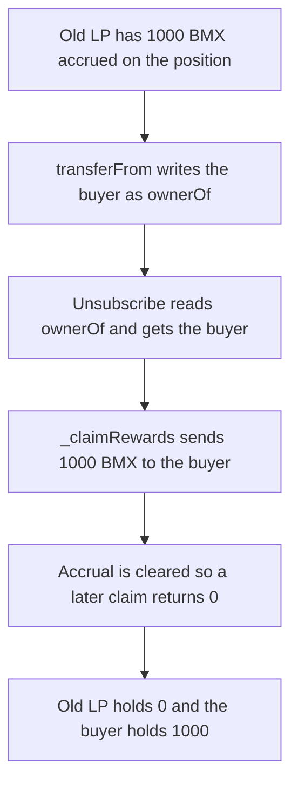

# BMX — transferring an LP NFT pays accrued rewards to the buyer

> **Vulnerability classes:** vuln/logic/reward-calculation · vuln/logic/incorrect-state-transition

> **Reproduction:** a self-contained Foundry PoC that compiles and runs offline
> with only `forge-std` — no fork and no RPC. Trace: [output.txt](output.txt).
> PoC: [test/62813-h-6-reward-token-loss-for-lps-during-nft-position-transfer-s_exp.sol](test/62813-h-6-reward-token-loss-for-lps-during-nft-position-transfer-s_exp.sol).

<!-- non-defihacklabs -->
<!-- source-auditvault: https://github.com/Auditware/AuditVault/blob/main/findings/62813-h-6-reward-token-loss-for-lps-during-nft-position-transfer-s.md -->
<!-- date: 2025-09 -->

---

## Key info

| | |
|---|---|
| **Impact** | **HIGH** — **1,000 BMX** accrued by the old LP is paid to the buyer, and nothing is left to claim |
| **Protocol** | BMX Deli Swap, DeliHook v4 position transfer |
| **Vulnerable code** | `notifyUnsubscribeWithContext` calls `_claimRewards(posKey, ownerAddr)` after `ownerOf` has changed |
| **Bug class** | Reward recipient is the post-transfer NFT owner |
| **Finding** | Sherlock (0x73696d616f) — BMX Deli Swap, September 2025 · id 62813, H-6 |
| **Report** | [Judging issue 184](https://github.com/sherlock-audit/2025-09-bmx-deli-swap-judging/issues/184) |
| **Source** | [AuditVault finding](https://github.com/Auditware/AuditVault/blob/main/findings/62813-h-6-reward-token-loss-for-lps-during-nft-position-transfer-s.md) |
| **Status** | Reproduced here as a local synthetic. |
| **Compiler** | solc 0.8.27, cancun, via IR |

---

## TL;DR

`transferFrom` writes the new NFT owner and then unsubscribes. Unsubscribe reads `ownerOf`, which is already the buyer, and `_claimRewards` sends the position's accrued BMX to that address.

With **N = 1,000 BMX** accrued:

- The old LP's balance stays **0**. They no longer hold the NFT or the rewards.
- The buyer receives **1,000 BMX** inside the transfer.
- The position accrual is cleared, so a later claim returns **0**. The 1,000 BMX is no longer claimable.

## The vulnerable code

```solidity
function transferFrom(address from, address to, uint256 id) public {
    ownerOf[id] = to; // ownership first
    if (hasSubscriber[id]) _unsubscribe(id);
}

function _unsubscribe(uint256 id) internal {
    address owner = ownerOf[id]; // already the buyer
    gauge.notifyUnsubscribeWithContext(posKey, 0, 0, owner, 0, 0, 0);
}

function notifyUnsubscribeWithContext(bytes32 posKey, bytes32, int24, address ownerAddr, int24, int24, uint128) external {
    _claimRewards(posKey, ownerAddr); // @> VULN: pays the post-transfer owner
}
```

`_claimRewards` does `amount = positionRewards[posKey].claim()` and `BMX.transfer(recipient, amount)`.

The fix pays `subscriber[posKey]`, the LP recorded when the position was opened, and ignores `ownerAddr`.

## Root cause

The reward recipient is the current NFT owner. The transfer updates that owner before the claim, so the buyer is paid for rewards the seller accrued. Removing the position afterwards leaves a claimable balance of zero.

## Preconditions

- The old LP holds a subscribed position with **1,000 BMX** accrued and the gauge funded for that amount.
- The LP transfers the position NFT to a buyer.

## Attack walkthrough

1. Fund the gauge with 1,000 BMX and subscribe the position to the old LP.
2. Sell the NFT. `ownerOf` becomes the buyer, then unsubscribe reads that address.
3. `_claimRewards` transfers 1,000 BMX to the buyer and zeroes the accrual.
4. The old LP's BMX balance is 0. The buyer's balance is 1,000. `accrued` is 0, so the buyer cannot claim anything further.

Control: the same transfer still gives the NFT to the buyer, but the gauge pays the recorded subscriber. The old LP receives **1,000 BMX**. The buyer receives **0**.

## Diagrams



## Impact

The old LP loses **1,000 BMX** of accrued rewards on a transfer. The buyer is paid that amount even though they did not accrue it. After the transfer the position has nothing left to claim.

## Remediation

Checkpoint on transfer to the subscriber recorded when the position was opened, and pass that address to `_claimRewards` instead of the post-transfer `ownerOf`.

## Sources

- [AuditVault finding 62813](https://github.com/Auditware/AuditVault/blob/main/findings/62813-h-6-reward-token-loss-for-lps-during-nft-position-transfer-s.md)
- [Sherlock judging issue 184](https://github.com/sherlock-audit/2025-09-bmx-deli-swap-judging/issues/184)
- Root cause: [DailyEpochGauge.sol L706](https://github.com/sherlock-audit/2025-09-bmx-deli-swap/blob/main/deli-swap-contracts/src/DailyEpochGauge.sol#L706-L707)

### Taxonomy

- `severity/high`
