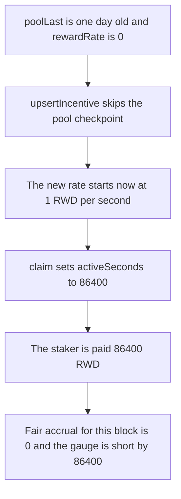

# BMX — a zero-rate incentive upsert pays a staker for the day before the schedule exists

> **Vulnerability classes:** vuln/logic/reward-calculation · vuln/logic/incorrect-order-of-operations

> **Reproduction:** a self-contained Foundry PoC that compiles and runs offline
> with only `forge-std` — no fork and no RPC. Trace: [output.txt](output.txt).
> PoC: [test/62814-h-7-in-the-incentivegauge-upsertincentive-function-updatepo_exp.sol](test/62814-h-7-in-the-incentivegauge-upsertincentive-function-updatepo_exp.sol).

<!-- non-defihacklabs -->
<!-- source-auditvault: https://github.com/Auditware/AuditVault/blob/main/findings/62814-h-7-in-the-incentivegauge-upsertincentive-function-updatepo.md -->
<!-- date: 2025-09 -->

---

## Key info

| | |
|---|---|
| **Impact** | **HIGH** — the staker is paid **86,400 RWD**. The fair accrual for a schedule that starts in this block is **0** |
| **Protocol** | BMX Deli Swap, IncentiveGauge |
| **Vulnerable code** | `_upsertIncentive` calls `_updatePool` only when `rewardRate > 0`, then `_updatePool` streams `endTs - poolLast` |
| **Bug class** | Pool checkpoint skipped, so the next stream includes time before the incentive |
| **Finding** | Sherlock (x15 and others) — BMX Deli Swap, September 2025 · id 62814, H-7 |
| **Report** | [Judging issue 240](https://github.com/sherlock-audit/2025-09-bmx-deli-swap-judging/issues/240) |
| **Source** | [AuditVault finding](https://github.com/Auditware/AuditVault/blob/main/findings/62814-h-7-in-the-incentivegauge-upsertincentive-function-updatepo.md) |
| **Status** | Reproduced here as a local synthetic. |
| **Compiler** | solc 0.8.27, cancun, via IR |

---

## TL;DR

`_upsertIncentive` updates the pool only inside `if (info.rewardRate > 0)`. A new incentive whose previous rate is 0 therefore starts while `poolLast` is still yesterday. The next `_updatePool` sets `activeSeconds = endTs - poolLast` and pays that whole window.

With one staker, a rate of **1 RWD per second**, and a checkpoint **86,400 seconds** old:

- **Paid:** 86,400 RWD, transferred in the same block the schedule is created.
- **Fair:** 0 RWD. Checkpointing before the rate is stored makes `poolLast == now`, so the same claim streams nothing.
- The gauge's remaining budget is short by **86,400 RWD**.

## The vulnerable code

```solidity
function _upsertIncentive(uint256 amount) internal returns (uint128 rate) {
    uint256 total = amount;
    if (info.rewardRate > 0) {
        _updatePool(); // skipped when the stored rate is 0
    }
    rate = uint128(total / WEEK);
    info.rewardRate = rate;
    info.periodFinish = uint64(block.timestamp + WEEK);
    info.lastUpdate = uint64(block.timestamp);
    info.remaining = uint128(total);
}

function _updatePool() internal {
    if (info.rewardRate > 0) {
        uint256 endTs = nowTs < info.periodFinish ? nowTs : info.periodFinish;
        if (endTs > poolLast) {
            uint256 activeSeconds = endTs - poolLast; // @> VULN: stale poolLast
            amt = uint256(info.rewardRate) * activeSeconds;
        }
    }
}
```

The fix calls `_updatePool` before the new rate is written, including when `rewardRate` is 0. That moves `poolLast` to now while the rate is still 0, so the new schedule does not pay for the gap.

## Root cause

The pool checkpoint and the incentive clock are updated in the wrong order. The incentive's `lastUpdate` becomes `block.timestamp`, but `poolLast` stays at the previous checkpoint whenever the stored rate is 0. The stream formula then treats every second since `poolLast` as time this incentive was active.

## Preconditions

- `poolLast` is 86,400 seconds behind `block.timestamp` (1,700,000,000 in this run). No timestamp change happens inside `run()`.
- The incentive's `rewardRate` is 0.
- The gauge holds 604,800 RWD, which is one week at 1 RWD per second.
- One staker has the full share.

## Attack walkthrough

1. Seed the staker and set `poolLast` to yesterday. `rewardRate` stays 0.
2. Mint 604,800 RWD into the gauge and call `upsertIncentive`. The `rewardRate > 0` branch does not call `_updatePool`.
3. The new rate, `periodFinish`, and `lastUpdate` are stored from the current timestamp.
4. `claim` runs in the same block. `activeSeconds` is 86,400. The staker is transferred 86,400 RWD.
5. `fairAmount` is 0. The gauge balance is the week budget minus 86,400 RWD.

Control: the same seed, budget, and claim, but `_updatePool` runs before the rate is stored. `paid` is 0. The staker's balance stays 0. The gauge still holds the full 604,800 RWD.

## Diagrams



## Impact

The staker receives **86,400 RWD** that the incentive had not yet streamed. The fair payment in this block is **0**. Those tokens leave the gauge budget, so later claims against the same week are short by **86,400 RWD**.

## Remediation

Call `_updatePool` before writing `rewardRate`, `periodFinish`, and `remaining`, whether or not a previous schedule is still active. The checkpoint then lands at the start of the new schedule and the following update cannot charge the stale gap.

## Sources

- [AuditVault finding 62814](https://github.com/Auditware/AuditVault/blob/main/findings/62814-h-7-in-the-incentivegauge-upsertincentive-function-updatepo.md)
- [Sherlock judging issue 240](https://github.com/sherlock-audit/2025-09-bmx-deli-swap-judging/issues/240)
- Root cause: [IncentiveGauge.sol L486](https://github.com/sherlock-audit/2025-09-bmx-deli-swap/blob/main/deli-swap-contracts/src/IncentiveGauge.sol#L486)

### Taxonomy

- `severity/high`
- `sector/dex`
- `platform/sherlock`
