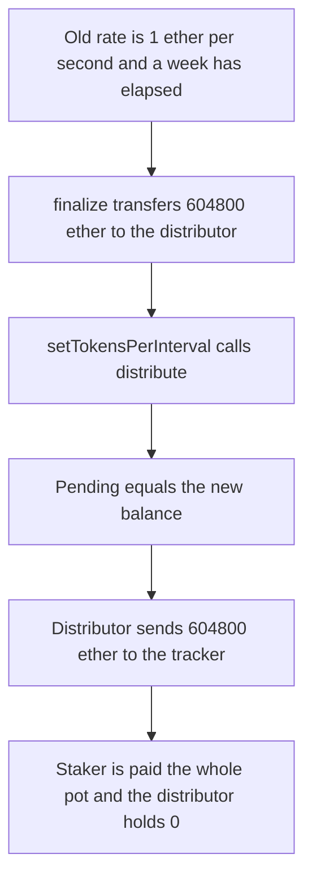

# BMX — finalize sends WETH before the reward rate is set

> **Vulnerability classes:** vuln/logic/reward-calculation

> **Reproduction:** a self-contained Foundry PoC that compiles and runs offline
> with only `forge-std` — no fork and no RPC. Trace: [output.txt](output.txt).
> PoC: [test/62815-h-8-voterfinalize-incorrect-rewards-distribution-due-to-tran_exp.sol](test/62815-h-8-voterfinalize-incorrect-rewards-distribution-due-to-tran_exp.sol).

<!-- non-defihacklabs -->
<!-- source-auditvault: https://github.com/Auditware/AuditVault/blob/main/findings/62815-h-8-voterfinalize-incorrect-rewards-distribution-due-to-tran.md -->
<!-- date: 2025-09 -->

---

## Key info

| | |
|---|---|
| **Impact** | **HIGH** — the staker is paid **604,800 WETH** immediately and the distributor is left with **0** |
| **Protocol** | BMX Deli Swap `Voter.finalize` |
| **Vulnerable code** | `WETH.transfer` to the distributor runs before `setTokensPerInterval` |
| **Bug class** | Old reward rate is applied to WETH that was just deposited |
| **Finding** | Sherlock (0x73696d616f) — BMX Deli Swap, September 2025 · id 62815, H-8 |
| **Report** | [Judging issue 242](https://github.com/sherlock-audit/2025-09-bmx-deli-swap-judging/issues/242) |
| **Source** | [AuditVault finding](https://github.com/Auditware/AuditVault/blob/main/findings/62815-h-8-voterfinalize-incorrect-rewards-distribution-due-to-tran.md) |
| **Status** | Fixed by notifying the rate before the transfer. Reproduced here as a local synthetic. |
| **Compiler** | solc 0.8.27, cancun, via IR |

---

## TL;DR

`setTokensPerInterval` calls `updateRewards`, which calls `distribute`. `distribute` pays `tokensPerInterval * time since last distribution`, capped by the distributor's balance.

`finalize` transfers the new WETH **before** that call. The old rate is 1 ether per second and the last distribution is one week old, so pending is **604,800 ether**. That equals the pot just deposited, so `distribute` sends all of it to the staker. The distributor's balance is **0**. Nothing is left to stream over the week.

`run()` does not warp. The block timestamp is already `1_700_000_000`, and the stored `lastDistributionTime` is one week earlier.

## The vulnerable code

```solidity
function finalize() external {
    uint256 toRewards = WETH.balanceOf(address(this));
    WETH.transfer(address(distributor), toRewards); // @> VULN: balance is visible to distribute
    distributor.setTokensPerInterval(toRewards / WEEK);
}
```

`distribute` then does:

```solidity
uint256 amount = pendingRewards();
lastDistributionTime = block.timestamp;
uint256 balance = rewardToken.balanceOf(address(this));
if (amount > balance) amount = balance;
rewardToken.transfer(msg.sender, amount);
```

The fixed order calls `setTokensPerInterval` first. `pending` is still a week of the old rate, but the balance is 0, so the transfer amount is 0. The WETH is moved onto the distributor only after that.

## Root cause

`distribute` pays the previously configured rate out of whatever balance it finds. Depositing the new epoch's WETH before updating the rate makes that balance include the new pot, and a week of the old rate consumes it in one call.

## Preconditions

- `lastDistributionTime` is one week before the block timestamp. No timestamp change happens inside `run()`.
- `tokensPerInterval` is 1 ether per second, so pending is 604,800 ether.
- The distributor holds no WETH until `finalize` transfers the pot.
- One staker receives whatever the tracker is paid.

## Attack walkthrough

1. Mint 604,800 ether of WETH to the voter.
2. Seed the distributor: rate 1 ether per second, last distribution one week ago.
3. `finalize` transfers the pot, then calls `setTokensPerInterval`.
4. `distribute` computes pending of 604,800 ether, sees that balance, and transfers it to the tracker.
5. The tracker pays the staker. The staker holds **604,800 ether**. The distributor holds **0**.

Control: `setTokensPerInterval` runs while the distributor is empty, so the staker is paid **0**. The transfer then leaves **604,800 ether** on the distributor.

## Diagrams



## Impact

The staker receives **604,800 WETH** in the finalize call, which is the entire weekly pot. The distributor is left with **0**, so later blocks have nothing to stream at the new rate.

## Remediation

Call `setTokensPerInterval` before transferring the WETH. `distribute` then caps the payout at the empty balance, and the deposit remains on the distributor for the week.

## Sources

- [AuditVault finding 62815](https://github.com/Auditware/AuditVault/blob/main/findings/62815-h-8-voterfinalize-incorrect-rewards-distribution-due-to-tran.md)
- [Sherlock judging issue 242](https://github.com/sherlock-audit/2025-09-bmx-deli-swap-judging/issues/242)
- Fixed order: [Voter.sol](https://github.com/morphex-labs/deli-swap-contracts/blob/main/src/Voter.sol) calls `setTokensPerInterval` before `WETH.safeTransfer`

### Taxonomy

- `severity/high`
- `vuln/logic/reward-calculation`
