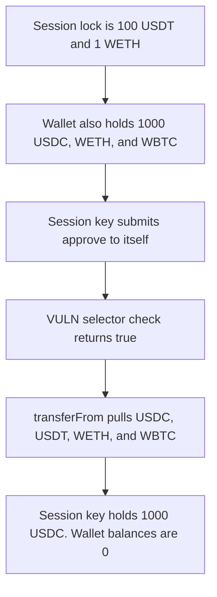

# Etherspot: a session key approves itself and drains the wallet

> **Vulnerability classes:** `vuln/access-control/missing-auth`

<!-- non-defihacklabs -->
<!-- source-auditvault: https://github.com/Auditware/AuditVault/blob/main/findings/62847-c-01-sessionkey-owner-can-drain-the-smart-wallet-shieldify-n.md -->
<!-- date: 2025-10 -->

## Key info

| Field | Value |
|---|---|
| **Loss** | The session key takes 1,000 USDC that was not in its lock, plus the wallet's USDT, WETH, and WBTC. The wallet ends at 0 |
| **Vulnerable contract** | `CredibleAccountModule._validateSingleCall` |
| **Attacker EOA** | `0x1111111111111111111111111111111111111111` (the session key owner) |
| **Attack contract** | `Exploit` |
| **Attack tx** | `Exploit.run()` |
| **Chain / block / date** | Ethereum model · block 0 · 2025-10 |
| **Compiler** | solc 0.8.27, cancun |
| **Bug class** | `approve` returns true for any spender and any amount |

## TL;DR

A session is locked to 100 USDT and 1 WETH. `_validateSingleCall` returns true for every ERC-20 `approve` and never reads the spender or the amount. The session key makes the wallet approve itself for `type(uint256).max` on USDC, USDT, WETH, and WBTC, then `transferFrom`s each balance. USDC was not in the lock. The session key receives 1,000 USDC. The wallet's four token balances are 0.

## The vulnerable code

```solidity
bytes4 selector = bytes4(_callData);
if (selector == APPROVE) return true; // @> VULN: approve of any spender and any amount is allowed
```

```diff
- if (selector == APPROVE) return true;
+ if (selector == APPROVE) {
+     (address spender, uint256 amount) = abi.decode(_callData[4:], (address, uint256));
+     require(spender == address(this), "spender");
+     require(amount <= lockedAmount[target], "lock");
+     return true;
+ }
```

## Root cause

The module treats the approve selector as sufficient authorization. The session lock is stored and never consulted. The spender in the calldata can be the session key itself.

## Preconditions

- The wallet has enabled this session key.
- The lock records 100 USDT and 1 WETH. It does not record USDC or WBTC.
- The wallet holds 1,000 USDC, 100 USDT, 5 WETH, and 2 WBTC.

## Attack walkthrough

1. The wallet is funded. USDC is outside the lock.
2. The session key asks the wallet to approve USDC to itself.
3. The module returns true on the approve selector.
4. `transferFrom` pulls 1,000 USDC.
5. The same approve is used for WBTC, and for the locked tokens, with no amount check.
6. The session key holds the 1,000 USDC. Every wallet balance is 0.

## Diagrams



## Impact

The wallet owner loses 1,000 USDC that the session was never allowed to touch, and also loses the locked USDT and WETH plus the extra WBTC. Checking that the spender is the module, and that the amount is inside the lock, stops the approval.

## How to reproduce

```bash
cd 62847-c-01-sessionkey-owner-can-drain-the-smart-wallet-shieldify-n_exp
forge test -vv
```

## Sources

- AuditVault finding: https://github.com/Auditware/AuditVault/blob/main/findings/62847-c-01-sessionkey-owner-can-drain-the-smart-wallet-shieldify-n.md
- Shieldify Etherspot review: https://github.com/shieldify-security/audits-portfolio-md/blob/main/Etherspot-GasTankPaymasterModule-Extended-Security-Review.md
- `_validateSingleCall`: https://github.com/etherspot/etherspot-modular-accounts/blob/9019f2a78c36e74bdb1df4029672998cb4631162/src/modules/validators/CredibleAccountModule.sol#L763
