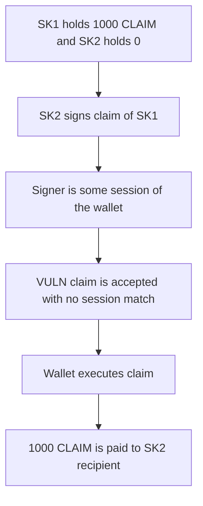

# Etherspot: one session key spends another session key's claim balance

> **Vulnerability classes:** `vuln/access-control/missing-modifier` · `vuln/auth/signature-validation`

<!-- non-defihacklabs -->
<!-- source-auditvault: https://github.com/Auditware/AuditVault/blob/main/findings/62848-h-01-sessionkey-owner-can-impersonate-another-session-key-ow.md -->
<!-- date: 2025-09 -->

## Key info

| Field | Value |
|---|---|
| **Loss** | 1000 CLAIM moved from SK1's session to SK2's recipient |
| **Vulnerable contract** | `CredibleAccountModule._validateSingleCall` |
| **Attacker EOA** | `0x1111111111111111111111111111111111111111` |
| **Attack contract** | `Exploit` |
| **Attack tx** | `Exploit.run()` |
| **Chain / block / date** | Ethereum model · block 0 · 2025-09 |
| **Compiler** | solc 0.8.27, cancun |
| **Bug class** | claim calldata is not bound to the signing session key |

## TL;DR

A smart wallet can hold several session keys. `validateUserOp` checks that the signer is one of them. `_validateSingleCall` then accepts `claim()` without reading the `sessionKey` argument. SK2 signs a claim that names SK1. Validation passes, the wallet executes it, and SK1's 1000 CLAIM is paid to SK2's recipient.

## Background

Shieldify's review of Etherspot's GasTank paymaster module, finding H-01. The blamed functions are `_validateSelector` and `_validateSingleCall` in `CredibleAccountModule.sol` at commit `9019f2a`, lines 759-766. The report's scenario is two sessions on one wallet, with SK2 consuming SK1.

## The vulnerable code

```solidity
function _validateSelector(bytes4 _selector) internal pure returns (bytes4) {
    return (_selector == this.claim.selector || _selector == IERC20.approve.selector) ? _selector : bytes4(0);
}

function _validateSingleCall(bytes calldata _callData) internal view returns (bool) {
    (address target,, bytes calldata execData) = ExecutionLib.decodeSingle(_callData[EXEC_OFFSET:]);
    bytes4 selector = _validateSelector(bytes4(execData[0:4]));
    if (selector == bytes4(0)) return false;
    if (selector == IERC20.approve.selector) return true;
    if (target != address(this)) return false;
    return true; // @> VULN: claim() is accepted without sessionKey == sessionKeySigner
}
```

`EXEC_OFFSET` is 0 in this reduction. The outer bytes are the target, the value, and the inner calldata. The selector check and the final `return true` are the audited lines.

## Root cause

The validator proves that the signer belongs to the wallet. It does not prove that the signer is the session whose balance `claim` will spend. Any sibling session can name another session in the calldata.

## Preconditions

- One smart wallet has two session keys, SK1 and SK2.
- SK1's session balance is 1000 CLAIM. SK2's is zero.
- The user operation calls `claim(SK1, recipient)` and is signed by SK2.

## Attack walkthrough

1. Credit 1000 CLAIM to SK1 and register both keys on the wallet.
2. Build claim calldata whose session argument is SK1 and whose recipient is `0x2222…2222`.
3. `validateUserOp(SK2, calldata)` sees that SK2 is a session of the wallet.
4. `_validateSelector` accepts `claim`, the target is the module, and `_validateSingleCall` returns true.
5. The wallet executes the calldata. `claim` requires the caller to be the wallet, which it is.
6. SK1's balance is zeroed and 1000 CLAIM arrives at the recipient. SK2's own session balance was never funded.

## Diagrams



## Impact

SK2 spends SK1's session. The recipient `0x2222…2222` receives 1000 CLAIM. SK1 did not sign, and SK2 had no claimable balance of its own. The report's impact is consumption of another session by an unauthorized session owner on the same wallet.

## Remediation

When the selector is `claim`, decode the `sessionKey` argument and require it to equal the signer. The team reported the check as fixed.

## How to reproduce

```bash
cd 62848-h-01-sessionkey-owner-can-impersonate-another-session-key-ow_exp
forge test -vv
```

`test_sk2_consumes_sk1_claim` asserts validation succeeded, the recipient holds 1000 CLAIM, and SK1's session balance is zero. Captured output is `output.txt`.

## Sources

- AuditVault finding: https://github.com/Auditware/AuditVault/blob/main/findings/62848-h-01-sessionkey-owner-can-impersonate-another-session-key-ow.md
- Report: https://github.com/shieldify-security/audits-portfolio-md/blob/main/Etherspot-GasTankPaymasterModule-Extended-Security-Review.md
- Blamed lines: https://github.com/etherspot/etherspot-modular-accounts/blob/9019f2a78c36e74bdb1df4029672998cb4631162/src/modules/validators/CredibleAccountModule.sol#L759-L766
