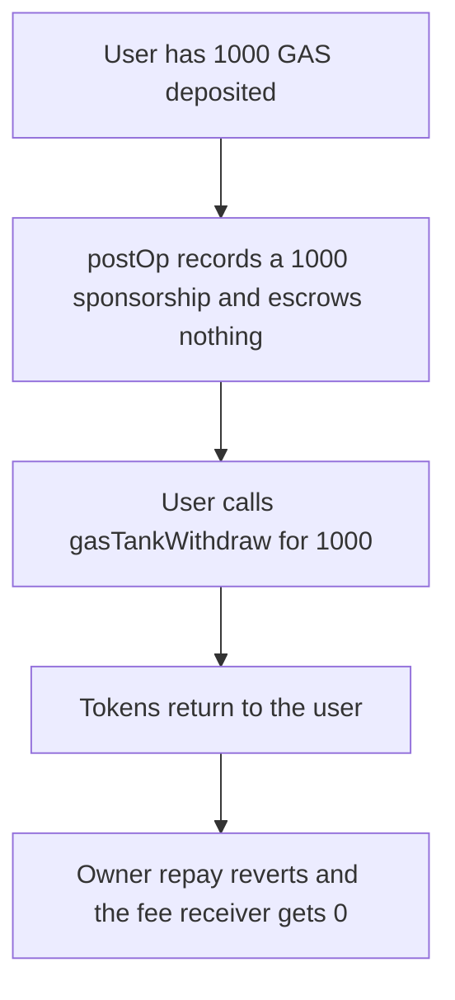

# Etherspot — a gas-tank user withdraws the balance that should repay sponsored gas

> **Vulnerability classes:** `vuln/logic/missing-check` · `vuln/logic/fee-calculation`

> **Reproduction:** a self-contained Foundry PoC that compiles and runs offline
> with only `forge-std` — no fork and no RPC. Trace: [output.txt](output.txt).
> PoC: [test/62850-h-03-users-can-escape-paying-for-the-tx-gas-shieldify-none-e_exp.sol](test/62850-h-03-users-can-escape-paying-for-the-tx-gas-shieldify-none-e_exp.sol).

<!-- non-defihacklabs -->
<!-- source-auditvault: https://github.com/Auditware/AuditVault/blob/main/findings/62850-h-03-users-can-escape-paying-for-the-tx-gas-shieldify-none-e.md -->
<!-- date: 2025-09 -->

---

## Key info

| | |
|---|---|
| **Impact** | **HIGH** — the user pulls back **1,000 GAS** after a **1,000 GAS** sponsorship; the fee receiver is paid **0** |
| **Protocol** | Etherspot `GasTankPaymaster.gasTankWithdraw` |
| **Vulnerable code** | `token.transfer` of the full balance with no read of the unpaid sponsorship |
| **Bug class** | Sponsored gas is recorded after the fact and can be withdrawn first |
| **Finding** | Shieldify H-03 — Etherspot GasTank paymaster · id 62850 |
| **Report** | [Shieldify review](https://github.com/shieldify-security/audits-portfolio-md/blob/main/Etherspot-GasTankPaymasterModule-Extended-Security-Review.md) |
| **Source** | [AuditVault finding](https://github.com/Auditware/AuditVault/blob/main/findings/62850-h-03-users-can-escape-paying-for-the-tx-gas-shieldify-none-e.md) |
| **Compiler** | solc 0.8.27, cancun, via IR |

---

## TL;DR

The paymaster checks that a user will pay, executes the sponsored operation, and only then asks an admin to call `repaySponsoredTransaction`. `_postOp` adds to `sponsored` and does not escrow tokens. `gasTankWithdraw` transfers `balances[user]` with no look at that debt.

The user has 1,000 GAS on deposit. A sponsorship of 1,000 GAS is recorded. The user withdraws 1,000. The owner's repay reverts with insufficient balance. The fee receiver stays at 0, and `sponsored` is still 1,000.

The fixed tank sets `isWithdrawPaused` in `postOp`. The withdraw reverts, and the repay credits the fee receiver with 1,000.

## The vulnerable code

```solidity
function gasTankWithdraw(uint256 amount) external {
    uint256 currentBalance = balances[msg.sender];
    if (currentBalance < amount) revert("GasTankPaymaster_InsufficientBalance");
    token.transfer(msg.sender, amount); // @> VULN: unpaid sponsored gas is ignored
    balances[msg.sender] = currentBalance - amount;
}
```

```diff
 function gasTankWithdraw(uint256 amount) external {
+    require(!isWithdrawPaused[msg.sender], "withdraw paused");
     uint256 currentBalance = balances[msg.sender];
```

`postOp` sets the pause. `repaySponsoredTransaction` clears it once `sponsored` is zero.

## Attack walkthrough

1. The tank already holds the user's 1,000 GAS deposit. The user's wallet is empty.
2. `postOp` records a 1,000 GAS sponsorship. The token balance is not reduced.
3. `gasTankWithdraw(1000)` transfers the tokens back. There is no pause and no debt check.
4. `repaySponsoredTransaction` reverts. The fee receiver's internal balance stays 0. The debt is still 1,000.

## Diagrams



## Impact

The paymaster has already paid for the user operation. The user leaves with the entire deposit, so the fee receiver cannot be repaid. In this run the sponsored fee equals the deposit, so the escaped amount is 1,000 GAS.

## Sources

- [AuditVault 62850](https://github.com/Auditware/AuditVault/blob/main/findings/62850-h-03-users-can-escape-paying-for-the-tx-gas-shieldify-none-e.md)
- [Shieldify Etherspot GasTank review](https://github.com/shieldify-security/audits-portfolio-md/blob/main/Etherspot-GasTankPaymasterModule-Extended-Security-Review.md)
- [etherspot-modular-accounts audit branch](https://github.com/etherspot/etherspot-modular-accounts/blob/audit/GTP-CAM-RLV-IM/src/paymaster/GasTankPaymaster.sol) — `gasTankWithdraw` and `repaySponsoredTransaction`
