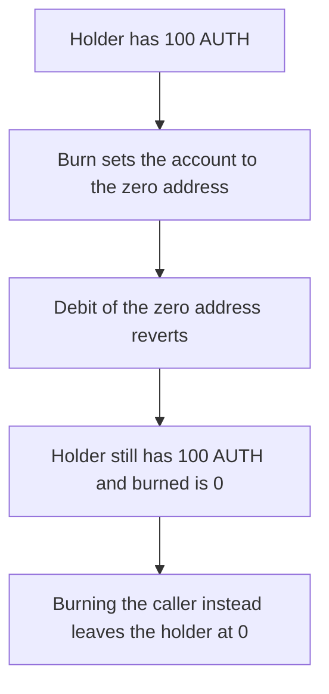

# Radius EVMAuth — a burn debits the zero address and leaves the holder unchanged

> **Vulnerability classes:** vuln/logic/wrong-condition · vuln/logic/state-update

> **Reproduction:** a self-contained Foundry PoC that compiles and runs offline
> with only `forge-std` — no fork and no RPC. Trace: [output.txt](output.txt).
> PoC: [test/62865-incorrect-account-assignment-in-token-burning-logic-trailofb_exp.sol](test/62865-incorrect-account-assignment-in-token-burning-logic-trailofb_exp.sol).

<!-- non-defihacklabs -->
<!-- source-auditvault: https://github.com/Auditware/AuditVault/blob/main/findings/62865-incorrect-account-assignment-in-token-burning-logic-trailofb.md -->
<!-- date: 2025-10 -->

---

## Key info

| | |
|---|---|
| **Impact** | **HIGH** — a burn of **100 AUTH** reverts, and the holder still has **100 AUTH** |
| **Protocol** | Radius Technology EVMAuth |
| **Vulnerable code** | `_update` sets `address _account = to` on the burn path, and `to` is `address(0)` |
| **Bug class** | Burn debits the wrong account, so the holder's balance is not reduced |
| **Finding** | Trail of Bits — Radius Technology EVMAuth, October 2025 · id 62865 |
| **Report** | [EVMAuth security review](https://github.com/trailofbits/publications/blob/master/reviews/2025-10-radiustechnology-evmauth-securityreview.pdf) |
| **Source** | [AuditVault finding](https://github.com/Auditware/AuditVault/blob/main/findings/62865-incorrect-account-assignment-in-token-burning-logic-trailofb.md) |
| **Status** | Reproduced here as a local synthetic. |
| **Compiler** | solc 0.8.27, cancun, via IR |

---

## TL;DR

The burn arm of `_update` does `address _account = to`. For a burn, `to` is `address(0)`, so the debit targets the zero address. That account has no tokens, the debit reverts, and the holder's balance is unchanged.

With **N = 100 AUTH**:

- The burn call reverts inside `_burnGroupBalances`.
- The holder still has **100 AUTH**. `burned` stays **0**.
- Control assigns `_account = from` (the caller) and the same burn leaves the holder at **0** and records **100 AUTH** burned.

## The vulnerable code

```solidity
// Burning
else if (to == address(0)) {
    address _account = to; // @> VULN: should be `from`
    _burnGroupBalances(_account, _id, _amount);
    _pruneGroups(_account, _id);
}
```

`_burnGroupBalances` requires `balanceOf(account) >= amount` and then subtracts. The zero address fails that require. The holder's slot is never written.

The fix is `address _account = from`.

## Root cause

The burn account is taken from the transfer's `to` parameter. On a burn that parameter is the zero address by convention, not the token holder. The subsequent group burn and prune therefore never touch the holder, and the revert rolls back the whole debit.

## Preconditions

- The holder has **100 AUTH**.
- A caller burns them by calling `update(holder, address(0), 100 AUTH)`.

## Attack walkthrough

1. Mint 100 AUTH to the holder.
2. Call `update` with `to = address(0)`. The burn branch assigns `_account = to`.
3. `_burnGroupBalances` reads `balanceOf(address(0))`, which is 0, and reverts.
4. The outer call catches that revert. The holder balance is still 100 AUTH. `burned` is 0.

Control: the same mint and burn, with `_account = from`. The caller's balance becomes 0 and `burned` is 100 AUTH.

## Diagrams



## Impact

The holder keeps **100 AUTH** after a burn that was supposed to revoke them. The recorded burn amount is **0**. Access that keys off this balance continues. Burning the caller, which is the intended account, removes the full **100 AUTH**.

## Remediation

Set the burn account to `from`, the holder whose tokens are being destroyed, and keep the balance check on that account.

## Sources

- [AuditVault finding 62865](https://github.com/Auditware/AuditVault/blob/main/findings/62865-incorrect-account-assignment-in-token-burning-logic-trailofb.md)
- [Trail of Bits EVMAuth review, October 2025](https://github.com/trailofbits/publications/blob/master/reviews/2025-10-radiustechnology-evmauth-securityreview.pdf)

### Taxonomy

- `severity/high`
- `sector/token`
- `platform/trailofbits`
