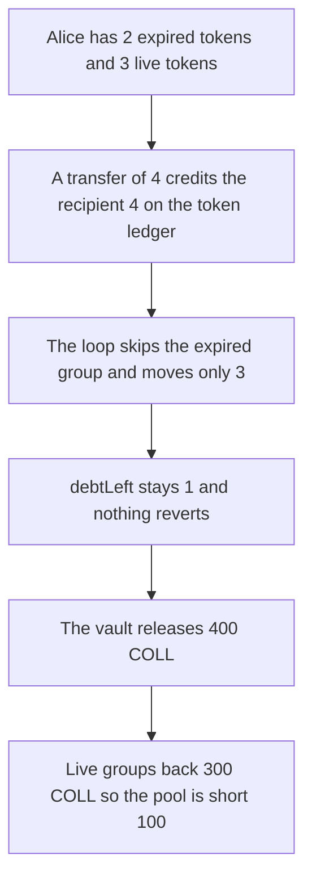

# Radius EVMAuth — a group transfer releases collateral while debt remains

> **Vulnerability classes:** vuln/logic/missing-check · vuln/logic/state-update

> **Reproduction:** a self-contained Foundry PoC that compiles and runs offline
> with only `forge-std` — no fork and no RPC. Trace: [output.txt](output.txt).
> PoC: [test/62867-missing-debt-validation-in-group-transfer-function-trailofbi_exp.sol](test/62867-missing-debt-validation-in-group-transfer-function-trailofbi_exp.sol).

<!-- non-defihacklabs -->
<!-- source-auditvault: https://github.com/Auditware/AuditVault/blob/main/findings/62867-missing-debt-validation-in-group-transfer-function-trailofbi.md -->
<!-- date: 2025-10 -->

---

## Key info

| | |
|---|---|
| **Impact** | **HIGH** — **400 COLL** moves while group **debt stays 1**. The pool is short **100 COLL** |
| **Protocol** | Radius Technology EVMAuth |
| **Vulnerable code** | `_transferGroups` ends without requiring `debt == 0`, and the caller still releases collateral for the full amount |
| **Bug class** | Expired groups are skipped, so a transfer can finish short and still move collateral |
| **Finding** | Trail of Bits — Radius Technology EVMAuth, October 2025 · id 62867 |
| **Report** | [EVMAuth security review](https://github.com/trailofbits/publications/blob/master/reviews/2025-10-radiustechnology-evmauth-securityreview.pdf) |
| **Source** | [AuditVault finding](https://github.com/Auditware/AuditVault/blob/main/findings/62867-missing-debt-validation-in-group-transfer-function-trailofbi.md) |
| **Status** | Reproduced here as a local synthetic. |
| **Compiler** | solc 0.8.27, cancun, via IR |

---

## TL;DR

`_transferGroups` walks the sender's groups in order, skips any group that is already expired, and never checks that `debt` reached 0. The ERC1155 balances and the collateral release still use the full requested amount.

Alice holds **5** tokens: **2** expired in this block and **3** live. A transfer of **4**:

- The ERC1155 ledger credits the recipient **4** and leaves Alice with **1**.
- The group loop moves only the **3** live tokens. `debtLeft` stays **1**.
- The vault still sends **400 COLL** (4 × 100). The recipient's groups back only **300 COLL**.
- The pool is short **100 COLL**.

Control requires `debt == 0` before the release. The same transfer reverts. No collateral moves, and both ledgers stay as seeded.

## The vulnerable code

```solidity
for (uint256 i = 0; i < groups.length && debt > 0; i++) {
    if (groups[i].expiresAt <= _now || groups[i].balance == 0) {
        continue;
    }
    // move a whole or partial group, decreasing debt
}
_pruneGroups(from, id);
debtLeft = debt; // @> VULN: no require(debt == 0)
// caller then releases `amount * UNIT` collateral
```

The fix is `require(debt == 0)` before any collateral leaves the vault.

## Root cause

Expired groups are skipped instead of being counted against the requested amount, and the function does not fail when the live groups cannot cover it. The ERC1155 update and the collateral transfer are sized from the requested amount, so they can move more value than the group ledger transferred.

## Preconditions

- Alice's groups are `(balance 2, expiresAt 1)` and `(balance 3, expiresAt max)`. `block.timestamp` is 1, so the first group is already expired. Nothing warps time inside `run()`.
- The vault holds **500 COLL**, which is 100 COLL for each of the 5 tokens.
- The caller transfers **4** tokens to the recipient.

## Attack walkthrough

1. Seed Alice with 2 expired tokens and 3 live tokens. Her ERC1155 balance is 5.
2. Transfer 4 to the recipient. The ERC1155 balances become Alice 1, recipient 4.
3. The loop skips the expired group and moves the live group of 3. `debt` is 1.
4. `debtLeft` is stored as 1. No check reverts.
5. The vault sends 400 COLL. The recipient's group sum is 3, so 100 COLL of that release has no live group behind it.
6. The vault balance falls from 500 COLL to 100 COLL.

Control: the same seed and transfer hit `require(debt == 0)` and revert. The recipient's collateral stays 0. The vault still holds 500 COLL. Alice's ERC1155 balance stays 5 and her group sum stays 5.

## Diagrams



## Impact

The recipient is paid **400 COLL** for a transfer whose groups only moved **3** tokens. **Debt of 1** remains. The pool is short **100 COLL** relative to the live groups that changed hands. Alice is left with an ERC1155 balance of 1 and a group sum of 0.

## Remediation

After the group loop, require `debt == 0` before updating the caller's success path, and release collateral only for the amount the groups actually moved.

## Sources

- [AuditVault finding 62867](https://github.com/Auditware/AuditVault/blob/main/findings/62867-missing-debt-validation-in-group-transfer-function-trailofbi.md)
- [Trail of Bits EVMAuth review, October 2025](https://github.com/trailofbits/publications/blob/master/reviews/2025-10-radiustechnology-evmauth-securityreview.pdf)

### Taxonomy

- `severity/high`
- `sector/lending`
- `platform/trailofbits`
