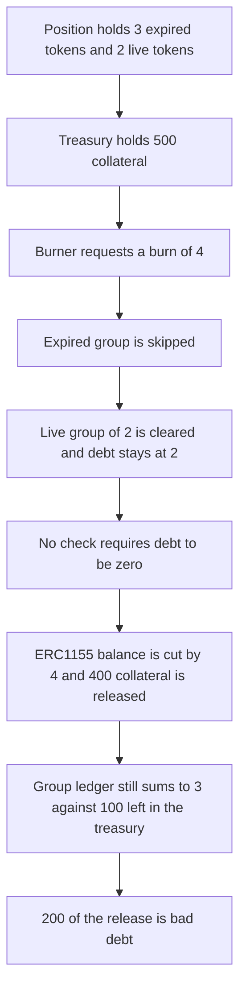

# Radius EVMAuth — group burn returns while debt remains

> **Vulnerability classes:** vuln/logic/missing-check · vuln/logic/accounting

<!-- non-defihacklabs -->
<!-- source-auditvault: https://github.com/Auditware/AuditVault/blob/main/findings/62868-missing-debt-validation-in-group-burn-function-trailofbits-n.md -->
<!-- date: 2025-10 -->

## Key info

| | |
|---|---|
| **Protocol** | Radius Technology EVMAuth |
| **Finding** | Trail of Bits, October 2025, AuditVault 62868 |
| **Vulnerable code** | `_burnGroupBalances` |
| **Harm** | Burn of 4 finishes with debt 2 still open. 400 collateral is released. 200 of it is bad debt against a group ledger that still sums to 3. |
| **Chain** | local synthetic |

**AuditVault taxonomy:** lang/solidity · sector/lending · sector/nft · platform/trailofbits · severity/high · genome: missing-modifier · dos-resistance · timestamp-dependence

## TL;DR

`_burnGroupBalances` walks an account's token groups in FIFO order and skips any group whose `expiresAt` is already past. It never checks that `debt` reached zero. A burn of 4 against a position that has 3 expired tokens and 2 live tokens clears only the live group, leaves `debt == 2`, and still refunds collateral for all 4. The caller receives 400 collateral. The treasury is left holding 100 against a group ledger that still sums to 3, which is 200 of bad debt. The fixed function reverts with `DEBT` and releases nothing.

## The vulnerable code

The loop is the body from the review. The only addition after it is the record of the leftover debt, which is the line the audited function is missing a check on:

```solidity
function _burnGroupBalances(address account, uint256 id, uint256 amount) internal {
    Group[] storage groups = _group[account][id];
    uint256 _now = block.timestamp;
    uint256 debt = amount;
    uint256 i = 0;
    while (i < groups.length && debt > 0) {
        if (groups[i].expiresAt <= _now) {
            i++;
            continue;
        }
        if (groups[i].balance > debt) {
            groups[i].balance -= debt;
            debt = 0;
        } else {
            debt -= groups[i].balance;
            groups[i].balance = 0;
        }
        i++;
    }
    // FIX: require(debt == 0, "DEBT");
    this.settle(debt); // @> VULN: burn returns while debt is still outstanding
}
```

The caller then does what the review describes for the ERC1155 side: it subtracts the full requested amount and, in this reduction, refunds that many tokens of collateral.

```solidity
erc1155Balance[account][id] -= amount;
uint256 released = amount * COLLATERAL_PER;
require(collateral.transfer(msg.sender, released), "RELEASE");
badDebt = unsettledDebt * COLLATERAL_PER;
```

## Root cause

Expired groups are skipped with `continue` and are not counted toward the burn. When the live groups cannot cover `amount`, `debt` is still positive at the end of the loop. Nothing reverts. The ERC1155 balance is updated as if every requested token was burned, and the collateral refund follows that balance change. The group array does not.

## Preconditions

One position, token id 1. Group 0 has balance 3 and `expiresAt = 1`, so it is already expired at the replay timestamp. Group 1 has balance 2 and does not expire. ERC1155 balance is 5. Each token is backed by 100 collateral, and the treasury holds 500. The burn request is 4. No timestamp warp is required.

## Attack walkthrough

1. Fund the vault with 500 collateral.
2. Seed the two groups and set the ERC1155 balance to 5.
3. Call `burn(account, 1, 4)`.
4. The loop sees group 0 expired, increments `i`, and continues. Those 3 tokens stay.
5. Group 1's balance of 2 is not greater than the remaining debt of 4, so the else branch sets `debt = 2` and the live balance to 0.
6. The function records debt 2 instead of reverting.
7. The ERC1155 balance falls from 5 to 1. 400 collateral is transferred to the burner. `badDebt` is `2 * 100 = 200`.
8. The group ledger still sums to 3. The treasury holds 100. The attacker receives the 400.

The control is the same position and the same burn of 4 on a vault that inserts `require(debt == 0, "DEBT")` before any refund. The call reverts. The treasury still holds 500, the ERC1155 balance is still 5, and both groups are unchanged. A burn of exactly the 2 live tokens succeeds on that vault and pays 200, which is the amount the live group actually covered.

## Diagrams



## Impact

The burner is paid 400 collateral for a burn that only cleared 2 live tokens. Debt of 2 is still outstanding. The group ledger sums to 3 while the treasury holds collateral for 1, so the protocol is short 200. On the fixed vault the same call reverts and the 500 stays put. Burning only the live 2, which does drive debt to zero, pays 200 and leaves the books consistent.

## Remediation

Require `debt == 0` at the end of `_burnGroupBalances` before the ERC1155 balance or the collateral refund is touched. That is the short-term fix in the review. The control above runs it.

## How to reproduce

```bash
cd 62868-missing-debt-validation-in-group-burn-function-trailofbits-n_exp
forge test -vv
```

## Sources

- AuditVault finding: https://github.com/Auditware/AuditVault/blob/main/findings/62868-missing-debt-validation-in-group-burn-function-trailofbits-n.md
- Trail of Bits review: https://github.com/trailofbits/publications/blob/master/reviews/2025-10-radiustechnology-evmauth-securityreview.pdf
- Audited tree: https://github.com/evmauth/evmauth-core/tree/v0.2.1 (audit start 2025-07-30, report 2025-10)
- Protocol note: https://github.com/evmauth/evmauth-core/discussions/41
