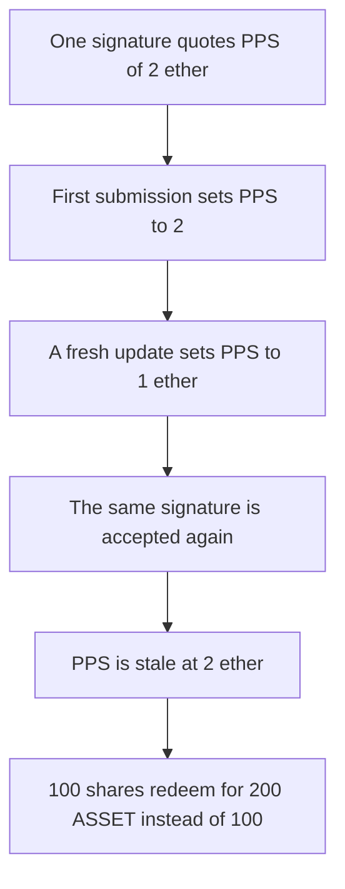

# Superform — a PPS signature with no nonce is replayed and the redeem pays 100 too much

> **Vulnerability classes:** vuln/auth/signature-replay · vuln/oracle/stale-price

> **Reproduction:** a self-contained Foundry PoC that compiles and runs offline
> with only `forge-std` — no fork and no RPC. Trace: [output.txt](output.txt).
> PoC: [test/63079-lack-of-replay-protection-in-pps-oracle-spearbit-none-superf_exp.sol](test/63079-lack-of-replay-protection-in-pps-oracle-spearbit-none-superf_exp.sol).

<!-- non-defihacklabs -->
<!-- source-auditvault: https://github.com/Auditware/AuditVault/blob/main/findings/63079-lack-of-replay-protection-in-pps-oracle-spearbit-none-superf.md -->
<!-- date: 2025-06 -->

---

## Key info

| | |
|---|---|
| **Impact** | **HIGH** — the second use of one signature sets PPS to **2 ether** and a 100-share redeem pays **200 ASSET** instead of **100**. Off by **100 ASSET** |
| **Protocol** | Superform v2 periphery, ECDSA PPS oracle |
| **Vulnerable code** | `update` hashes `strategy, pps, stdev, validator, totalValidators, timestamp` and never consumes a nonce |
| **Bug class** | Signature replay of a stale PPS |
| **Finding** | Spearbit (MiloTruck) — Superform v2 periphery, June 2025 · id 63079 |
| **Report** | [Superform v2 periphery review](https://github.com/spearbit/portfolio/blob/master/pdfs/Superform-v2-periphery-Spearbit-Security-Review-June-2025.pdf) |
| **Source** | [AuditVault finding](https://github.com/Auditware/AuditVault/blob/main/findings/63079-lack-of-replay-protection-in-pps-oracle-spearbit-none-superf.md) |
| **Status** | Reproduced here as a local synthetic. The signer key is held locally and one signature is precomputed. |
| **Compiler** | solc 0.8.27, cancun, via IR |

---

## TL;DR

The PPS message hash has no nonce. A signature over PPS = **2 ether** is accepted, a fresh price of **1 ether** is posted, and the same signature is accepted again. That second use puts the stale price back.

A redeemer with **100 shares** is then paid `100 * 2 = 200 ASSET`. At the fair PPS the payout is **100 ASSET**. The difference is **N = 100 ASSET**.

Control puts `nonce` in the hash and increments it. The first submission succeeds and consumes nonce 0. The second submission of that signature reverts. The fresh PPS stays **1 ether**, and the redeem pays **100 ASSET**.

## The vulnerable code

```solidity
bytes32 messageHash = keccak256(abi.encodePacked(strategy, price, stdev, validator, totalValidators, timestamp));
bytes32 ethSigned = keccak256(abi.encodePacked("\x19Ethereum Signed Message:\n32", messageHash));
address recovered = ecrecover(ethSigned, v, r, s);
require(recovered == signer, "signer");
uses += 1;
pps = price; // @> VULN: no nonce is consumed
```

The fix is to append `nonce` to the packed payload and increment it inside the successful update.

## Root cause

Verification only checks that the recovered signer is the validator. The signed bytes do not include a nonce, a chain id, or the oracle address, and the oracle does not record that this digest was already used. Any caller who has seen the signature can submit it again after a newer price is posted.

## Preconditions

- The validator key is `0xf39Fd6e51aad88F6F4ce6aB8827279cffFb92266`. The signature below was produced offline for strategy `0xbeeF`, PPS `2 ether`, stdev `0`, that validator, total validators `1`, and timestamp `1700000000`.
- The vault holds **200 ASSET** and the caller has **100 shares**.
- A fresh PPS of **1 ether** is posted between the two submissions.

## Attack walkthrough

1. Mint 200 ASSET into the vault and 100 shares to the redeemer.
2. Submit the precomputed signature. The oracle sets PPS to 2 ether. `uses` is 1.
3. Post the fresh PPS of 1 ether.
4. Submit the same `v`, `r`, and `s` again. PPS returns to 2 ether. `uses` is 2.
5. Redeem. Payout is 200 ASSET. Fair payout is 100 ASSET. `offBy` is 100 ASSET.

Control signs the same fields plus nonce 0. The first update consumes the nonce. The second update reverts with `signer`. Redeem pays 100 ASSET.

## Diagrams



## Impact

The redeemer receives **200 ASSET** for 100 shares. The fair amount at PPS 1 ether is **100 ASSET**. The vault overpays by **100 ASSET** because the second use of the signature restored the stale price.

## Remediation

Include a nonce in the signed payload and increment it when the signature is accepted. A repeated submission then recovers a different signer and reverts.

## Sources

- [AuditVault finding 63079](https://github.com/Auditware/AuditVault/blob/main/findings/63079-lack-of-replay-protection-in-pps-oracle-spearbit-none-superf.md)
- [Spearbit Superform v2 periphery review, June 2025](https://github.com/spearbit/portfolio/blob/master/pdfs/Superform-v2-periphery-Spearbit-Security-Review-June-2025.pdf)

### Taxonomy

- `severity/high`
- `sector/oracle`
- `platform/spearbit`
