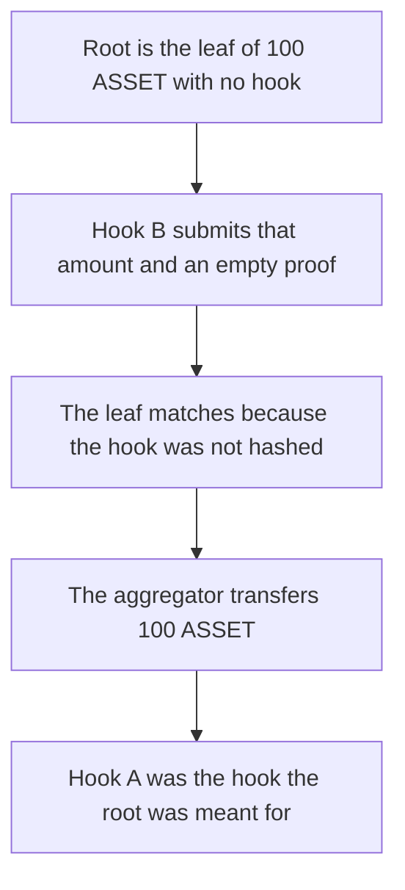

# Superform — a merkle proof for one hook is accepted for another, and 100 ASSET moves

> **Vulnerability classes:** vuln/access-control/missing-validation · vuln/logic/missing-check

> **Reproduction:** a self-contained Foundry PoC that compiles and runs offline
> with only `forge-std` — no fork and no RPC. Trace: [output.txt](output.txt).
> PoC: [test/63080-lack-of-hookaddress-in-merkle-tree-schema-in-supervaultaggre_exp.sol](test/63080-lack-of-hookaddress-in-merkle-tree-schema-in-supervaultaggre_exp.sol).

<!-- non-defihacklabs -->
<!-- source-auditvault: https://github.com/Auditware/AuditVault/blob/main/findings/63080-lack-of-hookaddress-in-merkle-tree-schema-in-supervaultaggre.md -->
<!-- date: 2025-06 -->

---

## Key info

| | |
|---|---|
| **Impact** | **HIGH** — a proof built for hook A is accepted for hook B and **100 ASSET** is transferred |
| **Protocol** | Superform v2 periphery, SuperVaultAggregator |
| **Vulnerable code** | `leafFor` hashes the hook arguments and does not include the hook address |
| **Bug class** | Merkle leaf omits the hook, so two hooks share an authorization |
| **Finding** | Spearbit (MiloTruck) — Superform v2 periphery, June 2025 · id 63080 |
| **Report** | [Superform v2 periphery review](https://github.com/spearbit/portfolio/blob/master/pdfs/Superform-v2-periphery-Spearbit-Security-Review-June-2025.pdf) |
| **Source** | [AuditVault finding](https://github.com/Auditware/AuditVault/blob/main/findings/63080-lack-of-hookaddress-in-merkle-tree-schema-in-supervaultaggre.md) |
| **Status** | Reproduced here as a local synthetic. |
| **Compiler** | solc 0.8.27, cancun, via IR |

---

## TL;DR

The authorization leaf is `keccak256(args)`. It does not contain the hook address. A one-leaf tree whose root is that hash was created for hook A (deposit) and the amount **100 ASSET**. Hook B (withdraw) presents the same amount and an empty proof. The leaf matches, and the aggregator transfers **100 ASSET** to the caller.

Control hashes `(hook, args)`. The root is bound to hook A. The same empty proof for hook B reverts. The **100 ASSET** stays in the aggregator.

## The vulnerable code

```solidity
function leafFor(bytes memory args) public pure returns (bytes32) {
    // @> VULN: the leaf is the args only, so two hooks with the same args share a proof
    return keccak256(bytes.concat(keccak256(args)));
}
```

The fix is `keccak256(bytes.concat(keccak256(abi.encode(hook, args))))`.

## Root cause

Deposit and redeem hooks in this system encode the same `address + uint256` arguments. A leaf that ignores the hook address cannot tell those calls apart, so a proof minted for one hook authorizes the other.

## Preconditions

- The aggregator holds **100 ASSET**.
- The merkle root is the leaf of `abi.encode(100 ASSET)` and the proof is empty. That root was intended for hook A.
- The caller executes hook B with the same amount.

## Attack walkthrough

1. Mint 100 ASSET into the aggregator.
2. Compute the leaf from the amount alone and store it as the root.
3. Call `execute` with hook B, the same amount, and an empty proof.
4. The recomputed leaf equals the root. The proof passes.
5. The aggregator transfers 100 ASSET to the caller and records `moved = 100`.

Control stores `leafFor(hook A, args)` as the root. `execute(hook B, ...)` reverts with `proof`. The caller receives 0. The aggregator still holds 100 ASSET.

## Diagrams



## Impact

The caller receives **100 ASSET** using a proof that does not authorize hook B. The aggregator balance falls from 100 ASSET to 0.

## Remediation

Include the hook address in the leaf preimage, and reject a proof whose leaf was built for a different hook.

## Sources

- [AuditVault finding 63080](https://github.com/Auditware/AuditVault/blob/main/findings/63080-lack-of-hookaddress-in-merkle-tree-schema-in-supervaultaggre.md)
- [Spearbit Superform v2 periphery review, June 2025](https://github.com/spearbit/portfolio/blob/master/pdfs/Superform-v2-periphery-Spearbit-Security-Review-June-2025.pdf)

### Taxonomy

- `severity/high`
- `sector/vault`
- `platform/spearbit`
