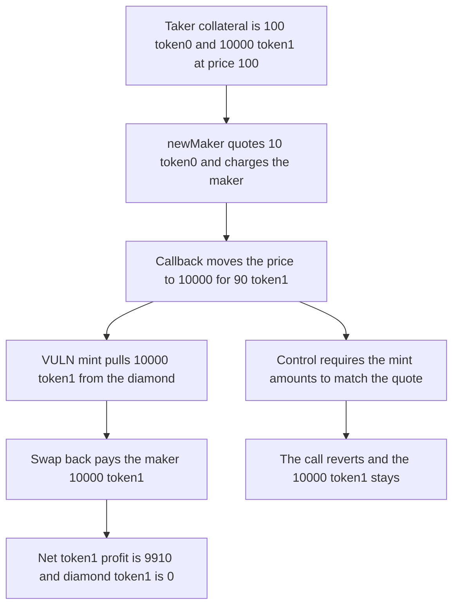

# Ammplify: a maker callback moves the spot and the mint spends taker collateral

> **Vulnerability classes:** vuln/reentrancy/single-function · vuln/oracle/spot-price

<!-- non-defihacklabs -->
<!-- source-auditvault: https://github.com/Auditware/AuditVault/blob/main/findings/63168-h-2-all-taker-collateral-and-collected-fees-can-be-stolen-by.md -->
<!-- date: 2025-09 -->

## Key info

| Field | Value |
|---|---|
| **Loss** | Maker nets 9,910 token1. The diamond's 10,000 token1 of taker collateral is spent by the mint |
| **Vulnerable contract** | `Diamond.newMaker` |
| **Attacker EOA** | `0x1111111111111111111111111111111111111111` |
| **Attack contract** | `Exploit` |
| **Attack tx** | `Exploit.run()` |
| **Chain / block / date** | Ethereum model · block 0 · 2025-09 |
| **Compiler** | solc 0.8.27, cancun, via IR |
| **Bug class** | Mint amounts after the RFT callback are not checked against the quote |

## TL;DR

`newMaker` quotes 10 token0 at price 100, charges the maker that amount, then calls the maker from `RFTLib.settle`. The callback moves the pool to price 10,000. The mint then pulls 10,000 token1 from the diamond, which is holding taker collateral. The maker swaps back, receives that 10,000 token1, and keeps a net 9,910 after the 90 token1 spent to move the price. Checking the minted amounts against the quote reverts and leaves the 10,000 token1 in place.

## Background

Sherlock's September 2025 Ammplify contest, issue 58 (H-2), reported by panprog. `Maker.newMaker` and `adjustMaker` call `RFTLib.settle` and then `PoolWalker.settle`. The second call mints at whatever the spot is after the callback. The diamond holds taker collateral and unclaimed fees at the same address that pays the mint. The numbers below are the report's trace: price 100 to 10,000, quote of 10 token0, mint of 10,000 token1, net 9,910 token1.

## The vulnerable code

```solidity
IPayer(payer).tokenRequestCB();
(, uint256 spent) = pool.mintFrom(address(this));
// @> VULN: the minted token1 is not checked against the amount quoted and charged
spent1 = spent;
```

The quote at price 100 was 10 token0 and 0 token1. `spent` is 10,000 token1. Nothing compares them.

## Root cause

The charge is computed before an untrusted callback, and the mint is executed after it, against the diamond's own balances. The callback is allowed to change the pool spot. The amounts the pool then requests are paid from taker collateral.

## Preconditions

- The pool price is 100. Taker collateral on the diamond is 100 token0 and 10,000 token1.
- Liquidity quoted at price 100 costs 10 token0. The same liquidity at price 10,000 costs 10,000 token1.
- The maker can move the spot inside `tokenRequestCB` and move it back after `newMaker` returns.

## Attack walkthrough

1. The diamond holds 100 token0 and 10,000 token1.
2. `newMaker` quotes 10 token0 and pulls that from the maker.
3. The callback pays 90 token1, receives 0.09 token0, and sets the price to 10,000.
4. The mint pulls 10,000 token1 from the diamond. `spent1` is stored with no comparison to the quote.
5. The maker swaps back to price 100, receives 10,000 token1, and withdraws 10 token0 of liquidity.
6. Token1 profit is 10,000 minus the 90 spent to move the price, which is 9,910. The control reverts on the mismatch and the 10,000 token1 stays.

## Diagrams



## Impact

The maker's token1 balance increases by 9,910. The diamond, which held 10,000 token1 of taker collateral, is left at 0 token1 and still holds the 10 token0 the maker paid. A quote that matches the mint leaves that 10,000 token1 untouched. Moving the price before a checked mint reverts and restores the collateral.

## Remediation

After the mint, require the token amounts pulled from the diamond to equal the amounts charged to the user, which is the mitigation in issue 58.

## How to reproduce

```bash
cd 63168-h-2-all-taker-collateral-and-collected-fees-can-be-stolen-by_exp
forge test -vv
```

`test_exploit_steals_9910_token1` asserts a 9,910 token1 profit, a 10 token0 charge, a 10,000 token1 mint, and an empty diamond token1 balance. `test_control_matching_quote_leaves_taker_collateral` leaves the 10,000 token1 in place. `test_control_reverts_if_callback_moves_the_price` reverts with the mismatch and the collateral is unchanged. Captured output is `output.txt`.

## Sources

- AuditVault finding: https://github.com/Auditware/AuditVault/blob/main/findings/63168-h-2-all-taker-collateral-and-collected-fees-can-be-stolen-by.md
- Sherlock issue 58: https://github.com/sherlock-audit/2025-09-ammplify-judging/issues/58
- Blamed calls: https://github.com/sherlock-audit/2025-09-ammplify/blob/main/Ammplify/src/facets/Maker.sol#L49-L50
