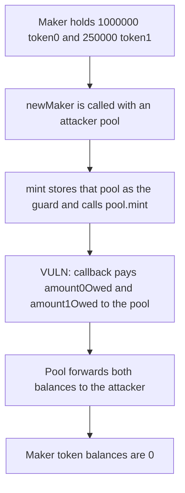

# Ammplify: a fake pool is paid the maker's whole token balance

> **Vulnerability classes:** `vuln/logic/missing-check`

<!-- non-defihacklabs -->
<!-- source-auditvault: https://github.com/Auditware/AuditVault/blob/main/findings/63179-h-13-attackers-can-drain-the-protocol-tokens-sherlock-ammpli.md -->
<!-- date: 2025-09 -->

## Key info

| Field | Value |
|---|---|
| **Loss** | 1000000 token0 and 250000 token1 moved from the maker to the attacker |
| **Vulnerable contract** | `Maker.uniswapV3MintCallback` |
| **Attacker EOA** | `0x1111111111111111111111111111111111111111` |
| **Attack contract** | `Exploit` |
| **Attack tx** | `Exploit.run()` |
| **Chain / block / date** | Ethereum model · block 0 · 2025-09 |
| **Compiler** | solc 0.8.27, cancun, via IR |
| **Bug class** | Unchecked pool address in the mint callback |

## TL;DR

`newMaker` takes a pool address and never checks that Uniswap V3 created it. `mint` stores that address as the pool guard and calls `pool.mint`. The callback pays `amount0Owed` and `amount1Owed` to `msg.sender`. The fake pool asks for the maker's entire balance of both tokens and forwards them to the attacker.

## Background

Sherlock's September 2025 Ammplify contest, issue 566. `Maker.newMaker` passes the user-supplied pool into `PoolLib.mint`, which tstores it and calls `IUniswapV3Pool.mint`. `uniswapV3MintCallback` only checks `msg.sender == poolGuard` and then `safeTransfer`s whatever the pool reports. The fix is to require the pool was created by the canonical factory. The protocol later fixed this in itos-finance/Ammplify pull 43.

## The vulnerable code

```solidity
_safeTransfer(pInfo.token0, activeMint, amount0Owed); // @> VULN
_safeTransfer(pInfo.token1, activeMint, amount1Owed);
```

`pInfo` is read from the same pool that chose `amount0Owed` and `amount1Owed`. The guard was set to that pool inside `mint`.

```diff
  function newMaker(address pool, ...) external {
+     require(factory.getPool(token0, token1, fee) == pool, "not a pool");
      _mint(pool, ...);
  }
```

## Root cause

The only authorization on the callback is "you are the address we just called." The user chooses that address, and the callback trusts the amounts and token addresses it returns.

## Preconditions

- The maker holds token balances. Here that is 1000000 token0 and 250000 token1, standing in for fees and unpaid liquidity.
- The caller can pass any contract as `pool`.

## Attack walkthrough

1. The attacker deploys a pool whose `token0` and `token1` are the maker's tokens.
2. `newMaker` is called with that pool. No factory check runs.
3. `mint` sets the guard and calls `pool.mint`.
4. The pool's `mint` calls back with the maker's full balances.
5. Both transfers land on the pool, which forwards them to the attacker. The maker's balances are 0.

## Diagrams



## Impact

The attacker receives 1000000 token0 and 250000 token1 that were sitting on the maker. Those balances are the fees, penalties, and idle liquidity the report says can be taken. A factory check before the guard is set stops the callback from ever running against this contract.

## Remediation

Require `pool` equals `factory.getPool(token0, token1, fee)` before `tstore`, and keep the `msg.sender == poolGuard` check.

## How to reproduce

```bash
cd 63179-h-13-attackers-can-drain-the-protocol-tokens-sherlock-ammpli_exp
forge test -vv
```

`test_exploit_fake_pool_drains_both_tokens` asserts the attacker holds both full balances and the maker holds neither. Captured output is `output.txt`.

## Sources

- AuditVault finding: https://github.com/Auditware/AuditVault/blob/main/findings/63179-h-13-attackers-can-drain-the-protocol-tokens-sherlock-ammpli.md
- Sherlock issue 566: https://github.com/sherlock-audit/2025-09-ammplify-judging/issues/566
- Callback: https://github.com/sherlock-audit/2025-09-ammplify/blob/main/Ammplify/src/facets/Pool.sol#L16-L22
- newMaker: https://github.com/sherlock-audit/2025-09-ammplify/blob/main/Ammplify/src/facets/Maker.sol#L31-L52
- Fix: https://github.com/itos-finance/Ammplify/pull/43
