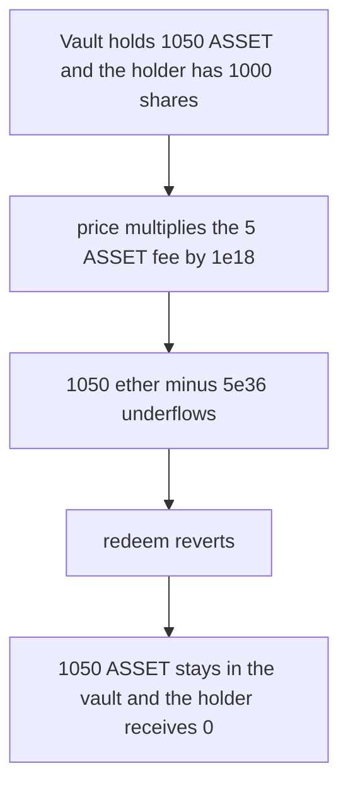

# Elytra — the elyAsset price underflows and 1,050 ASSET stays stuck

> **Vulnerability classes:** vuln/arithmetic/underflow · vuln/dos/frozen-funds

> **Reproduction:** a self-contained Foundry PoC that compiles and runs offline
> with only `forge-std` — no fork and no RPC. Trace: [output.txt](output.txt).
> PoC: [test/63545-h-02-elyasset-price-calculation-errors-cause-underflow-rever_exp.sol](test/63545-h-02-elyasset-price-calculation-errors-cause-underflow-rever_exp.sol).

<!-- non-defihacklabs -->
<!-- source-auditvault: https://github.com/Auditware/AuditVault/blob/main/findings/63545-h-02-elyasset-price-calculation-errors-cause-underflow-rever.md -->
<!-- date: 2025-07 -->

---

## Key info

| | |
|---|---|
| **Impact** | **HIGH** — redeem reverts and **1,050 ASSET** stays stuck. The holder receives **0** |
| **Protocol** | Elytra, elyAsset price |
| **Vulnerable code** | `(totalValue - (fee * 1e18)) * 1e18 / supply` |
| **Bug class** | Fee is scaled a second time, so the subtraction underflows |
| **Finding** | Pashov Audit Group — Elytra, July 2025 · id 63545, H-02 |
| **Report** | [Elytra security review](https://github.com/pashov/audits/blob/master/team/md/Elytra-security-review_2025-07-10.md) |
| **Source** | [AuditVault finding](https://github.com/Auditware/AuditVault/blob/main/findings/63545-h-02-elyasset-price-calculation-errors-cause-underflow-rever.md) |
| **Status** | Reproduced here as a local synthetic. Solidity 0.8 reverts. It does not wrap. |
| **Compiler** | solc 0.8.27, cancun, via IR |

---

## TL;DR

`fee` is already 18 decimals. The price multiplies it by `1e18` again. With total value **1,050 ether**, fee **5 ether**, and supply **1,000 ether**, the subtraction is `1,050e18 - 5e36`. That underflows. `redeem` reverts. The vault still holds **1,050 ASSET** and the holder receives **0**. The 1,000 shares are unchanged.

Control uses `(totalValue - fee) * 1e18 / supply`. The price is **1.045 ether**. The same redeem pays **1,045 ASSET** and leaves the **5 ASSET** fee in the vault.

## The vulnerable code

```solidity
function price() public view returns (uint256) {
    // @> VULN: fee is already 18 decimals
    return (totalValue - (fee * 1 ether)) * 1 ether / supply;
}
```

The fix drops the extra `* 1 ether` on `fee`.

## Root cause

`protocolFeeInHYPE` and `totalValueInProtocol` are both 18-decimal values. Scaling only the fee makes it larger than the total, so a Solidity 0.8 checked subtraction reverts the whole redemption.

## Preconditions

- `totalValue` is 1,050 ether and that amount of ASSET sits in the vault.
- `fee` is 5 ether. `supply` and the holder's shares are 1,000 ether.

## Attack walkthrough

1. Mint 1,050 ASSET into the vault and 1,000 shares to the holder.
2. `redeem` calls `price()`.
3. `fee * 1 ether` is 5e36. Subtracting it from 1,050 ether reverts.
4. The catch records the revert. The vault balance is still 1,050 ASSET. The holder balance is 0. The shares are still 1,000.

Control redeems the same position and transfers 1,045 ASSET.

## Diagrams



## Impact

Holders cannot redeem. **1,050 ASSET** remains in the vault. The fair redemption of these 1,000 shares is **1,045 ASSET**.

## Remediation

Subtract `fee` without the extra `1e18` scale, then scale the result by `1e18 / supply`.

## Sources

- [AuditVault finding 63545](https://github.com/Auditware/AuditVault/blob/main/findings/63545-h-02-elyasset-price-calculation-errors-cause-underflow-rever.md)
- [Pashov Elytra review, 10 July 2025](https://github.com/pashov/audits/blob/master/team/md/Elytra-security-review_2025-07-10.md)

### Taxonomy

- `severity/high`
- `sector/oracle`
- `platform/pashov`
