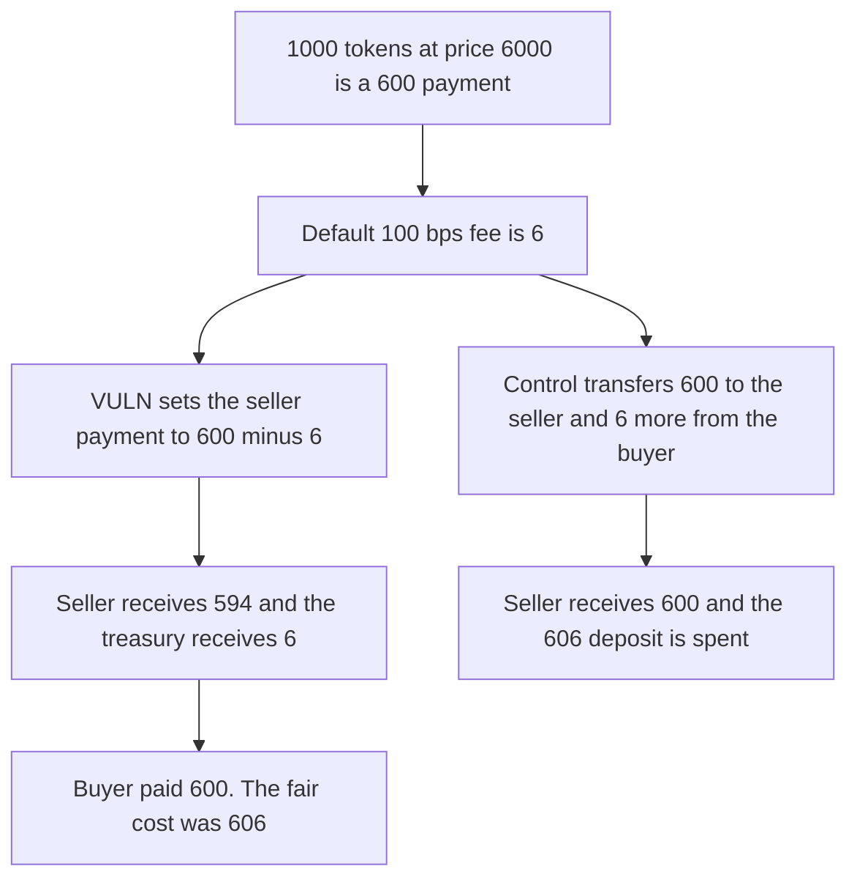

# Index Fun: the seller pays the buyer's trade fee on a token swap

> **Vulnerability classes:** vuln/logic/fee-calculation · vuln/defi/fee-manipulation

<!-- non-defihacklabs -->
<!-- source-auditvault: https://github.com/Auditware/AuditVault/blob/main/findings/63700-h-1-seller-pays-buyers-trade-fee-in-token-swaps-leading-to-s.md -->
<!-- date: 2025-10 -->

## Key info

| Field | Value |
|---|---|
| **Loss** | Seller receives 594 of a 600 price. The 6 buyer fee is taken from the seller |
| **Vulnerable contract** | `MarketController._executeTokenSwap` |
| **Attacker EOA** | `0x1111111111111111111111111111111111111111` |
| **Attack contract** | `Exploit` |
| **Attack tx** | `Exploit.run()` |
| **Chain / block / date** | Ethereum model · block 0 · 2025-10 |
| **Compiler** | solc 0.8.27, cancun, via IR |
| **Bug class** | Buyer fee subtracted from the seller's proceeds instead of charged on top |

## TL;DR

`_executeTokenSwap` computes the buyer's fee and sets `netPayment = paymentAmount - tradeFee`. A sale of 1,000 tokens at price 6,000 / 10,000 is a 600 payment. The default 100 bps fee is 6. The seller receives 594 and the buyer pays 600, not 606. JIT minting charges that 6 as an extra transfer. The control pays the seller 600 and still sends 6 to the treasury, which spends the buyer's full 606 deposit.

## Background

Sherlock's October 2025 Index Fun order-book contest, issue 60 (H-1), reported by curly11 and many others. The same subtraction is in `_executeAgainstMatcher`. The sponsor fixed it by deleting `netPayment` and transferring `paymentAmount` to the seller, matching `_executeJITMinting`.

## The vulnerable code

```solidity
paymentAmount = (fillAmount * price) / 10000;
tradeFee = (paymentAmount * buyerFeeRate) / 10000;
// @> VULN: the buyer's trade fee is deducted from the seller's proceeds instead of charged on top
uint256 net = paymentAmount - tradeFee;
```

The fee rate here is the default `tradeFeeRate` of 100. No admin call is required. A custom rate only scales the same subtraction.

## Root cause

The token-swap settlement treats the fee as a slice of the seller's price. The JIT path treats it as an additional debit of the buyer. Sellers who already hold outcome tokens, which is the token-swap path, are paid less than the price they listed by exactly the buyer's fee.

## Preconditions

- The fill is 1,000 tokens at price 6,000, so the payment is 600.
- The buyer fee rate is 100 bps. The fee is 6.
- The buyer has 606 deposited, which would cover the fair cost. The swap only spends 600.

## Attack walkthrough

1. The market is configured with the 100 bps default.
2. The buyer deposits 606.
3. Payment is 600 and the fee is 6.
4. `netPayment` is stored as 594. The fair seller amount is 600 and the fair buyer cost is 606.
5. The treasury receives 6 and the seller receives 594. Six of the deposit is unspent.
6. The control transfers 600 to the seller and 6 to the treasury, and the deposit is fully spent.

## Diagrams



## Impact

The seller receives 594 USDC on a 600 USDC price. The 6 USDC difference is the buyer's trade fee, paid out of the seller's proceeds. The buyer spends 600 instead of 606. The treasury still receives its 6. The control pays the seller the full 600 and charges the fee on top.

## Remediation

Transfer `paymentAmount` to the seller and transfer `tradeFee` from the buyer to the treasury as a separate debit, which is the JIT minting order and the fix described on issue 60.

## How to reproduce

```bash
cd 63700-h-1-seller-pays-buyers-trade-fee-in-token-swaps-leading-to-s_exp
forge test -vv
```

`test_exploit_seller_receives_594_of_600` asserts a 594 seller balance, a 6 treasury balance, and a 6 shortfall against 600. `test_control_seller_receives_full_payment` asserts a 600 seller balance and an empty buyer deposit. Captured output is `output.txt`.

## Sources

- AuditVault finding: https://github.com/Auditware/AuditVault/blob/main/findings/63700-h-1-seller-pays-buyers-trade-fee-in-token-swaps-leading-to-s.md
- Sherlock issue 60: https://github.com/sherlock-audit/2025-10-index-fun-order-book-contest-judging/issues/60
- Blamed lines: https://github.com/sherlock-audit/2025-10-index-fun-order-book-contest/blob/main/orderbook-solidity/src/Market/MarketController.sol#L911-L914
