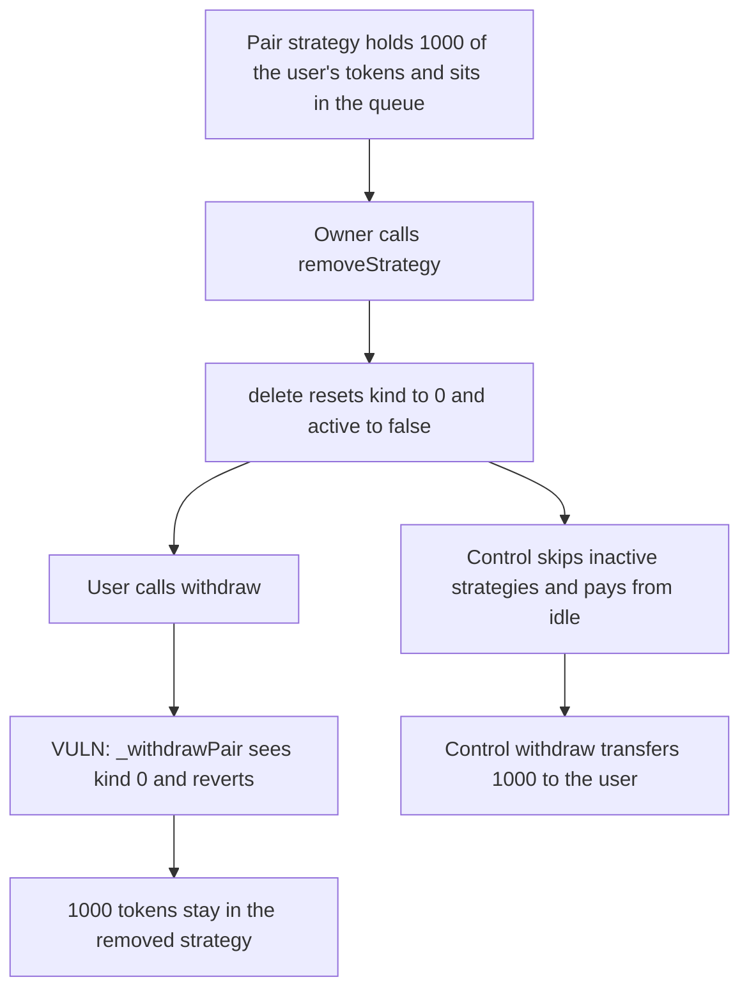

# Prime Vaults: deleting a pair strategy makes user withdrawals revert

> **Vulnerability classes:** `vuln/dos/frozen-funds` · `vuln/logic/missing-check`

<!-- non-defihacklabs -->
<!-- source-auditvault: https://github.com/Auditware/AuditVault/blob/main/findings/64014-h-01-removed-strategy-can-bypass-removal-and-block-withdrawa.md -->
<!-- date: 2025-12 -->

## Key info

| Field | Value |
|---|---|
| **Loss** | 1000 tokens stay in the removed pair strategy. The user's withdraw reverts |
| **Vulnerable contract** | `PrimeVault._withdrawPair` |
| **Attacker EOA** | `0x1111111111111111111111111111111111111111` (the owner) |
| **Attack contract** | `Exploit` |
| **Attack tx** | `Exploit.run()` |
| **Chain / block / date** | Ethereum model · block 0 · 2025-12 |
| **Compiler** | solc 0.8.27, cancun, via IR |
| **Bug class** | `delete` resets strategy kind, and withdraw ignores `active` |

## TL;DR

`removeStrategy` does `delete strategies[stra]`. The struct comes back as `kind = SingleAsset` (0) and `active = false`. The withdraw queue still lists the strategy as a pair. `_withdrawPair` requires `kind == PairAsset`, so the user's withdraw reverts. The 1000 tokens sitting on that strategy cannot be withdrawn.

## Background

Shieldify's December 2025 Prime Vaults review, H-01. `StrategyRegistry.removeStrategy` deletes the record. `PrimeStrategy.withdraw` walks `withdrawPriority` and dispatches on the kind stored in the queue, then re-reads kind from the registry inside `_withdrawSingle` and `_withdrawPair`. A removed pair fails the pair check and reverts the whole withdraw. A removed single-asset strategy passes the single-asset check, which is the bypass half of the same bug. This run shows the revert that blocks withdrawals. The fix is to read `active` and return 0 for a removed strategy so the loop can continue.

## The vulnerable code

```solidity
delete strategies[stra];
```

```solidity
if (kind != StrategyKind.PairAsset) revert VAULT__INVALID_STRATEGY_KIND(); // @> VULN
```

```diff
  (StrategyKind kind, bool active) = registry.strategies(strategy);
+ if (!active) return 0;
  if (kind != StrategyKind.PairAsset) revert VAULT__INVALID_STRATEGY_KIND();
```

## Root cause

`delete` sets the enum to its zero value, which is a real kind (`SingleAsset`), and sets `active` to false. The withdraw helpers never read `active`, so a removed pair looks like the wrong kind and a removed single-asset strategy looks legitimate.

## Preconditions

- A pair strategy is in the withdraw queue and holds user funds. Here it holds 1000 tokens and the vault's idle balance does not cover the withdrawal.
- The owner has called `removeStrategy` on that address.
- The queue entry was not removed, so withdraw still dispatches to `_withdrawPair`.

## Attack walkthrough

1. The owner calls `removeStrategy`. The registry record becomes kind 0 and inactive.
2. The user calls `withdraw` for 1000.
3. The queue entry is still `PairAsset`, so `_withdrawPair` runs.
4. The registry kind is 0, the pair check reverts, and the whole withdraw reverts.
5. The user balance is 0. The strategy still holds 1000.

## Diagrams



## Impact

The user cannot withdraw. The 1000 tokens remain in a strategy the owner already removed. Until the queue entry is fixed, or the helpers skip inactive strategies, every withdraw that reaches this entry reverts. The same delete is what lets a removed single-asset strategy keep passing `_withdrawSingle`. The control skips the inactive entry and pays the user from idle funds.

## Remediation

In `_withdrawSingle` and `_withdrawPair`, read `active` and return 0 when it is false, before the kind check. Removing the queue entry at the same time as `removeStrategy` avoids the dead entry.

## How to reproduce

```bash
cd 64014-h-01-removed-strategy-can-bypass-removal-and-block-withdrawa_exp
forge test -vv
```

`test_exploit_removed_pair_reverts_withdraw_and_locks_tokens` asserts kind is 0, active is false, withdraw returns false, and the strategy still holds 1000. `test_control_inactive_strategy_is_skipped_and_idle_pays` asserts a vault that skips inactive strategies pays the caller 1000. Captured output is `output.txt`.

## Sources

- AuditVault finding: https://github.com/Auditware/AuditVault/blob/main/findings/64014-h-01-removed-strategy-can-bypass-removal-and-block-withdrawa.md
- Shieldify report: https://github.com/shieldify-security/audits-portfolio-md/blob/main/Prime-Vaults-Security-Review.md
- Registry: https://github.com/prime-vaults/prime-vaults-strategy/blob/b722f446d14f0ff4fd600dab80a16ac8b11b413d/contracts/StrategyRegistry.sol#L80-L95
- Withdraw: https://github.com/prime-vaults/prime-vaults-strategy/blob/b722f446d14f0ff4fd600dab80a16ac8b11b413d/contracts/PrimeStrategy.sol
