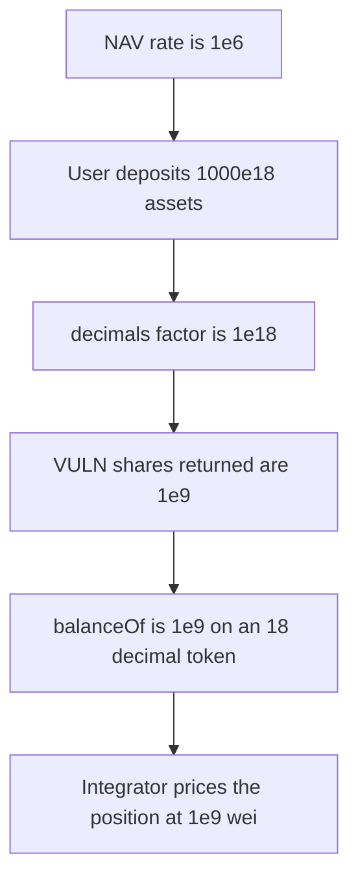

# SecuritizeVault: share tokens are minted in the wrong decimals

> **Vulnerability classes:** `vuln/arithmetic/decimal-mismatch` · `vuln/logic/price-calculation`

<!-- non-defihacklabs -->
<!-- source-auditvault: https://github.com/Auditware/AuditVault/blob/main/findings/64245-securitizevaults-share-token-is-in-wrong-decimals-cyfrin-non.md -->
<!-- date: 2024-12 -->

## Key info

| Field | Value |
|---|---|
| **Loss** | 1000 assets are booked as 1e9 shares on an 18-decimal token. An integrator prices them at 1e9 wei |
| **Vulnerable contract** | `SecuritizeVault._convertToShares` |
| **Attacker EOA** | `0x1111111111111111111111111111111111111111` |
| **Attack contract** | `Exploit` |
| **Attack tx** | `Exploit.run()` |
| **Chain / block / date** | Ethereum model · local · 2024-12 |
| **Compiler** | solc 0.8.27, cancun |
| **Bug class** | Share amount returned in liquidation-token decimals |

## TL;DR

`decimals()` stays 18, the ERC-4626 default for the asset. `_convertToShares` multiplies a 6-decimal NAV rate of 1e6 by the 18-decimal assets and divides by 1e18. A 1000 asset deposit mints 1,000,000,000 shares. An integrator that trusts `decimals()` prices that balance at 1e9 wei, while the vault holds 1000e18 assets.

## Background

Cyfrin's 17 December 2024 Securitize redeem-swap vault review, reported by Hans. The proof sets the NAV rate to 1e6 and deposits 1000e18. The log is `Share token decimals: 18` and `Share amount: 1000000000`. Securitize fixed it in commit 9788dec.

## The vulnerable code

```solidity
uint256 rate = nav.rate();
uint256 decimalsFactor = 10 ** decimals();
uint256 totalSharesAfterDeposit = rate * (totalAssets() + _assets) / decimalsFactor;
if (totalSharesAfterDeposit >= totalSupply) {
    return totalSharesAfterDeposit - totalSupply; // @> VULN: result is liquidation decimals, not share decimals
}
```

## Root cause

The rate is denominated in liquidation-token decimals. Dividing by the share token's 18 decimals does not convert the result back into share decimals. The return value is a 6-decimal quantity stored in an 18-decimal token.

## Preconditions

- External redemption is in use and the liquidation token has 6 decimals.
- `nav.rate()` is 1e6, meaning 1.0 in those decimals.
- The depositor supplies 1000e18 of the 18-decimal asset. Total supply starts at 0.

## Attack walkthrough

1. The NAV provider rate is set to 1e6.
2. 1000e18 assets are transferred into the vault.
3. `decimalsFactor` is 1e18.
4. `1e6 * 1000e18 / 1e18` is 1,000,000,000. That value is minted.
5. `balance * 1e18 / 10**decimals` is 1e9. The assets remain in the vault.

## Diagrams



## Impact

The vault holds 1000e18 assets against a share balance of 1e9. Any 18-decimal integration prices the position 1e12 times too small. A conversion that treats 1e6 as the liquidation scale and then mints 18-decimal shares returns 1000e18 for the same deposit.

## Remediation

Return `_convertToShares` and `_convertToAssets` in share-token decimals, and name the decimal factors after the unit they scale. Overriding `decimals()` down to 6 avoids the mismatch but, as the report notes, loses precision elsewhere.

## How to reproduce

```bash
cd 64245-securitizevaults-share-token-is-in-wrong-decimals-cyfrin-non_exp
forge test -vv
```

`test_exploit_1000_assets_mint_1e9_shares_priced_as_dust` asserts 18 decimals, a 1e9 share balance, and a 1e12 underpricing. `test_control_fixed_conversion_mints_1000_whole_shares` asserts 1000e18 shares. Captured output is `output.txt`.

## Sources

- AuditVault finding: https://github.com/Auditware/AuditVault/blob/main/findings/64245-securitizevaults-share-token-is-in-wrong-decimals-cyfrin-non.md
- Cyfrin report: https://github.com/solodit/solodit_content/blob/main/reports/Cyfrin/2024-12-17-cyfrin-securitize-redeem-swap-vault-nav-v2.0.md
- Fix commit: https://bitbucket.org/securitize_dev/bc-securitize-vault-sc/commits/9788decda7cdf9979179d4a1f19f0c6619ada46f
