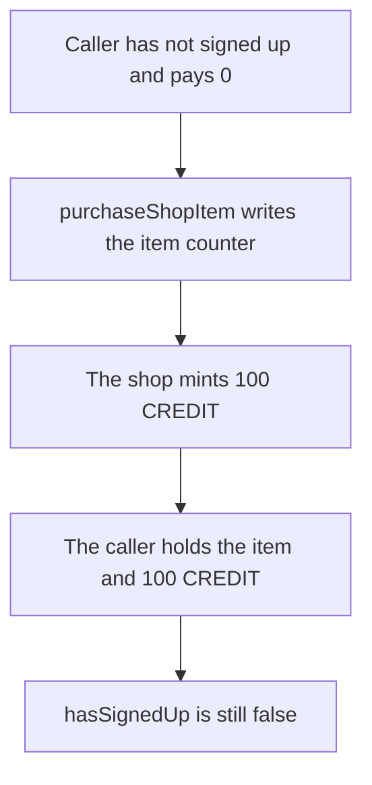

# Ruyui — a shop purchase without signup mints 100 CREDIT for 0

> **Vulnerability classes:** vuln/access-control/missing-check · vuln/logic/missing-validation

> **Reproduction:** a self-contained Foundry PoC that compiles and runs offline
> with only `forge-std` — no fork and no RPC. Trace: [output.txt](output.txt).
> PoC: [test/64703-h-01-it-is-possible-to-purchase-in-game-items-without-signin_exp.sol](test/64703-h-01-it-is-possible-to-purchase-in-game-items-without-signin_exp.sol).

<!-- non-defihacklabs -->
<!-- source-auditvault: https://github.com/Auditware/AuditVault/blob/main/findings/64703-h-01-it-is-possible-to-purchase-in-game-items-without-signin.md -->
<!-- date: 2026-01 -->

---

## Key info

| | |
|---|---|
| **Impact** | **HIGH** — a caller who never signed up receives the item and **100 CREDIT** for **0** |
| **Protocol** | Roots of Embervault, Ruyui shop |
| **Vulnerable code** | `purchaseShopItem` updates `userShopItemPurchases` and mints credit with no `hasSignedUp` check |
| **Bug class** | Purchase does not require signup |
| **Finding** | Shieldify — Roots of Embervault / Ruyui, January 2026 · id 64703, H-01 |
| **Report** | [Ruyui security review](https://github.com/shieldify-security/audits-portfolio-md/blob/main/RootsofEmbervault-Ruyui-Security-Review.md) |
| **Source** | [AuditVault finding](https://github.com/Auditware/AuditVault/blob/main/findings/64703-h-01-it-is-possible-to-purchase-in-game-items-without-signin.md) |
| **Status** | Reproduced here as a local synthetic. |
| **Compiler** | solc 0.8.27, cancun, via IR |

---

## TL;DR

`purchaseShopItem` assumes the caller already signed up. It does not check `hasSignedUp`. A caller who never signed up, and who pays nothing, still gets item 1 recorded and **100 CREDIT** minted.

Control requires `hasSignedUp`. The same purchase reverts. After `signUp()`, the purchase mints the 100 CREDIT.

## The vulnerable code

```solidity
function purchaseShopItem(uint256 itemId) external {
    // @> VULN: no hasSignedUp check
    userShopItemPurchases[msg.sender][itemId] += 1;
    credit.mint(msg.sender, CREDIT_OUT);
}
```

The fix is `require(hasSignedUp[msg.sender], "signup")` before those writes.

## Root cause

Signup is what records the user and the referee. The purchase path updates per-user item state and pays credit as if that had already happened. Skipping it grants the item and the credit without the signup fee and without a referee.

## Preconditions

- `hasSignedUp` for the caller is false.
- The caller sends no value.

## Attack walkthrough

1. Confirm the caller has not signed up.
2. Call `purchaseShopItem(1)`.
3. The item counter becomes 1 and the shop mints 100 CREDIT.
4. The caller's credit balance is 100. `hasSignedUp` is still false.

Control reverts with `signup` until `signUp()` is called. The signed-up purchase then mints 100 CREDIT.

## Diagrams



## Impact

The caller receives item 1 and **100 CREDIT** without signing up and without paying. The referee who would have been set at signup is never paid.

## Remediation

Require `hasSignedUp(msg.sender)` at the start of `purchaseShopItem` and `purchaseBattlePass`.

## Sources

- [AuditVault finding 64703](https://github.com/Auditware/AuditVault/blob/main/findings/64703-h-01-it-is-possible-to-purchase-in-game-items-without-signin.md)
- [Shieldify Ruyui review](https://github.com/shieldify-security/audits-portfolio-md/blob/main/RootsofEmbervault-Ruyui-Security-Review.md)

### Taxonomy

- `severity/high`
- `sector/gaming`
- `platform/shieldify`
