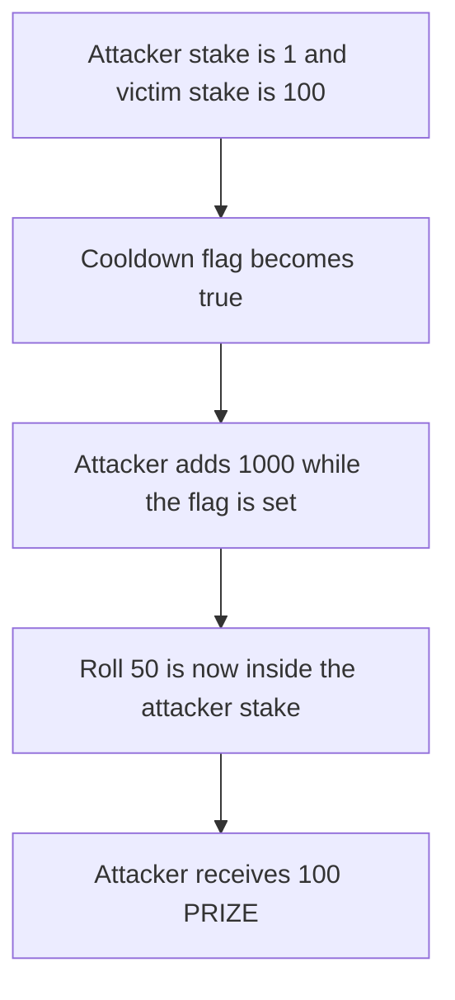

# Souls.club — staking during the cooldown flag wins 100 PRIZE the attacker should not

> **Vulnerability classes:** vuln/logic/reward-calculation · vuln/logic/wrong-condition

> **Reproduction:** a self-contained Foundry PoC that compiles and runs offline
> with only `forge-std` — no fork and no RPC. Trace: [output.txt](output.txt).
> PoC: [test/64739-h-01-stake-manipulation-during-cooldown-period-allows-probab_exp.sol](test/64739-h-01-stake-manipulation-during-cooldown-period-allows-probab_exp.sol).

<!-- non-defihacklabs -->
<!-- source-auditvault: https://github.com/Auditware/AuditVault/blob/main/findings/64739-h-01-stake-manipulation-during-cooldown-period-allows-probab.md -->
<!-- date: 2025-11 -->

---

## Key info

| | |
|---|---|
| **Impact** | **HIGH** — the attacker wins **100 PRIZE** on roll 50 after raising stake from 1 to 1,001 during cooldown |
| **Protocol** | Souls.club Wheel |
| **Vulnerable code** | `joinDuringCooldown` adds to `stakeA` while `cooldown` is already true |
| **Bug class** | Stake changes the odds after the round has locked |
| **Finding** | Shieldify — Souls.club Wheel, November 2025 · id 64739, H-01 |
| **Report** | [Souls.club Wheel review](https://github.com/shieldify-security/audits-portfolio/blob/main/reports/SoulsClub-Wheel-Security-Review.pdf) |
| **Source** | [AuditVault finding](https://github.com/Auditware/AuditVault/blob/main/findings/64739-h-01-stake-manipulation-during-cooldown-period-allows-probab.md) |
| **Status** | Reproduced here as a local synthetic. Cooldown is a flag. There is no warp. |
| **Compiler** | solc 0.8.27, cancun, via IR |

---

## TL;DR

The attacker joins with stake **1**. The victim joins with stake **100**. Both seats are filled, so `cooldown` becomes true in this block. The attacker then adds **1,000**. Stake is now **1,001**.

The wheel walks the attacker first. Roll **50** is not less than 1, so the frozen stake would lose. It is less than 1,001, so the boosted stake wins. The attacker receives **100 PRIZE**.

Control reverts the extra stake. Stake stays 1. The same roll selects the victim. The attacker receives **0** and the prize stays in the wheel.

## The vulnerable code

```solidity
function joinDuringCooldown(uint256 amount) external {
    require(cooldown, "cooldown");
    // @> VULN: cooldown is already set and the attacker stake still grows
    stakeA += amount;
}
```

The fix reverts instead of adding the amount.

## Root cause

`joinGame` keeps adding to `stakeByPlayer` after the session has activated. The winner is stake-weighted, so a deposit during that window changes who roll 50 hits.

## Preconditions

- Attacker stake starts at 1 and victim stake is 100. The attacker is the first player in the walk.
- `cooldown` is the flag set when both stakes are nonzero. The roll is the constant 50.
- The wheel holds 100 PRIZE.

## Attack walkthrough

1. Fund 100 PRIZE. Attacker joins with 1. Victim joins with 100. `cooldown` becomes true.
2. `joinDuringCooldown(1000)` adds to `stakeA`. It is now 1001.
3. `spin` uses roll 50. `50 < 1001` selects the attacker. `50 < 1` would have selected the victim.
4. The wheel transfers 100 PRIZE to the attacker.

Control reverts `joinDuringCooldown`. The spin pays nobody on the attacker path. The winner is the victim. The prize balance of the wheel stays 100.

## Diagrams



## Impact

The attacker wins **100 PRIZE** that roll 50 would have given to the victim. The victim's 100 stake is no longer the winning range.

## Remediation

Reject stake increases once `cooldown` is true. Freeze the stakes that the roll is measured against.

## Sources

- [AuditVault finding 64739](https://github.com/Auditware/AuditVault/blob/main/findings/64739-h-01-stake-manipulation-during-cooldown-period-allows-probab.md)
- [Shieldify Souls.club Wheel review](https://github.com/shieldify-security/audits-portfolio/blob/main/reports/SoulsClub-Wheel-Security-Review.pdf)

### Taxonomy

- `severity/high`
- `sector/gaming`
- `platform/shieldify`
