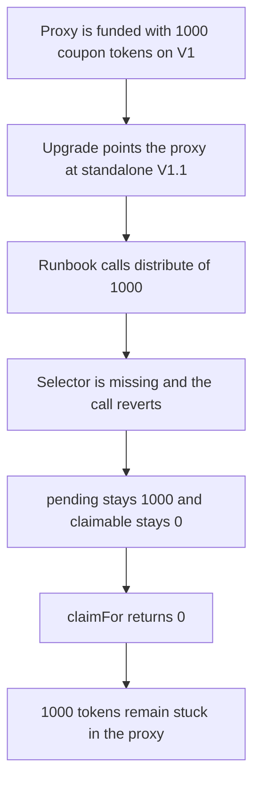

# Buck Labs RewardsEngine — V1.1 never distributes

> **Vulnerability classes:** vuln/logic/missing-check · vuln/dos/frozen-funds

<!-- non-defihacklabs -->
<!-- source-auditvault: https://github.com/Auditware/AuditVault/blob/main/findings/64790-rewardsengine-v11-missing-distribute-spearbit-none-buck-labs.md -->
<!-- date: 2026-01 -->

## Key info

| | |
|---|---|
| **Protocol** | Buck Labs |
| **Finding** | Spearbit, January 2026, AuditVault 64790 |
| **Vulnerable code** | `RewardsEngineV1_1.claimFor` (no `distribute`) |
| **Harm** | 1000 coupon tokens stay in the proxy. `claimFor` returns 0. The V1 control pays the user 1000. |
| **Chain** | local synthetic |

**AuditVault taxonomy:** lang/solidity · platform/spearbit · sector/account · severity/high · genome: upgradeable-contract · permanent · upgrade-safety

## TL;DR

The upgrade runbook calls `distribute(uint256)` after the RewardsEngine proxy moves to V1.1. The V1.1 implementation in the review is a standalone contract. It adds `claimFor` and `batchClaimFor` and does not inherit V1, so `distribute` is not on it. The call reverts. The 1000 coupon tokens that were funded into the proxy stay there, `pending` stays 1000, and `claimFor` returns 0. Keeping the V1 implementation, `distribute` credits the beneficiary and `claim` pays 1000.

## The vulnerable code

V1.1 as reviewed. The OpenZeppelin bases named in the report (`Initializable`, `AccessControlUpgradeable`, `PausableUpgradeable`, `MulticallUpgradeable`, `UUPSUpgradeable`) are omitted. The shape is the same: this contract is not a child of V1, and `distribute` is absent.

```solidity
function claimFor(address user, address recipient) external returns (uint256 amount) {
    amount = claimable[user]; // @> VULN: V1.1 has no distribute, so the coupon was never credited
    claimable[user] = 0;
    if (amount != 0) require(rewardToken.transfer(recipient, amount), "PAY");
    return amount;
}
```

V1, which the control keeps, does have the runbook entrypoint:

```solidity
function distribute(uint256 coupon) external {
    require(coupon > 0 && coupon <= pending, "COUPON");
    pending -= coupon;
    claimable[beneficiary] += coupon;
}
```

## Root cause

The migration treats V1.1 as a strict superset of V1. The implementation that was reviewed is not. After `upgradeTo`, the proxy's code no longer exposes `distribute(uint256)`. The coupon was already pulled into the proxy by `fund`, which only increases `pending`. Nothing moves `pending` into `claimable`, so the later claim reads zero.

## Preconditions

The proxy is upgraded to V1 first, so `initialize` and `fund` succeed and the proxy holds 1000 of the coupon token. `pending` is 1000 and `claimable` is 0. The proxy is then upgraded to V1.1. The beneficiary is the caller. No timestamp warp. The implementation pointer sits in the EIP-1967 slot so it does not collide with the reward storage.

## Attack walkthrough

1. Mint 1000 coupon tokens and approve the proxy.
2. Point the proxy at V1. Initialize it for the beneficiary and fund 1000. The tokens now sit on the proxy and `pending` is 1000.
3. Point the proxy at V1.1.
4. Call `distribute(1000)`, the exact runbook signature. The call returns failure. `pending` is still 1000.
5. `claimFor` reads `claimable[beneficiary]`, gets 0, and returns 0. The proxy balance is still 1000. The beneficiary's balance is 0.

The control stops after the fund, while the proxy still points at V1. `distribute(1000)` credits the beneficiary. `claim` transfers 1000 to that user and leaves the proxy at 0.

## Diagrams



## Impact

The beneficiary receives 0 of the 1000 coupon tokens. The full 1000 is stuck in the proxy until another upgrade restores `distribute` or some other payout path. That is the migration break the review describes: the distribution step cannot run, and the claim that follows pays nothing. The V1 control pays the same 1000 out.

## Remediation

Make V1.1 inherit the V1 implementation and add only `claimFor` and `batchClaimFor`, so `distribute(uint256)` is still present after the upgrade. Re-run the runbook, including `distribute`, against the upgraded proxy before shipping it. The control above is that V1 path.

## How to reproduce

```bash
cd 64790-rewardsengine-v11-missing-distribute-spearbit-none-buck-labs_exp
forge test -vv
```

## Sources

- AuditVault finding: https://github.com/Auditware/AuditVault/blob/main/findings/64790-rewardsengine-v11-missing-distribute-spearbit-none-buck-labs.md
- Spearbit review: https://github.com/spearbit/portfolio/blob/master/pdfs/Buck-Labs-Spearbit-Security-Review-January-2026.pdf
- Reviewed files named in the report: `RewardsEngineV1_1.sol`, `buckUpgradeProcedure.md`
- Fix noted by the report: commit `22968a5`, where V1.1 becomes a strict superset of V1
