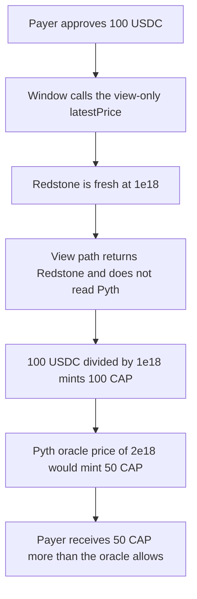

# Buck Labs — mint price skips the oracle check

> **Vulnerability classes:** vuln/oracle/missing-circuit-breaker · vuln/oracle/price-manipulation

<!-- non-defihacklabs -->
<!-- source-auditvault: https://github.com/Auditware/AuditVault/blob/main/findings/64791-mint-pricing-bypasses-oracle-validation-spearbit-none-buck-l.md -->
<!-- date: 2026-01 -->

## Key info

| | |
|---|---|
| **Protocol** | Buck Labs |
| **Finding** | Spearbit, January 2026, AuditVault 64791 |
| **Vulnerable code** | `OracleAdapter._fetchPriceView` / `_tryRedstone` |
| **Harm** | 100 USDC mints 100 CAP. The Pyth oracle price allows 50. |
| **Chain** | local synthetic |

**AuditVault taxonomy:** lang/solidity · sector/options · sector/oracle · platform/spearbit · severity/high · genome: missing-circuit-breaker · single-source · oracle-freshness

## TL;DR

Mint pricing calls the view-only oracle path. That path returns the first fresh feed and does not compare it with the second. Redstone is fresh at 1e18. Pyth, the oracle price, is fresh at 2e18. A mint of 100 USDC therefore issues 100 CAP. The same payment at the oracle price issues 50. The checked adapter returns the higher of the two fresh prices, so the control mint uses 2e18 and issues 50.

## The vulnerable code

The view body from the review. Both feeds are fresh. The first one wins:

```solidity
function _fetchPriceView() internal view returns (uint256 price, uint256 updatedAt) {
    (uint256 redstonePx, uint256 redstoneTime, bool redstoneFresh) = _tryRedstone();
    if (redstoneFresh) return (redstonePx, redstoneTime);
    (uint256 pythPx, uint256 pythTime, bool pythFresh) = _tryPyth();
    if (pythFresh) return (pythPx, pythTime);
    return (lastGoodPrice, lastGoodPriceTime);
}

function _tryRedstone() internal view returns (uint256 price, uint256 updatedAt, bool fresh) {
    return (redstonePrice, block.timestamp, true); // @> VULN: first fresh oracle, no Pyth cross-check
}
```

`LiquidityWindow.mint` divides the USDC taken in by that price:

```solidity
(uint256 price,) = oracle.latestPrice();
tokensOut = usdcIn * 1e18 / price;
```

The control adapter does not use this path. Its `latestPrice` is the higher of the two fresh feeds.

## Root cause

`latestPrice` is a view. It never updates a circuit breaker and it never requires the two feeds to agree. The first `if (redstoneFresh)` returns immediately, so a depressed but still-fresh primary price is what mint divides by. Pyth at 2e18 is ignored for the whole mint.

## Preconditions

Redstone price is 1e18. Pyth price is 2e18. Both reads report `fresh = true` at the current block timestamp, so no warp is required. The payer has 100 USDC and approves the window. `lastGoodPrice` is the Pyth price, but the view path never reaches it.

## Attack walkthrough

1. Mint 100 USDC to the payer and approve the window.
2. Call `mint(100 USDC)`. The window calls `latestPrice`.
3. `_tryRedstone` returns 1e18 and fresh. `_fetchPriceView` returns that pair and does not read Pyth.
4. `tokensOut = 100e18 / 1e18 = 100` CAP. The window pulls 100 USDC and mints 100 CAP.
5. The oracle allowance is `100e18 / pythPrice = 50` CAP. 100 is greater than 50.

The control wires `OracleAdapterChecked`. `latestPrice` returns 2e18, the higher fresh price. The same `mint(100 USDC)` issues 50 CAP.

## Diagrams



## Impact

The payer spends 100 USDC and receives 100 CAP. At the oracle price of 2e18 those 100 USDC are only entitled to 50 CAP. The extra 50 CAP is the reserve the review describes: minting at the unvalidated lower price takes more tokens than the cross-checked oracle allows. The control mint, using that oracle price, issues 50 and stops there.

## Remediation

Do not price mints off the first fresh feed. Compare Redstone and Pyth and use a price that cannot undercut the higher fresh feed, which is what `OracleAdapterChecked.latestPrice` does. The review's other option is a view that reverts when the feeds diverge. Either one stops this mint at 50 CAP.

## How to reproduce

```bash
cd 64791-mint-pricing-bypasses-oracle-validation-spearbit-none-buck-l_exp
forge test -vv
```

## Sources

- AuditVault finding: https://github.com/Auditware/AuditVault/blob/main/findings/64791-mint-pricing-bypasses-oracle-validation-spearbit-none-buck-l.md
- Spearbit review: https://github.com/spearbit/portfolio/blob/master/pdfs/Buck-Labs-Spearbit-Security-Review-January-2026.pdf
- Reviewed files named in the report: `OracleAdapterV4.sol`, `PolicyManagerV2.sol`, `LiquidityWindowV2.sol`
- Fix noted by the report: commit `f40ce28`, where pricing uses one validated path
