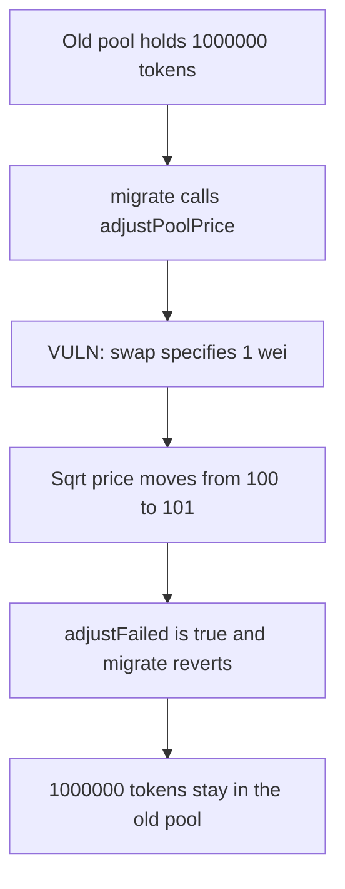

# g8keep migration reverts on a 1-wei swap and leaves 1,000,000 tokens in the old pool

> **Vulnerability classes:** vuln/dos/frozen-funds · vuln/logic/missing-check

<!-- non-defihacklabs -->
<!-- source-auditvault: https://github.com/Auditware/AuditVault/blob/main/findings/64998-h-01-migration-will-fail-trying-to-swap-1-wei-of-tokens-to-r.md -->
<!-- date: 2024-12 -->

## Key info

| | |
|---|---|
| **Protocol** | g8keep |
| **Finding** | Pashov H-01, AuditVault 64998 |
| **Vulnerable code** | `Migrator._adjustPoolPrice` |
| **Harm** | 1,000,000 old tokens stay in the old pool; the user receives 0 new tokens |
| **Chain** | local synthetic |

## TL;DR

When the pool sqrt price is below the target, migration swaps `int256(uint256(1))`. One wei moves the price from 100 to 101, not to 1000. `adjustFailed` stays true, `migrate()` reverts, and the 1,000,000 tokens never leave the old pool. Swapping the 900-point distance reaches 1000 and the user receives 1,000,000 new tokens.

## The vulnerable code

```solidity
} else {
    // @> VULN: 1 wei of the quote token cannot move sqrt price from 100 to the target 1000
    IUniswapV3Pool(poolAddress).swap(address(this), false, int256(uint256(1)), sqrtPriceX96, "");
}
(uint160 sqrtPriceX96New,,,,,,) = IUniswapV3Pool(poolAddress).slot0();
adjustFailed = sqrtPriceX96 != sqrtPriceX96New;
```

The control passes the distance to the target, `900`, and the pool writes the limit.

## Root cause

The else branch hardcodes a 1-wei specified amount. That amount cannot travel from sqrt price 100 to 1000, so the equality check against the target fails on every attempt and migration always reverts.

## Preconditions

The pool's starting sqrt price is below the target. The old pool holds 1,000,000 tokens. No privileged role is required to observe the failed migration.

## Attack walkthrough

1. 1,000,000 old tokens are deposited in the old pool.
2. `migrate()` calls `_adjustPoolPrice`.
3. The else branch swaps 1 wei toward target 1000.
4. The pool price becomes 101. `adjustFailed` is true.
5. `migrate()` reverts. The old pool still holds 1,000,000 and the user holds 0 new tokens.

## Diagrams



## Impact

The migration cannot complete. 1,000,000 tokens remain in the old pool and the user receives none of the new token. The control swap reaches sqrt price 1000, burns the old balance, and mints 1,000,000 new tokens to the user.

## Remediation

Swap the amount required to reach the target price, and compare the resulting price with a tolerance instead of exact equality.

## How to reproduce

```bash
cd 64998-h-01-migration-will-fail-trying-to-swap-1-wei-of-tokens-to-r_exp
forge test -vv
```

## Sources

- AuditVault finding: https://github.com/Auditware/AuditVault/blob/main/findings/64998-h-01-migration-will-fail-trying-to-swap-1-wei-of-tokens-to-r.md
- Pashov report: https://github.com/pashov/audits/blob/master/team/md/g8keep-security-review_2024-12-12.md
