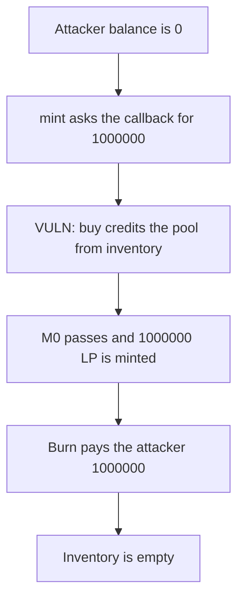

# g8keep `buy(pool)` mints 1,000,000 LP against an empty balance

> **Vulnerability classes:** vuln/logic/price-calculation · vuln/logic/missing-check

<!-- non-defihacklabs -->
<!-- source-auditvault: https://github.com/Auditware/AuditVault/blob/main/findings/65000-h-03-its-possible-to-add-liquidity-to-uniswapv3-while-token.md -->
<!-- date: 2024-12 -->

## Key info

| | |
|---|---|
| **Protocol** | g8keep |
| **Finding** | Pashov H-03, AuditVault 65000 |
| **Vulnerable code** | `SaleToken.buy` |
| **Harm** | 1,000,000 inventory tokens withdrawn by an attacker whose own balance was 0 |
| **Chain** | local synthetic |

## TL;DR

`transfer()` to the Uniswap V3 pool reverts until the token is migrated. `buy()` still credits any recipient, including the pool, from the sale inventory. The mint callback uses that credit to pass the audited balance check, so 1,000,000 LP is minted against an empty attacker balance. Burning the LP pays the attacker the inventory. The control migrates and transfers the caller's own tokens into the pool first. The inventory stays at 1,000,000.

## The vulnerable code

The mint check is the snippet from the report. The missing guard is `buy`.

```solidity
if (amount0 > 0) balance0Before = balance0();
if (amount1 > 0) balance1Before = balance1();
IUniswapV3MintCallback(msg.sender).uniswapV3MintCallback(amount0, amount1, data);
if (amount0 > 0) require(balance0Before.add(amount0) <= balance0(), "M0");
if (amount1 > 0) require(balance1Before.add(amount1) <= balance1(), "M1");
```

```solidity
function buy(address to, uint256 amount) external {
    // @> VULN: buy credits the Uniswap V3 pool even though transfer() to the pool is blocked
    balanceOf[INVENTORY] -= amount;
    balanceOf[to] += amount;
}
```

## Root cause

The transfer restriction is only on `transfer`. `buy` moves inventory balances with no check that `to` is not the pool, so a mint callback can satisfy `M0` without the attacker owning any tokens.

## Preconditions

The token is not migrated, so a direct transfer to the pool reverts. The sale inventory holds 1,000,000 tokens. The attacker holds 0.

## Attack walkthrough

1. The attacker calls `pool.mint` for 1,000,000 token0 while holding 0 tokens.
2. The callback calls `buy(pool, 1000000)`.
3. Inventory falls by 1,000,000 and the pool balance rises by 1,000,000.
4. The `M0` check passes and 1,000,000 LP is minted.
5. Burning the LP transfers 1,000,000 tokens to the attacker.

## Diagrams



## Impact

1,000,000 sale-inventory tokens are taken by an account that started empty. The control transfers 1,000,000 of the caller's own tokens into the pool after migration and leaves the inventory at 1,000,000.

## Remediation

Reject `buy` when the recipient is the Uniswap V3 pool, the same way `transfer` already does before migration.

## How to reproduce

```bash
cd 65000-h-03-its-possible-to-add-liquidity-to-uniswapv3-while-token_exp
forge test -vv
```

## Sources

- AuditVault finding: https://github.com/Auditware/AuditVault/blob/main/findings/65000-h-03-its-possible-to-add-liquidity-to-uniswapv3-while-token.md
- Pashov report: https://github.com/pashov/audits/blob/master/team/md/g8keep-security-review_2024-12-12.md
