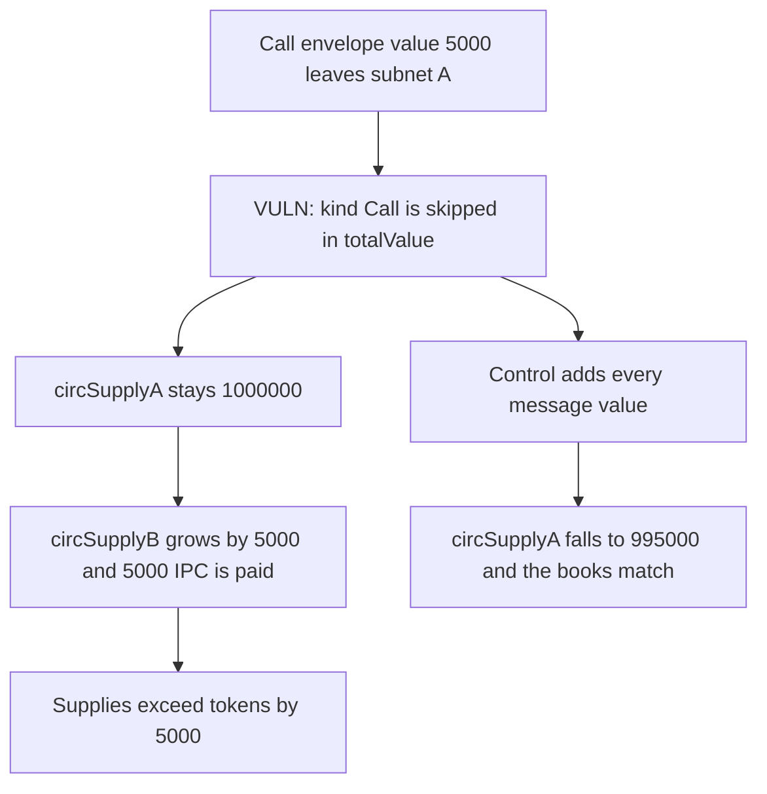

# Recall leaves Call value in a subnet's circulating supply

> **Vulnerability classes:** vuln/logic/state-update · vuln/logic/incorrect-state-transition

<!-- non-defihacklabs -->
<!-- source-auditvault: https://github.com/Auditware/AuditVault/blob/main/findings/65089-h-02-xnet-call-messages-with-value-0-lead-to-inflated-circul.md -->
<!-- date: 2025-02 -->

## Key info

| Field | Value |
|---|---|
| **Loss** | 5000 IPC of circulating supply left unbacked after a Call that moves 5000 |
| **Vulnerable contract** | `CheckpointingFacet.execBottomUpMsgs` |
| **Attacker EOA** | `0x1111111111111111111111111111111111111111` |
| **Attack contract** | `Exploit` |
| **Attack tx** | `Exploit.run()` |
| **Chain / block / date** | Ethereum model · block 0 · 2025-02 |
| **Compiler** | solc 0.8.27, cancun, via IR |
| **Bug class** | Bottom-up supply debit ignores Call messages that carry value |

## TL;DR

`execBottomUpMsgs` adds `msgs[i].value` only when `kind != Call`, then subtracts that sum from the source subnet's `circSupply`. A Call with value 5000 still credits the destination supply and transfers the 5000. Source supply stays 1,000,000. The two supplies sum to 1,005,000 against 1,000,000 of tokens, so 5000 is unbacked. Counting every message value drops the source supply to 995,000 and the gap is 0.

## Background

Code4rena, February 2025 Recall. The gateway invariant is that a subnet's total supply matches the funds locked for it. `CheckpointingFacet.execBottomUpMsgs` assumed a `Call` does not move supply. `sendContractXnetMessage` can commit a `Call` with non-zero value, and that value is locked and later delivered.

## The vulnerable code

```solidity
if (msgs[i].kind != IpcMsgKind.Call) {
    totalValue += msgs[i].value;
}
```

`circSupplyA` is then reduced by `totalValue`. The apply loop still does `circSupplyB += value` and transfers the tokens for a Call.

## Root cause

The debit and the apply path disagree. Apply treats a funded Call as a real transfer. The debit treats it as valueless. Repeating the pattern increases child supply without a matching decrease.

## Preconditions

- Source `circSupply` equals the tokens locked for that subnet. The PoC starts both at 1,000,000.
- A bottom-up batch contains a Call whose value is 5000.
- `execBottomUpMsgs` is reached for that batch. The function that builds the Call is permissionless.

## Attack walkthrough

1. Subnet A has circulating supply 1,000,000 and the gateway holds 1,000,000 IPC.
2. One Call envelope sends 5000 to the caller.
3. The kind check skips the value. `totalValueAccounted` is 0 and `circSupplyA` stays 1,000,000.
4. The apply loop adds 5000 to `circSupplyB` and transfers 5000 IPC to the caller.
5. Supplies sum to 1,005,000. Tokens sum to 1,000,000. The shortage is 5000.

## Diagrams



## Impact

The source subnet can still account for 5000 that already left. Destination supply includes that 5000 as well. Locked tokens no longer cover the sum of the circulating supplies. The fixed loop debits the 5000, pays the same 5000, and leaves supply equal to tokens.

## Remediation

Remove the `kind != Call` filter and add `msgs[i].value` for every bottom-up message before subtracting from `circSupply`, as in the report's patch.

## How to reproduce

```bash
cd 65089-h-02-xnet-call-messages-with-value-0-lead-to-inflated-circul_exp
forge test -vv
```

`test_call_value_leaves_5000_unbacked` asserts source supply is still 1,000,000, the accounted value is 0, and the supply-minus-token gap is 5000. `test_control_call_value_debits_source_supply` asserts source supply is 995,000 and the gap is 0.

## Sources

- AuditVault finding: https://github.com/Auditware/AuditVault/blob/main/findings/65089-h-02-xnet-call-messages-with-value-0-lead-to-inflated-circul.md
- Contest: https://code4rena.com/reports/2025-02-recall
