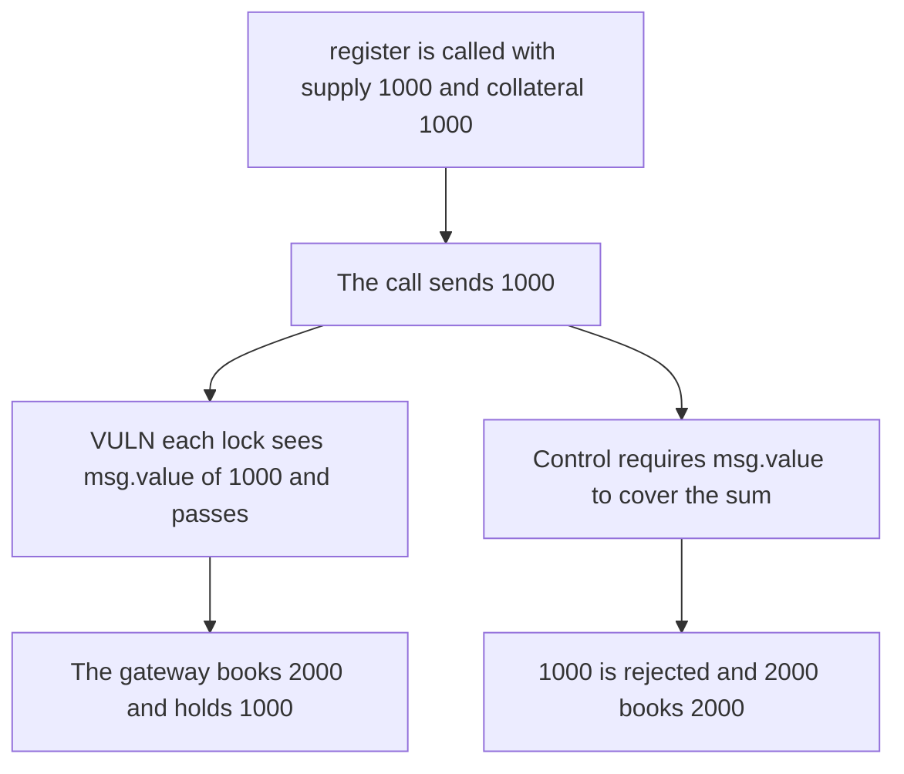

# Recall gateway books supply and collateral against one native payment

> **Vulnerability classes:** vuln/logic/double-lock · vuln/arithmetic/msg-value

<!-- non-defihacklabs -->
<!-- source-auditvault: https://github.com/Auditware/AuditVault/blob/main/findings/65095-h-08-permissionless-creation-of-new-subnets-under-gateway-wi.md -->
<!-- date: 2025-02 -->

## Key info

| Field | Value |
|---|---|
| **Loss** | 1000 of circulating supply and 1000 of collateral are booked after a payment of 1000. The shortfall is 1000 |
| **Vulnerable contract** | `Gateway.lock` |
| **Attacker EOA** | `0x1111111111111111111111111111111111111111` |
| **Attack contract** | `Exploit` at `0x15452ec016c4dc8c549e7fe6ff4b26324ea8b7a4` |
| **Attack tx** | `Exploit.run()` with value 1000 |
| **Chain / block / date** | Ethereum model · block 0 · 2025-02 |
| **Compiler** | solc 0.8.27, cancun, via IR |
| **Bug class** | Each native lock checks `msg.value >= value` on its own amount |



## TL;DR

`register` locks genesis supply and collateral as two calls. The quoted native branch of `lock` does `require(msg.value >= value)`. Both calls see the same `msg.value`. A payment of 1000 covers a 1000 supply lock and a 1000 collateral lock.

The gateway stores `circSupply` 1000 and `stake` 1000, and `received` is 1000. Booked obligations exceed cash by 1000. The control requires `msg.value >= genesisCircSupply + collateral`. A payment of 1000 reverts. A payment of 2000 books 2000 and holds 2000.

## The vulnerable code

```solidity
function lock(uint256 value) public payable returns (uint256) {
    require(msg.value >= value, "Insufficient funds"); // @> VULN: the second lock still sees the first payment
    checks += 1;
    lastLocked = value;
    return value;
}
```

## Impact

One native payment is counted twice. Here the gateway records 2000 of supply plus collateral against 1000 of cash, so the books are short 1000.

## How to reproduce

```bash
cd 65095-h-08-permissionless-creation-of-new-subnets-under-gateway-wi_exp
forge test -vv
```

`test_exploit_books_2000_after_paying_1000` asserts supply 1000, stake 1000, and cash 1000. `test_control_requires_the_sum` asserts 1000 reverts and 2000 books the cash.

## Sources

- AuditVault finding: https://github.com/Auditware/AuditVault/blob/main/findings/65095-h-08-permissionless-creation-of-new-subnets-under-gateway-wi.md
- Code4rena report: 2025-02-recall
