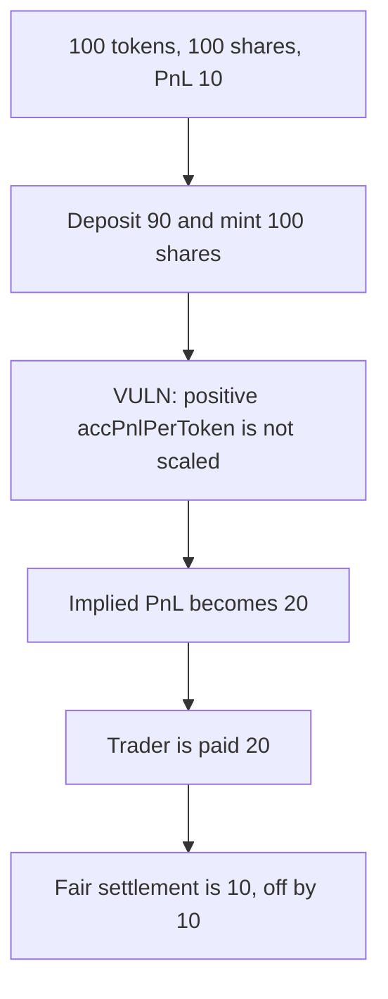

# Ostium `scaleVariables` settles PnL at 20 instead of 10

> **Vulnerability classes:** vuln/arithmetic/decimal-mismatch · vuln/logic/price-calculation

<!-- non-defihacklabs -->
<!-- source-auditvault: https://github.com/Auditware/AuditVault/blob/main/findings/65202-h-04-code-does-not-scale-accpnlpertoken-in-scalevariables-al.md -->
<!-- date: 2025-09 -->

## Key info

| | |
|---|---|
| **Protocol** | Ostium |
| **Finding** | Pashov H-04, AuditVault 65202 |
| **Vulnerable code** | `Vault.scaleVariables` |
| **Harm** | Settlement pays 20 tokens; the fair PnL is 10; off by 10 |
| **Chain** | local synthetic |

## TL;DR

`scaleVariables` scales `accPnlPerToken` only when it is negative. A vault with 100 tokens, 100 shares and trader profit of 10 has `accPnlPerToken` of 0.1. A 90-token deposit mints 100 shares and leaves the accumulator at 0.1. Implied PnL becomes `200 * 0.1 = 20` instead of 10. Settlement pays the trader 20. Scaling the positive accumulator pays 10.

## The vulnerable code

```solidity
uint256 supply = totalSupply();
// @> VULN: a positive accPnlPerToken is left unchanged, so implied PnL grows with the new shares
if (accPnlPerToken < 0) {
    accPnlPerToken = accPnlPerToken * supply.toInt256()
        / (isDeposit ? (supply + shares).toInt256() : (supply - shares).toInt256());
}
```

The control applies that same ratio when the accumulator is positive: `0.1e18 * 100 / 200 = 0.05e18`, and `0.05 * 200 = 10`.

## Root cause

The sign check treats a positive per-token PnL as "already correct". It is correct only for the old supply. New shares inherit the old per-token value, so the implied total doubles when the share supply doubles.

## Preconditions

`accPnlPerToken` is positive. A deposit increases the share supply. The numbers are the report's example, scaled by 1e18: 100 tokens, 100 shares, profit 10, deposit 90.

## Attack walkthrough

1. The depositor adds 90 tokens and receives 100 shares.
2. `scaleVariables` sees a positive accumulator and writes nothing.
3. Supply is 200 and `accPnlPerToken` is still 0.1e18.
4. `settle` pays `20e18` to the trader.
5. The fair payment is `10e18`. The difference is `10e18`.

## Diagrams



## Impact

Traders are settled 20 tokens of PnL when the open profit is 10. The extra 10 comes out of depositor equity. The control pays 10.

## Remediation

Scale `accPnlPerToken` by `supply / (supply + shares)` on deposits, and by `supply / (supply - shares)` on withdrawals, for both signs.

## How to reproduce

```bash
cd 65202-h-04-code-does-not-scale-accpnlpertoken-in-scalevariables-al_exp
forge test -vv
```

## Sources

- AuditVault finding: https://github.com/Auditware/AuditVault/blob/main/findings/65202-h-04-code-does-not-scale-accpnlpertoken-in-scalevariables-al.md
- Pashov report: https://github.com/pashov/audits/blob/master/team/md/Ostium-security-review_2025-09-14.md
