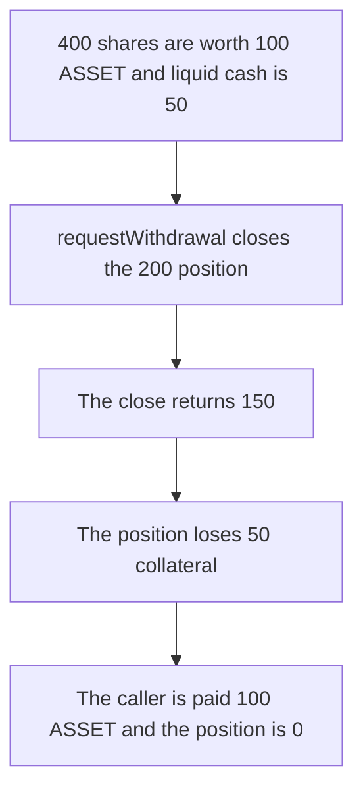

# Pear — a withdrawal closes the position and it loses 50 collateral

> **Vulnerability classes:** vuln/logic/liquidation-logic · vuln/logic/state-update

> **Reproduction:** a self-contained Foundry PoC that compiles and runs offline
> with only `forge-std` — no fork and no RPC. Trace: [output.txt](output.txt).
> PoC: [test/65287-h-01-forced-premature-position-liquidation-through-withdrawa_exp.sol](test/65287-h-01-forced-premature-position-liquidation-through-withdrawa_exp.sol).

<!-- non-defihacklabs -->
<!-- source-auditvault: https://github.com/Auditware/AuditVault/blob/main/findings/65287-h-01-forced-premature-position-liquidation-through-withdrawa.md -->
<!-- date: 2025-11 -->

---

## Key info

| | |
|---|---|
| **Impact** | **HIGH** — the position of **200** is closed and loses **50** collateral so a **100 ASSET** withdrawal can be paid |
| **Protocol** | Pear vault |
| **Vulnerable code** | `requestWithdrawal` closes the position when the share value exceeds liquid cash |
| **Bug class** | Withdrawal forces a liquidation |
| **Finding** | Shieldify — Pear vault, November 2025 · id 65287, H-01 |
| **Report** | [Pear vault review](https://github.com/shieldify-security/audits-portfolio-md/blob/main/Pear-Vault-Security-Review.md) |
| **Source** | [AuditVault finding](https://github.com/Auditware/AuditVault/blob/main/findings/65287-h-01-forced-premature-position-liquidation-through-withdrawa.md) |
| **Status** | Reproduced here as a local synthetic. |
| **Compiler** | solc 0.8.27, cancun, via IR |

---

## TL;DR

Liquid cash is **50 ASSET**. The position holds **200** of collateral. The caller has **400** of **1,000** shares, worth **100 ASSET**. That is more than the cash on hand, so `requestWithdrawal` closes the position at 75 percent. The close returns **150** and the position loses **N = 50**. The caller is paid **100 ASSET**. The position is 0.

Control pays only the liquid **50 ASSET**. The position stays **200**. `loss` stays **0**.

## The vulnerable code

```solidity
if (assets > liquid) {
    uint256 received = position * 75 / 100;
    // @> VULN: the withdrawal closes the position and the haircut is lost collateral
    loss = position - received;
    position = 0;
    liquid += received;
}
```

The fix pays `min(assets, liquid)` and does not write `position` or `loss`.

## Root cause

The queue checks that the caller has the shares. It does not check that the asset value of those shares fits in liquid cash. A withdrawal larger than cash forces the position closed, including at a loss.

## Preconditions

- Liquid cash is 50 ASSET. Position collateral is 200. Total shares are 1,000.
- The caller holds 400 shares and requests all of them.

## Attack walkthrough

1. The share value is `400 * 250 / 1000 = 100` ASSET. That is greater than 50 liquid.
2. The position is sold for 150. `loss` is 50. `position` becomes 0.
3. The vault pays the caller 100 ASSET.

Control transfers 50 ASSET and stops. The position is still 200.

## Diagrams



## Impact

The position loses **50** collateral that a cash-only withdrawal would have left in place. Remaining depositors eat that haircut. The caller is paid **100 ASSET**.

## Remediation

Cap a withdrawal at liquid cash. Do not close the position inside `requestWithdrawal`.

## Sources

- [AuditVault finding 65287](https://github.com/Auditware/AuditVault/blob/main/findings/65287-h-01-forced-premature-position-liquidation-through-withdrawa.md)
- [Shieldify Pear vault review](https://github.com/shieldify-security/audits-portfolio-md/blob/main/Pear-Vault-Security-Review.md)

### Taxonomy

- `severity/high`
- `sector/lending`
- `platform/shieldify`
