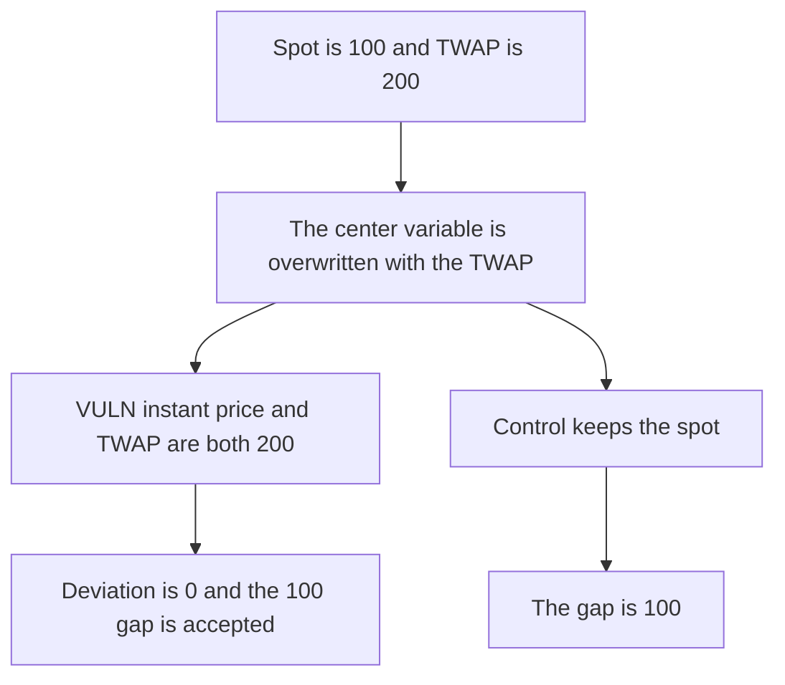

# The pool price check compares the TWAP with itself

> **Vulnerability classes:** vuln/oracle/deviation-check · vuln/logic/price-overwrite

<!-- non-defihacklabs -->
<!-- source-auditvault: https://github.com/Auditware/AuditVault/blob/main/findings/65730-h-02-variable-overwrite-in-checkpoolandgetcenterprice-create.md -->
<!-- date: 2026-01 -->

## Key info

| Field | Value |
|---|---|
| **Loss** | Spot 100 against TWAP 200 is accepted. The stored deviation is 0. The spot-versus-TWAP gap is 100 |
| **Vulnerable contract** | `Checker.check` |
| **Attacker EOA** | `0x1111111111111111111111111111111111111111` |
| **Attack contract** | `Exploit` at `0x15452ec016c4dc8c549e7fe6ff4b26324ea8b7a4` |
| **Attack tx** | `Exploit.run()` |
| **Chain / block / date** | Ethereum model · block 0 · 2026-01 |
| **Compiler** | solc 0.8.27, cancun, via IR |
| **Bug class** | The return variable starts as the spot and is then overwritten with the TWAP, so the deviation is `|twap - twap|` |



## TL;DR

`checkPoolAndGetCenterPrice` writes the spot into its return variable and later decodes the TWAP into that same variable. The instant price is then derived from the overwritten value, so it matches the TWAP. The deviation is 0 on every call, including a spot of 100 against a TWAP of 200.

The control keeps the spot and returns `|100 - 200| = 100`. The quoted check accepts the call because 0 is within the limit of 10.

## The vulnerable code

```solidity
uint256 center = spot;
center = twap;
uint256 instant = center;
deviation = instant > twap ? instant - twap : twap - instant; // @> VULN: instant was derived from the overwritten center
accepted = deviation <= 10;
```

## Impact

A price gap of 100 passes a check whose limit is 10. Liquidity operations that trust this check proceed at the unchecked spot.

## How to reproduce

```bash
cd 65730-h-02-variable-overwrite-in-checkpoolandgetcenterprice-create_exp
forge test -vv
```

`test_exploit_deviation_is_zero` asserts the deviation is 0 and the gap is accepted. `test_control_reports_the_spot_gap` asserts the gap is 100.

## Sources

- AuditVault finding: https://github.com/Auditware/AuditVault/blob/main/findings/65730-h-02-variable-overwrite-in-checkpoolandgetcenterprice-create.md
- Code4rena report: 2026-01-olas
