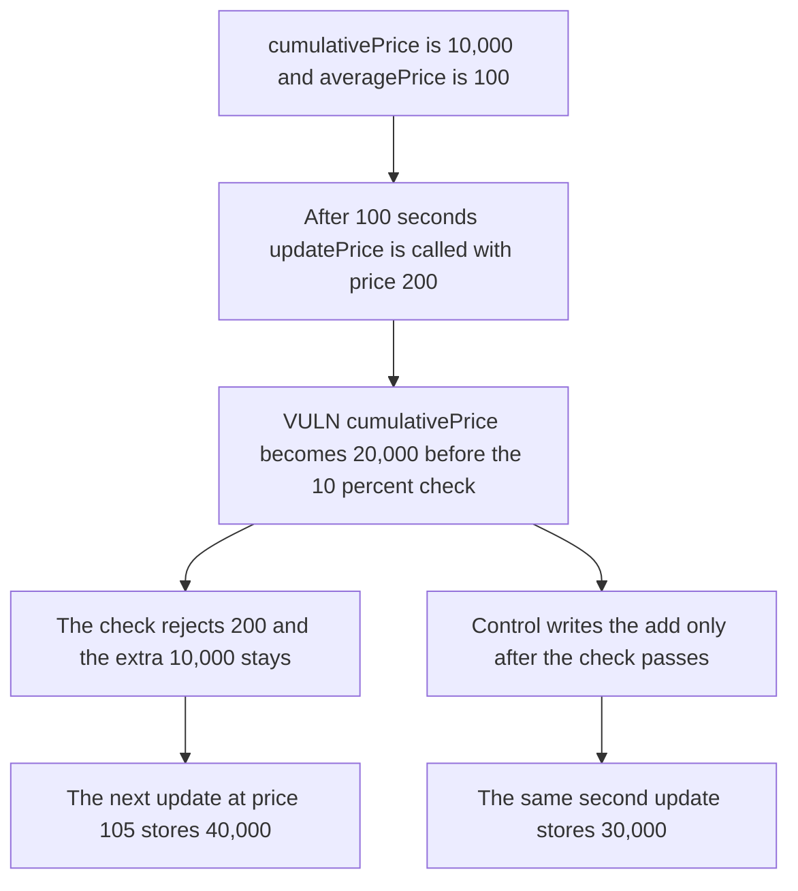

# A rejected price update still moves cumulativePrice

> **Vulnerability classes:** vuln/oracle/cumulative-price · vuln/logic/check-order

<!-- non-defihacklabs -->
<!-- source-auditvault: https://github.com/Auditware/AuditVault/blob/main/findings/65739-h-11-cumulativeprice-is-corrupted-when-price-updates-are-rej.md -->
<!-- date: 2026-01 -->

## Key info

| Field | Value |
|---|---|
| **Loss** | cumulativePrice ends at 40,000. The same two updates write 30,000 when the add waits for the check |
| **Vulnerable contract** | `Oracle.updatePrice` |
| **Attacker EOA** | `0x1111111111111111111111111111111111111111` |
| **Attack contract** | `Exploit` at `0x15452ec016c4dc8c549e7fe6ff4b26324ea8b7a4` |
| **Attack tx** | `Exploit.run()` |
| **Chain / block / date** | Ethereum model · block 0 · 2026-01 |
| **Compiler** | solc 0.8.27, cancun, via IR |
| **Bug class** | `cumulativePrice += averagePrice * elapsedTime` runs before the slippage check returns false |



## TL;DR

`updatePrice` adds `averagePrice * elapsedTime` into `cumulativePrice`, then computes the average, then rejects the update when `currentPrice` is outside `maxSlippage`. The add is already stored when the function returns false.

The finding's numbers are the inputs. `cumulativePrice` starts at 10,000, `averagePrice` at 100, and `maxSlippage` is 10. After 100 seconds a price of 200 is rejected, and `cumulativePrice` is 20,000. After another 100 seconds a price of 105 is accepted and `cumulativePrice` is 40,000. The control keeps 10,000 on the rejected call and stores 30,000 on the accepted call. The gap is the finding's extra 10,000.

## The vulnerable code

```solidity
lastElapsed = elapsedTime;
cumulativePrice += averagePrice * elapsedTime; // @> VULN: a rejected update still keeps this add
computedAverage = average;
lastAccepted = false;
```

## Impact

Every later TWAP is computed from a cumulative that includes the rejected interval. The worked example is 40,000 against the control's 30,000.

## How to reproduce

```bash
cd 65739-h-11-cumulativeprice-is-corrupted-when-price-updates-are-rej_exp
forge test -vv
```

`test_exploit_rejected_update_leaves_40000` asserts cumulativePrice 40,000 and a 10,000 marker. `test_control_rejected_update_lands_on_30000` asserts the rejected call leaves 10,000 and the accepted call stores 30,000.

## Sources

- AuditVault finding: https://github.com/Auditware/AuditVault/blob/main/findings/65739-h-11-cumulativeprice-is-corrupted-when-price-updates-are-rej.md
- Code4rena report: Olas, 2026-01
