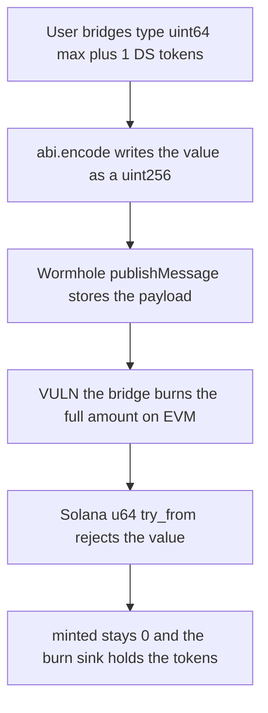

# Securitize: bridging one wei past u64 burns the tokens and Solana mints nothing

> **Vulnerability classes:** `vuln/bridge/missing-validation` · `vuln/data/wrong-encoding`

<!-- non-defihacklabs -->
<!-- source-auditvault: https://github.com/Auditware/AuditVault/blob/main/findings/65889-evm-to-solana-transfers-can-permanently-burn-tokens-by-produ.md -->
<!-- date: 2026-04 -->

## Key info

| Field | Value |
|---|---|
| **Loss** | `type(uint64).max + 1` DS tokens burned. Solana mints 0 |
| **Vulnerable contract** | `SecuritizeBridge._bridgeDSTokensInternal` |
| **Attacker EOA** | `0x1111111111111111111111111111111111111111` (the bridging user) |
| **Attack contract** | `Exploit` |
| **Attack tx** | `Exploit.run()` |
| **Chain / block / date** | Ethereum model · block 0 · 2026-04 |
| **Compiler** | solc 0.8.27, cancun, via IR |
| **Bug class** | uint256 payload value is burned before the Solana u64 decoder can reject it |

## TL;DR

The EVM bridge abi-encodes `_value` as a `uint256`, publishes the Wormhole payload, and then burns that amount. Solana decodes the same field with `u64::try_from`. `type(uint64).max + 1` passes every EVM check and fails the Solana narrowing, so `executeVaa` returns false and `minted` stays 0. The burn sink holds `18446744073709551616` tokens. The user's balance is 0. A value of 1000, which fits in a `u64`, is burned and minted.

## Background

Cyfrin's 30 April 2026 Securitize Solana Bridge review, reported by JesJupyter. `SecuritizeBridge._bridgeDSTokensInternal` builds the payload with `abi.encode` and burns `_dsToken` afterwards. The Solana program in `payload.rs` narrows `value` to `u64` and rejects the VAA when that fails. Securitize acknowledged the value cap: the EVM side will reject amounts above `type(uint64).max` before the burn when the destination is Solana.

## The vulnerable code

```solidity
bytes memory encoded = _encodePayload(
    _targetChain, _value, bytes32(uint256(uint160(msg.sender))), _destinationAddress, detail
);
uint64 sequence = wormholeCore.publishMessage(0, encoded, 1);
dsToken.burn(msg.sender, _value, BRIDGE_REASON); // @> VULN: burn runs even when Solana cannot decode _value
```

`_encodePayload` writes `_value` with `abi.encode`, which is 32 bytes. The Solana side of this reduction is the check the report quotes:

```solidity
if (value > type(uint64).max) return false;
```

Cap the amount before `publishMessage` and before `burn`:

```diff
+ if (_value > type(uint64).max) revert();
  uint64 sequence = wormholeCore.publishMessage(0, encoded, 1);
  dsToken.burn(msg.sender, _value, BRIDGE_REASON);
```

## Root cause

The source chain accepts a wider integer than the destination chain can decode, and it burns on the source before the destination has accepted the payload. The VAA can be valid as a Wormhole message and still be permanently unexecutable on Solana. Retrying does not change the encoded integer.

## Preconditions

- The user holds at least `type(uint64).max + 1` DS tokens. That amount is `18446744073709551616`.
- The target chain is the Solana id whose decoder narrows `value` to `u64`.
- No EVM check caps `_value` at `type(uint64).max` before the burn.

## Attack walkthrough

1. The user calls `bridgeDSTokensToAddress` with `_value = type(uint64).max + 1`.
2. `_encodePayload` abi-encodes that `uint256`. `publishMessage` stores the payload and returns sequence 1.
3. `burn` subtracts the full amount from the user and credits the burn sink.
4. `executeVaa` decodes the payload. `value > type(uint64).max`, so it returns false and does not add to `minted`.
5. The user's balance is 0. `minted` is 0. The sink holds the full amount.
6. The control bridges 1000 instead. The decoder accepts it and `minted` becomes 1000.

## Diagrams



## Impact

The user loses `type(uint64).max + 1` DS tokens. Solana mints nothing, and the same payload will fail the decoder on every retry. The burn is final. A transfer of 1000, inside the `u64` range, is burned on EVM and minted on the Solana model, which is the path the cap is meant to keep.

## Remediation

Before publishing or burning, reject `_value` above `type(uint64).max` when the destination is Solana. Securitize acknowledged that cap. The same rule applies to attribute widths and to the 1024-byte payload limit; this run demonstrates the value-overflow path from the report.

## How to reproduce

```bash
cd 65889-evm-to-solana-transfers-can-permanently-burn-tokens-by-produ_exp
forge test -vv
```

`test_exploit_u64_overflow_burns_with_no_solana_mint` asserts the decoder rejects, `minted` is 0, and the sink holds `type(uint64).max + 1`. `test_control_value_inside_u64_mints_on_solana` asserts a 1000-token bridge mints 1000. Captured output is `output.txt`.

## Sources

- AuditVault finding: https://github.com/Auditware/AuditVault/blob/main/findings/65889-evm-to-solana-transfers-can-permanently-burn-tokens-by-produ.md
- Cyfrin report: https://github.com/solodit/solodit_content/blob/main/reports/Cyfrin/2026-04-30-cyfrin-securitize-solana-bridge-v2.1.md
- Vulnerable lines: `_bridgeDSTokensInternal`, `_encodePayload`, and the Solana `u64::try_from` snippet quoted in that report. The finding does not name an audited commit.
