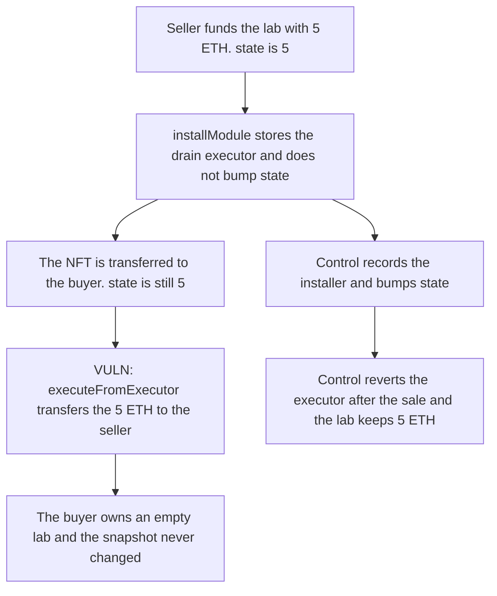

# A seller installs an OnChainLab executor before listing and drains 5 ETH after the buyer takes the NFT

> **Vulnerability classes:** vuln/access-control/missing-auth · vuln/logic/missing-check

<!-- non-defihacklabs -->
<!-- source-auditvault: https://github.com/Auditware/AuditVault/blob/main/findings/65951-onchainlabexecutefromexecutor-pre-listing-module-backdoor-by.md -->
<!-- date: 2026-05 -->

## Key info

| Field | Value |
|---|---|
| **Loss** | 5 ETH moved from the sold lab to the seller. The buyer's state snapshot never changes |
| **Vulnerable contract** | `OnChainLab.executeFromExecutor` |
| **Attacker EOA** | `0x0000000000000000000000000000000000065951` (the seller) |
| **Attack contract** | `Exploit` |
| **Attack tx** | `Exploit.run()` |
| **Chain / block / date** | Ethereum model · block 0 · 2026-05 |
| **Compiler** | solc 0.8.27, cancun, via IR |
| **Bug class** | Pre-listing executor survives the NFT sale and is invisible to `state` |

## TL;DR

`installModule` does not bump `state`, and `executeFromExecutor` does not check that the NFT owner is still the account that installed the module. The seller installs a drain executor, the buyer reads an unchanged `state` of 5, the NFT is transferred, and the executor still sends the lab's 5 ETH to the seller. Binding the executor to the installer makes the same call revert and leaves the 5 ETH in the lab.

## Background

Cyfrin's May 2026 Molecule OnChainLab review. A lab is an NFT-bound account. Marketplaces are told to snapshot `state` so a buyer can see if the account was mutated after listing. Five of the mutating paths bump that counter. Installing an executor and calling it are not among them, and the executor is not cleared when the NFT moves.

## The vulnerable code

```solidity
function executeFromExecutor(address to, uint256 value, bytes calldata) external {
    require(executorInstalled[msg.sender], "not executor");
    // @> VULN: executeFromExecutor does not bump state and does not check the NFT owner, so a pre-listing executor still drains
    asset.transfer(to, value);
}
```

`installModule` sets `executorInstalled[module] = true` and returns. `state` stays at the listing value. After `transferNft`, `nftOwner` is the buyer, and the executor call still succeeds.

## Root cause

The marketplace signal and the execution check are both missing the same fact: an executor installed by the seller is still authorized after the seller no longer owns the NFT.

## Preconditions

- The seller owns the lab and can install an executor module.
- The lab holds 5 ETH, which is what the buyer expects to receive.
- The buyer treats an unchanged `state` as "the account was not touched."

## Attack walkthrough

1. `state` is 5. The seller funds the lab with 5 ETH.
2. The seller installs the drain executor. `state` is still 5.
3. The NFT is transferred to the buyer. `state` is still 5.
4. The seller's executor calls `executeFromExecutor` and transfers the 5 ETH to the seller.
5. The lab balance is 0. The buyer's snapshot never moved.
6. The control bumps `state` on install and reverts the executor once the owner changes. The 5 ETH stays in the lab.

## Diagrams



## Impact

The seller receives 5 ETH. The buyer holds the NFT and an empty account, and every read of `state` still returns the pre-listing value. The control leaves the 5 ETH in the lab and reverts the post-sale executor call.

## Remediation

Increment `state` in `installModule` and `executeFromExecutor`. Store the NFT owner at install time and revert `executeFromExecutor` when the current owner is no longer that installer.

## How to reproduce

```bash
cd 65951-onchainlabexecutefromexecutor-pre-listing-module-backdoor-by_exp
forge test -vv
```

`test_exploit_prelisting_executor_drains_buyer` asserts the seller holds 5 ETH, the lab is empty, and `state` did not move. `test_control_executor_dies_when_owner_changes` asserts the fixed executor reverts and the lab keeps 5 ETH. Captured output is `output.txt`.

## Sources

- AuditVault finding: https://github.com/Auditware/AuditVault/blob/main/findings/65951-onchainlabexecutefromexecutor-pre-listing-module-backdoor-by.md
- Cyfrin report: https://github.com/solodit/solodit_content/blob/main/reports/Cyfrin/2026-05-12-cyfrin-molecule-onchainlab-v2.0.md
