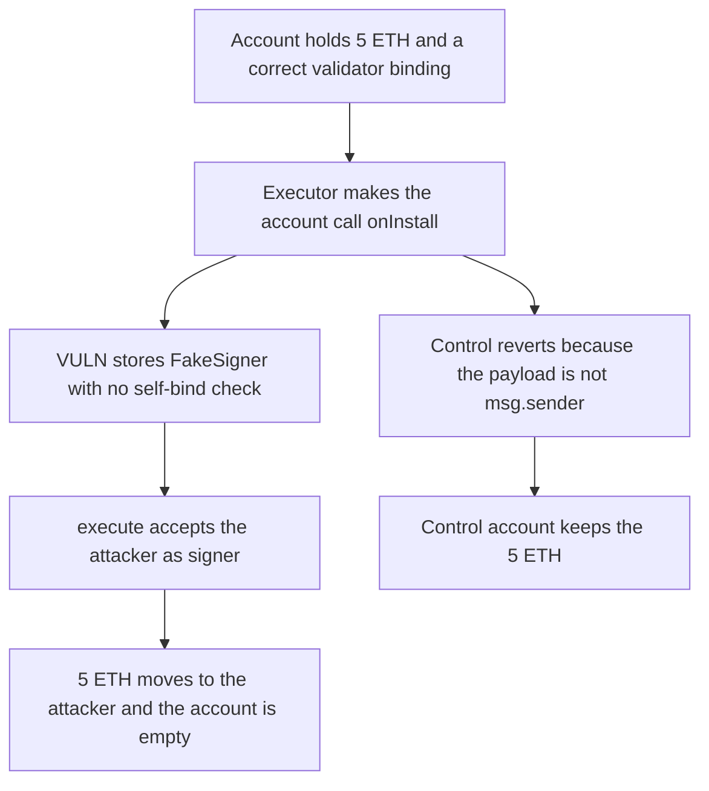

# Molecule: a permissive executor rebinds RootValidator and drains the account

> **Vulnerability classes:** vuln/access-control/missing-auth · vuln/logic/missing-check

<!-- non-defihacklabs -->
<!-- source-auditvault: https://github.com/Auditware/AuditVault/blob/main/findings/65952-rootvalidatoroninstall-permissionless-and-lacks-self-binding.md -->
<!-- date: 2026-05 -->

## Key info

| Field | Value |
|---|---|
| **Loss** | 5 ETH moved out of the OnChainLab after its validator binding is overwritten |
| **Vulnerable contract** | `RootValidator.onInstall` |
| **Attacker EOA** | `0x1111111111111111111111111111111111111111` |
| **Attack contract** | `Exploit` |
| **Attack tx** | `Exploit.run()` |
| **Chain / block / date** | Ethereum model · block 0 · 2026-05 |
| **Compiler** | solc 0.8.27, cancun, via IR |
| **Bug class** | Permissionless install writes a caller-supplied validator binding |

## TL;DR

`RootValidator.onInstall` is the only writer of `ecdsaValidatorStorage[msg.sender].onchainlab`. It trusts the first 20 bytes of calldata and it does not refuse a second write. An installed executor that can make the account call an arbitrary target asks the account to call `onInstall` with the attacker's `FakeSigner`. `execute` then accepts the attacker as the signer and transfers the account's 5 ETH. The fixed install requires the bound address to be `msg.sender` and reverts once the binding is already set, so the same call leaves the 5 ETH in place.

## Background

Cyfrin's May 2026 Molecule Onchainlab review, reported by Kage. The root validator is documented as permanent. The install path is the binding that `validateUserOp` later reads. Molecule fixed it in commit `33db38b`.

## The vulnerable code

```solidity
function onInstall(bytes calldata _data) external payable {
    address payable onchainlab = payable(address(bytes20(_data[0:20])));
    // @> VULN: stores the caller-supplied address with no self-binding and no already-initialized guard
    ecdsaValidatorStorage[msg.sender].onchainlab = onchainlab;
    emit RootValidatorRegistered(onchainlab);
}
```

The recommended guard, from the report, rejects a short payload, requires `onchainlab == msg.sender`, and reverts with `AlreadyInitialized` on a second write.

## Root cause

The storage key is `msg.sender`, and the value is untrusted calldata. Any call the account itself makes into `onInstall` overwrites the account's binding. A permissive executor turns that into a third-party action. After the write, signature checks recover the signer of the attacker's contract.

## Preconditions

- The account already bound itself to its own address and holds 5 ETH.
- An executor that anyone can invoke is installed on the account.
- The attacker deploys a contract whose `signer()` returns the attacker.

## Attack walkthrough

1. A direct `execute` of 5 ETH reverts. The binding still points at the account, whose signer is the original owner.
2. The executor makes the account call `onInstall(abi.encodePacked(FakeSigner))`.
3. The binding becomes the fake signer. `FakeSigner.signer()` is the attacker.
4. `execute` now transfers the 5 ETH to the attacker. The account balance is 0.
5. The control uses the self-bind and already-initialized checks. The hijack reverts and the account still holds 5 ETH.

## Diagrams



## Impact

The attacker receives 5 ETH that the account held. The original owner can no longer pass the signature check. The binding survives because nothing in this path clears `ecdsaValidatorStorage`. The control leaves the full 5 ETH on the account.

## Remediation

Require `_data.length >= 20`, require the decoded address to equal `msg.sender`, and revert if `ecdsaValidatorStorage[msg.sender].onchainlab` is already set.

## How to reproduce

```bash
cd 65952-rootvalidatoroninstall-permissionless-and-lacks-self-binding_exp
forge test -vv
```

`test_exploit_rebinds_root_validator_and_drains_account` asserts a 5 ETH attacker balance and an empty account. `test_control_self_bind_and_initialized_guard_keep_the_balance` asserts the rebind reverts and the account still holds 5 ETH. Captured output is `output.txt`.

## Sources

- AuditVault finding: https://github.com/Auditware/AuditVault/blob/main/findings/65952-rootvalidatoroninstall-permissionless-and-lacks-self-binding.md
- Cyfrin report: https://github.com/solodit/solodit_content/blob/main/reports/Cyfrin/2026-05-12-cyfrin-molecule-onchainlab-v2.0.md
- Fix: https://github.com/moleculeprotocol/onchainlabs/commit/33db38b
