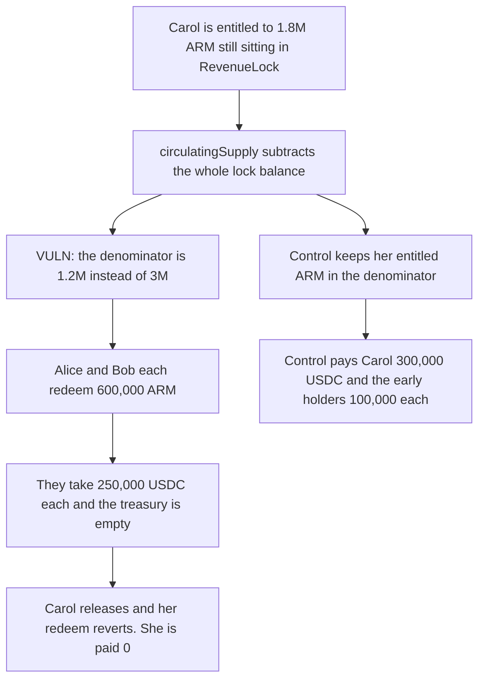

# Early Armada redeemers take Carol's 300,000 USDC because her unclaimed ARM is dropped from the denominator

> **Vulnerability classes:** vuln/logic/wrong-condition · vuln/logic/reward-calculation

<!-- non-defihacklabs -->
<!-- source-auditvault: https://github.com/Auditware/AuditVault/blob/main/findings/65988-armadaredemptioncirculatingsupply-excludes-entitled-but-uncl.md -->
<!-- date: 2026-05 -->

## Key info

| Field | Value |
|---|---|
| **Loss** | Carol is paid 0 instead of 300,000 USDC. Alice and Bob each receive 250,000 USDC |
| **Vulnerable contract** | `ArmadaRedemption.circulatingSupply` |
| **Attacker EOA** | `0x0000000000000000000000000000000000065988` (early redeemers) |
| **Attack contract** | `Exploit` |
| **Attack tx** | `Exploit.run()` |
| **Chain / block / date** | Ethereum model · block 0 · 2026-05 |
| **Compiler** | solc 0.8.27, cancun, via IR |
| **Bug class** | Redemption denominator excludes entitled-but-unclaimed ARM |

## TL;DR

`circulatingSupply` subtracts the entire `RevenueLock` balance, including ARM that is already entitled to Carol and only waiting on `release`. The denominator is 1.2M instead of 3M. Alice and Bob redeem 600,000 ARM each and take 250,000 USDC each, emptying a 500,000 USDC treasury. Carol then releases 1.8M ARM and her redeem reverts. Counting her entitled ARM in the denominator pays her 300,000 USDC and limits Alice and Bob to 100,000 each.

## Background

Cyfrin's May 2026 Armada crowdfund and governance review. After wind-down, holders redeem ARM against treasury assets. The spec says crowdfund participants and revenue-lock beneficiaries can still claim and then redeem. The on-chain denominator treats their still-unclaimed ARM as if it were not in circulation.

## The vulnerable code

```solidity
function circulatingSupply() public returns (uint256 supply) {
    // @> VULN: the full RevenueLock balance is subtracted, including ARM already entitled to a user who has not released
    supply = arm.totalSupply() - arm.balanceOf(treasury) - arm.balanceOf(revenueLock) - arm.balanceOf(crowdfund)
        - arm.balanceOf(address(this));
    lastSupply = supply;
}
```

Carol's 1.8M ARM sits in `RevenueLock` because her milestone was met and she has not called `release`. Subtracting that balance shrinks the denominator from 3M eligible ARM to 1.2M.

## Root cause

Entitled ARM is already owed to a named user. Treating the lock contract's whole balance as non-circulating lets whoever redeems first consume the treasury against too small a base.

## Preconditions

- Wind-down has opened redemption. This run does not warp time. The delay has already elapsed.
- Treasury assets are 500,000 USDC.
- Alice and Bob each hold 600,000 ARM. Carol is entitled to 1.8M ARM that is still in the lock.
- `release` and `redeem` are both callable. No admin key is required to redeem.

## Attack walkthrough

1. `circulatingSupply` returns 1.2M because Carol's 1.8M is subtracted.
2. Alice redeems 600,000 ARM and is paid 250,000 USDC. Her fair share was 100,000.
3. Bob redeems 600,000 ARM and is paid the other 250,000 USDC.
4. The treasury balance is 0.
5. `RevenueLock` releases Carol's 1.8M ARM. Her redeem reverts with no assets available.
6. The control leaves her entitled ARM in the denominator. Alice and Bob get 100,000 USDC each and Carol gets 300,000.

## Diagrams



## Impact

Carol loses her entire 300,000 USDC treasury share, 60 percent of the 500,000 USDC pool. Alice and Bob each receive 150,000 USDC more than the pro-rata amount. The control pays the three shares as 100,000, 100,000, and 300,000 and leaves the redemption contract empty.

## Remediation

Do not subtract ARM that is already entitled to a beneficiary. Subtract only the unentitled residue of `RevenueLock` and `ArmadaCrowdfund`, or count a pending release and claim as circulating until the user redeems.

## How to reproduce

```bash
cd 65988-armadaredemptioncirculatingsupply-excludes-entitled-but-uncl_exp
forge test -vv
```

`test_exploit_early_redeemers_take_carols_share` asserts Alice and Bob receive 250,000 USDC each and Carol receives 0. `test_control_entitled_arm_stays_in_the_denominator` asserts the fair 100,000 / 100,000 / 300,000 split. Captured output is `output.txt`.

## Sources

- AuditVault finding: https://github.com/Auditware/AuditVault/blob/main/findings/65988-armadaredemptioncirculatingsupply-excludes-entitled-but-uncl.md
- Cyfrin report: https://github.com/solodit/solodit_content/blob/main/reports/Cyfrin/2026-05-13-cyfrin-armada-crowdfund-governance-v2.0.md
