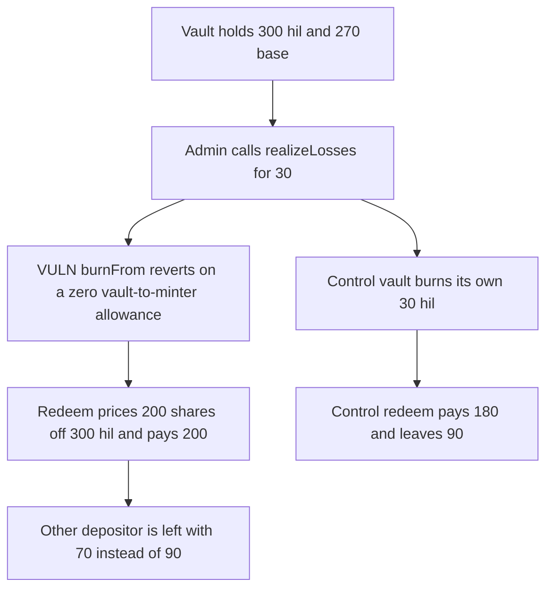

# Syntetika: realizeLosses reverts, so a redeemer is paid 200 of a 270 custody

> **Vulnerability classes:** vuln/logic/missing-allowance · vuln/logic/price-calculation

<!-- non-defihacklabs -->
<!-- source-auditvault: https://github.com/Auditware/AuditVault/blob/main/findings/66047-minterrealizelosses-is-dead-by-default-reverts-on-missing-va.md -->
<!-- date: 2026-05 -->

## Key info

| Field | Value |
|---|---|
| **Loss** | Redeemer with 200 of 300 shares is paid 200 base. Fair share of the 270 custody is 180. The other depositor is left with 70 instead of 90 |
| **Vulnerable contract** | `Minter.realizeLosses` |
| **Attacker EOA** | `0x1111111111111111111111111111111111111111` |
| **Attack contract** | `Exploit` |
| **Attack tx** | `Exploit.run()` |
| **Chain / block / date** | Ethereum model · block 0 · 2026-05 |
| **Compiler** | solc 0.8.27, cancun, via IR |
| **Bug class** | `burnFrom(vault)` spends an allowance the vault never granted |

## TL;DR

`realizeLosses` calls `hil.burnFrom(vault, losses)`. `burnFrom` skips allowance only when the spender is the holder or the token owner. The spender is the Minter, the holder is the vault, and the owner is the admin, so the allowance check runs against 0 and reverts. The vault keeps 300 hil against 270 base. A 200-share redeem prices off the unburned hil balance and pays 200. The other depositor's 100 shares are left with 70 base. When the vault burns its own tokens, the same redeem pays 180 and leaves 90.

## Background

Cyfrin's May 2026 Syntetika CCIP CCT review, reported by Immeas. This is not the acknowledged front-run of `realizeLosses`. No deploy script and no `StakingVault.initialize` approves the Minter. Syntetika fixed it in commit `9cdb8d7` by skipping allowance when the spender is the minter.

## The vulnerable code

```solidity
function realizeLosses(uint256 lossesAmount) external {
    require(msg.sender == admin, "admin");
    // @> VULN: burnFrom(vault) spends a vault-to-minter allowance the vault never granted
    hil.burnFrom(address(vault), lossesAmount);
}
```

`Hil.burnFrom` then executes `require(allowance[from][msg.sender] >= amount, "ERC20InsufficientAllowance")`.

## Root cause

The loss path assumes the Minter can burn the vault's hil balance. The token only grants that privilege to the holder and to `owner()`. Those are the vault and the admin. The allowance stays at the default of 0, so the share price cannot fall when custody falls.

## Preconditions

- The vault holds 300 hil and 270 base. The 30 base gap is the loss `realizeLosses` should burn.
- The redeemer has 200 shares and another depositor has 100. Total shares are 300.
- `hil.allowance(vault, minter)` is 0.

## Attack walkthrough

1. The admin calls `realizeLosses(30)`. The admin check passes.
2. `burnFrom` reverts `ERC20InsufficientAllowance`. The hil balance stays 300.
3. The redeemer burns 200 shares. Price is `300 / 300`, so the payout is 200 base.
4. Fair value of those shares against the 270 custody is 180. The excess is 20.
5. The vault has 70 base left for the other depositor's 100 shares. Their fair remainder was 90.
6. The control makes the vault the `burnFrom` caller, so `spender == from` and the allowance check is skipped. 30 hil is burned. The same redeem pays 180 and leaves 90.

## Diagrams



## Impact

The first redeemer receives 20 base that belongs to the other depositor. The other depositor's 100 shares can only be paid from the remaining 70. The loss-realization function itself cannot succeed until something grants the missing allowance. The control pays the fair 180.

## Remediation

Skip the allowance check when `spender` is the minter, or have the vault burn its own balance through an `onlyMinter` function. Both are in the report. The shipped fix skips allowance for the minter.

## How to reproduce

```bash
cd 66047-minterrealizelosses-is-dead-by-default-reverts-on-missing-va_exp
forge test -vv
```

`test_exploit_missing_allowance_overpays_the_redeemer_by_20` asserts the revert, a 200 payout, and 70 left. `test_control_vault_burns_its_own_balance_and_redeem_pays_180` asserts a 180 payout and 90 left. Captured output is `output.txt`.

## Sources

- AuditVault finding: https://github.com/Auditware/AuditVault/blob/main/findings/66047-minterrealizelosses-is-dead-by-default-reverts-on-missing-va.md
- Cyfrin report: https://github.com/solodit/solodit_content/blob/main/reports/Cyfrin/2026-05-02-cyfrin-syntetika-ccip-cct-v2.0.md
- Fix: https://github.com/SyntetikaLabs/monorepo/commit/9cdb8d745a8b3279a188639a0ee7958b63b68f44
