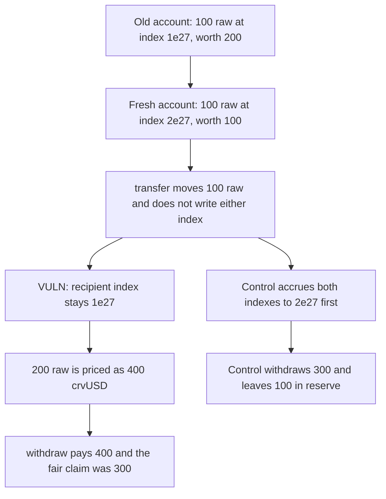

# RAAC: moving raw RToken onto an older index withdraws 100 crvUSD of unearned interest

> **Vulnerability classes:** `vuln/logic/reward-calculation` · `vuln/logic/state-update`

<!-- non-defihacklabs -->
<!-- source-auditvault: https://github.com/Auditware/AuditVault/blob/main/findings/66155-c-01-users-can-steal-lending-interest-pashov-audit-group-non.md -->
<!-- date: 2025-05 -->

## Key info

| Field | Value |
|---|---|
| **Loss** | 100 crvUSD of interest that was not accrued on the transferred principal. The attacker withdraws 400 instead of the fair 300 |
| **Vulnerable contract** | `RToken._update` |
| **Attacker EOA** | `0x000000000000000000000000000000000001026b` |
| **Attack contract** | `Exploit` |
| **Attack tx** | `Exploit.run()` |
| **Chain / block / date** | Ethereum model · block 0 · 2025-05 |
| **Compiler** | solc 0.8.27, cancun, via IR |
| **Bug class** | Transfer moves raw balance and leaves both liquidity indexes stale |

## TL;DR

`balanceOf` prices an account as raw principal plus `raw * (liquidityIndex - user.index) / RAY`. `transfer` moves the raw units and never writes either index. 100 raw units opened at the current index are moved onto an account whose index is one ray older. Those units are then priced as if they had been deposited at the old index. The attacker withdraws 400 crvUSD. The fair claim of both accounts was 300. The control accrues both indexes before the move and pays 300.

## Background

Pashov Audit Group's 6 May 2025 review of Regnum Aurum, finding C-01. Lenders of crvUSD receive RToken. The report says a transfer from a higher `_userState[account].index` to a lower one earns more interest than the position accrued, because pending interest is not processed and the index is not updated.

## The vulnerable code

```solidity
if (from != address(0)) {
    ILendingPool(_lendingPool).updateUserReward(from);
}
if (to != address(0) && to != from) {
    ILendingPool(_lendingPool).updateUserReward(to);
}
// @> VULN: raw RToken moves without accruing interest or writing either account's index
super._update(from, to, amount);
```

`updateUserReward` does not change `_userState[account].index`. The raw balance that arrives is still priced with the recipient's old index:

```solidity
uint256 userIndex = liquidityIndex - _userState[account].index;
if (userIndex == 0) return rawBalance;
return rawBalance + rawBalance.rayMul(userIndex);
```

## Root cause

Interest is a function of the recipient's stored index, and the transfer path never sets that index to the current liquidity index or mints the interest already owed into raw balance. Fresh principal inherits the recipient's entire historical gap.

## Preconditions

- Liquidity index is 2e27.
- The attacker holds 100 raw RToken recorded at index 1e27. That position is worth 200 crvUSD.
- A second account holds 100 raw RToken recorded at index 2e27. That position is worth 100 crvUSD.
- The RToken contract holds 400 crvUSD, which is the 200 of deposits plus a 200 interest reserve.

## Attack walkthrough

1. Before the transfer the two claims sum to 300 crvUSD.
2. 100 raw units move from the fresh account to the old account. The reward hook runs and the indexes stay put.
3. The old account now has 200 raw units and index 1e27, so `balanceOf` returns 400.
4. `withdraw` pays that 400 crvUSD out of the pool.
5. The excess over the fair 300 is 100 crvUSD.
6. The control accrues both accounts up to index 2e27 before the transfer, so the same move withdraws 300 and leaves 100 in reserve.

## Diagrams



## Impact

The attacker receives 400 crvUSD. The two positions were only owed 300. The extra 100 crvUSD is interest the transferred principal never accrued, taken from the pool reserve. Other lenders' interest reserve is smaller by that 100. The control pays the fair 300.

## Remediation

On transfer, accrue both accounts: mint the pending interest into raw balance and set both indexes to the current liquidity index before moving raw units. That is the fix the report recommends.

## How to reproduce

```bash
cd 66155-c-01-users-can-steal-lending-interest-pashov-audit-group-non_exp
forge test -vv
```

`test_exploit_transfer_steals_100_crvusd_interest` asserts a fair claim of 300, an inflated claim of 400, and an attacker balance of 400. `test_control_accrue_on_transfer_pays_300` asserts the accrued transfer pays 300 and leaves 100 in the token contract. Captured output is `output.txt`.

## Sources

- AuditVault finding: https://github.com/Auditware/AuditVault/blob/main/findings/66155-c-01-users-can-steal-lending-interest-pashov-audit-group-non.md
- Pashov review: https://github.com/pashov/audits/blob/master/team/md/RegnumAurum-security-review_2025-05-06.md
