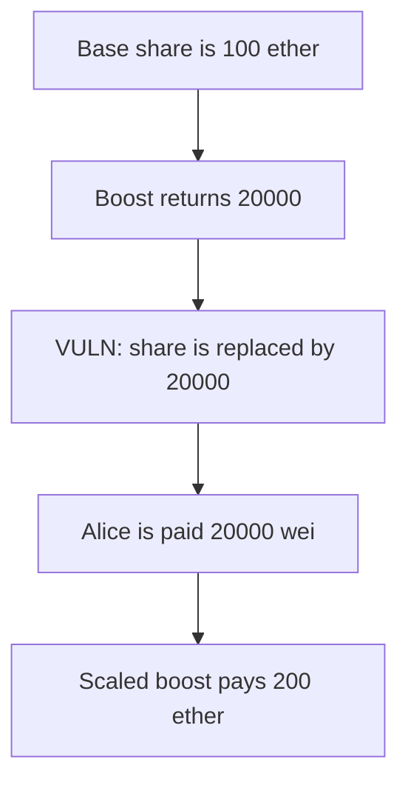

# BaseGauge — the boost basis points replace the reward share

> **Vulnerability classes:** `vuln/logic/reward-calculation` · `vuln/arithmetic/precision-loss`

<!-- non-defihacklabs -->
<!-- source-auditvault: https://github.com/Auditware/AuditVault/blob/main/findings/66157-c-03-incorrect-boost-application-leads-to-inflated-rewards-i.md -->
<!-- date: 2025-05 -->

## Key info

| | |
|---|---|
| **Protocol** | Regnum Aurum BaseGauge |
| **Finding** | Pashov Audit Group C-03, AuditVault 66157 |
| **Vulnerable code** | `_calculatePendingRewards` assigns `boost` to `userShare` |
| **Harm** | Alice is paid 20000 wei. The control pays 200 ether. |
| **Chain** | local synthetic |

## TL;DR

Alice's base reward share is 100 ether and her boost is 20000, which means 2x in basis points. `_calculatePendingRewards` replaces the share with that 20000 instead of computing `userShare * boost / WEIGHT_PRECISION`. She claims 20000 wei. The gauge keeps the rest of the 200 ether it was funded with. The control multiplies and pays 200 ether.

## The vulnerable code

```solidity
uint256 boost = _applyBoost(user, userShare);
userShare = boost > 0 ? boost : userShare;
```

`_updateUserReward` in the report scales with `WEIGHT_PRECISION`. The fix is `userShare * boost / WEIGHT_PRECISION`.

## Root cause

`_applyBoost` returns a basis-point multiplier. The pending-reward function treats that return value as the token amount.

## Preconditions

Alice's stake is the whole gauge, 1000 ether. Accrued rewards make her base share 100 ether. The boost function returns 20000. The gauge holds 200 ether of reward tokens, which is the 2x amount.

## Attack walkthrough

1. The preview computes `1000 ether * 100 ether / 1000 ether`, which is 100 ether.
2. `_applyBoost` returns 20000.
3. The assignment stores 20000 as `userShare`.
4. `getReward` transfers 20000 wei to Alice.
5. The control computes `100 ether * 20000 / 10000` and pays the staker 200 ether.

## Diagrams



## Impact

Alice receives 20000 wei instead of 200 ether. The unpaid rewards stay in the gauge. A gauge that divides by `WEIGHT_PRECISION` pays the staker 200 ether.

## Remediation

Set `userShare` to `userShare * boost / WEIGHT_PRECISION` when the boost is non-zero.

## How to reproduce

```bash
cd 66157-c-03-incorrect-boost-application-leads-to-inflated-rewards-i_exp
forge test -vv
```

## Sources

- AuditVault finding: https://github.com/Auditware/AuditVault/blob/main/findings/66157-c-03-incorrect-boost-application-leads-to-inflated-rewards-i.md
- Pashov report: https://github.com/pashov/audits/blob/master/team/md/RegnumAurum-security-review_2025-05-06.md
