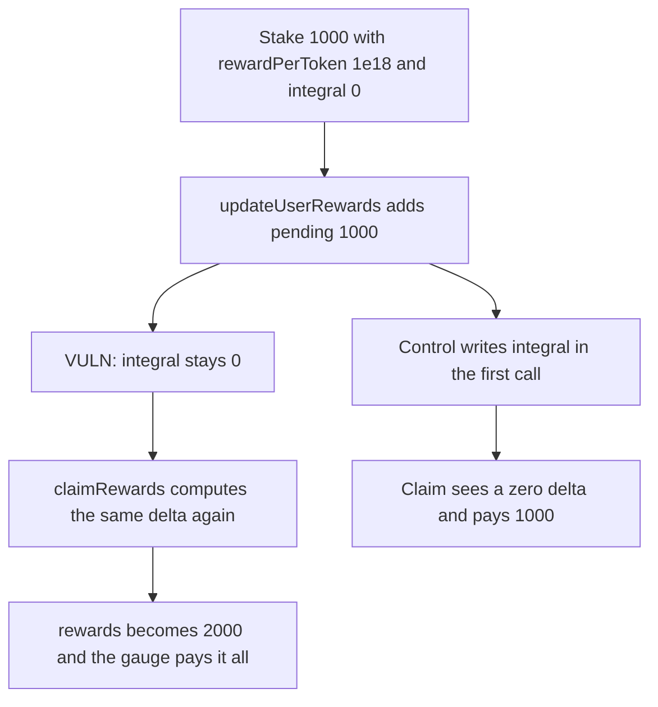

# BaseGauge pays the same reward accrual twice because integral is never advanced

> **Vulnerability classes:** vuln/logic/reward-calculation · vuln/logic/state-update

<!-- non-defihacklabs -->
<!-- source-auditvault: https://github.com/Auditware/AuditVault/blob/main/findings/66158-c-04-failure-to-update-user-integral-enables-double-reward-a.md -->
<!-- date: 2025-05 -->

## Key info

| Field | Value |
|---|---|
| **Loss** | 2000 reward tokens paid for one 1000 accrual. The gauge is emptied |
| **Vulnerable contract** | `BaseGauge.updateUserRewards` |
| **Attacker EOA** | `0x1111111111111111111111111111111111111111` |
| **Attack contract** | `Exploit` |
| **Attack tx** | `Exploit.run()` |
| **Chain / block / date** | Ethereum model · block 0 · 2025-05 |
| **Compiler** | solc 0.8.27, cancun, via IR |
| **Bug class** | Reward credit without advancing `userData.integral` |

## TL;DR

`updateUserRewards` adds the full pending amount to `rewards[token][user]` and updates `lastUpdate` and `userRewardPerTokenPaid`. It never writes `userData.integral`. `claimRewards` then calls `_updateUserReward`, which treats `rewardPerToken - integral` as still unpaid and credits the same 1000 again. A 1000 stake with `rewardPerTokenStored` of 1e18 receives 2000. The control writes `integral` in the first call and the claim pays 1000.

## Background

Pashov Audit Group's May 2025 Regnum Aurum review, finding C-04. `BaseGauge.updateUserRewards` is a public helper that checkpoints a user's pending rewards. The real checkpoint used by `claimRewards` is `userData.integral` inside `_updateUserReward`. The helper updates a different pair of fields.

## The vulnerable code

```solidity
uint256 pending = _calculatePendingRewards(token, msg.sender);
if (pending > 0) {
    // @> VULN: credits the full pending amount and never writes userData.integral, so the same gap is paid again on claim
    rewards[token][msg.sender] += pending;
    userRewardData[token][msg.sender].lastUpdate = block.timestamp;
    userRewardPerTokenPaid[token][msg.sender] = rd.rewardPerTokenStored;
}
```

`_updateUserReward` later does `userIntegralDelta = rewardPerToken - userData.integral` and, if that delta is nonzero, adds `workingBalance * userIntegralDelta / 1e18` to the same `rewards` mapping.

## Root cause

Two checkpoints exist. The helper writes `userRewardPerTokenPaid`. The claim path reads `integral`. Leaving `integral` at 0 means the historical gap is still open when the user claims.

## Preconditions

- The caller has a nonzero gauge balance. This run stakes 1000 tokens.
- `rewardPerTokenStored` is ahead of `integral`. Here the stored index is 1e18 and `integral` is 0, so the fair pending amount is 1000.
- The gauge holds at least 2000 reward tokens.

## Attack walkthrough

1. The staker calls `updateUserRewards`. Pending is 1000. That amount is added to `rewards`.
2. `integral` stays 0.
3. `claimRewards` runs `_updateUserReward` on the same index. It adds another 1000 and only then sets `integral`.
4. The gauge transfers 2000 and its reward balance is 0.
5. The control sets `integral` inside `updateUserRewards`. The claim sees a zero delta and pays 1000, leaving 1000 in the gauge.

## Diagrams



## Impact

The staker receives 2000 reward tokens for a single 1000 accrual and the gauge balance goes to 0. Repeating the pair of calls, as the report describes, drains whatever inventory the gauge still holds. The control pays the fair 1000 and leaves the other 1000 in the gauge.

## Remediation

After crediting `pending`, set `userRewardData[token][msg.sender].integral` to the same `rewardPerTokenStored` value the helper already copies into `userRewardPerTokenPaid`.

## How to reproduce

```bash
cd 66158-c-04-failure-to-update-user-integral-enables-double-reward-a_exp
forge test
```

`test_exploit_updateUserRewards_pays_the_same_rewards_twice` asserts a 2000 payout and an empty gauge. `test_control_integral_update_pays_once` asserts a 1000 payout. Captured output is `output.txt`.

## Sources

- AuditVault finding: https://github.com/Auditware/AuditVault/blob/main/findings/66158-c-04-failure-to-update-user-integral-enables-double-reward-a.md
- Report: https://github.com/pashov/audits/blob/master/team/md/RegnumAurum-security-review_2025-05-06.md
