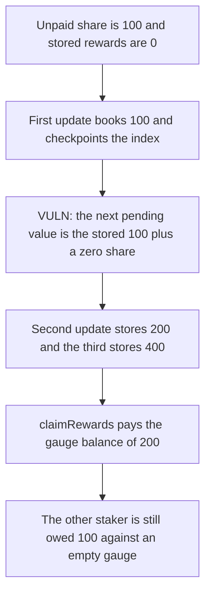

# Regnum Aurum: updateUserRewards adds stored rewards on top of themselves and one staker takes the whole pool

> **Vulnerability classes:** `vuln/logic/reward-calculation` · `vuln/logic/state-update`

<!-- non-defihacklabs -->
<!-- source-auditvault: https://github.com/Auditware/AuditVault/blob/main/findings/66159-c-05-double-counting-stored-rewards-causes-reward-inflation.md -->
<!-- date: 2025-05 -->

## Key info

| Field | Value |
|---|---|
| **Loss** | 200 reward tokens claimed from a 100 accrual. The other staker's 100 is booked against an empty gauge |
| **Vulnerable contract** | `BaseGauge._calculatePendingRewards` |
| **Attacker EOA** | `0x1111111111111111111111111111111111111111` |
| **Attack contract** | `Exploit` |
| **Attack tx** | `Exploit.run()` |
| **Chain / block / date** | Ethereum model · block 0 · 2025-05 |
| **Compiler** | solc 0.8.27, cancun, via IR |
| **Bug class** | Pending rewards include the stored balance, and the caller adds that sum onto the stored balance again |

## TL;DR

`_calculatePendingRewards` returns `storedRewards + userShare`. `updateUserRewards` then does `rewards += pending`. The first call, with nothing stored, books the fair 100. The index is checkpointed, so the next share is 0, but the helper still returns the stored 100. The second call makes rewards 200. The third makes them 400. `claimRewards` pays the gauge's entire 200 balance. The other staker is still booked for 100 and the contract is empty. Returning only the new share pays 100 and leaves 100.

## Background

Pashov Audit Group's Regnum Aurum review dated 2025-05-06, finding C-05. The report walks the same helper: a stored balance of 100 is returned again and added, then 200 is returned and added, doubling on every call. The published test drains the notified reward after three `updateUserRewards` calls.

## The vulnerable code

```solidity
function _calculatePendingRewards(address token, address user) internal view returns (uint256) {
    uint256 storedRewards = rewards[token][user];
    uint256 userShare = _pendingShare(token, user);
    // @> VULN: pending already contains storedRewards, and the caller adds it onto rewards again
    return storedRewards + userShare;
}
```

The caller is:

```solidity
uint256 pending = _calculatePendingRewards(token, msg.sender);
if (pending > 0) {
    rewards[token][msg.sender] += pending;
    userRewardPerTokenPaid[token][msg.sender] = rewardPerTokenStored[token];
}
```

## Root cause

The helper's return value is a total, not a delta. Adding a total onto the same storage word counts the old balance twice. After the paid index catches up, `userShare` is 0 and each later call still adds the whole stored balance.

## Preconditions

- The caller has a 100 stake and an unpaid index gap of 1e18, so the new share is 100. Stored rewards start at 0.
- Another account already has 100 stored and is checkpointed, so they accrue nothing new.
- The gauge holds 200 reward tokens, 100 for each account.

## Attack walkthrough

1. The first `updateUserRewards` reads stored rewards of 0 and returns 100. Rewards become 100 and the index is checkpointed.
2. The second call returns 100 plus a zero share. Rewards become 200.
3. The third call returns 200. Rewards become 400. No time passes between the calls.
4. `claimRewards` caps the payout at the 200 token balance and transfers all of it.
5. The other account is still booked for 100. The gauge balance is 0.
6. The control adds only `_pendingShare`. Three updates still book 100. The claim pays 100 and leaves 100.

## Diagrams


