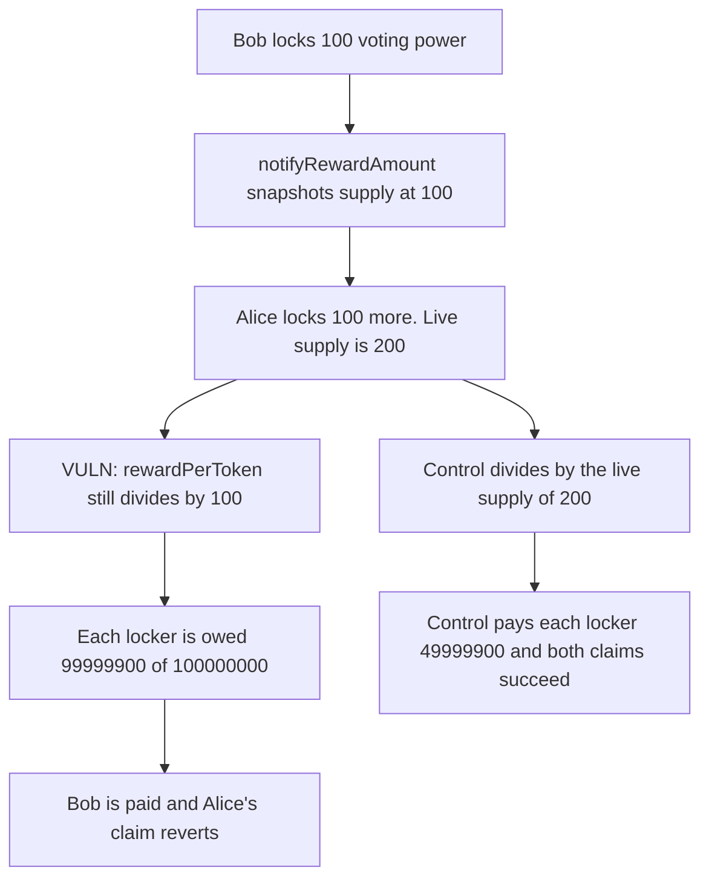

# veRAAC: reward index divides by a stale voting-power snapshot

> **Vulnerability classes:** `vuln/logic/reward-calculation`

<!-- non-defihacklabs -->
<!-- source-auditvault: https://github.com/Auditware/AuditVault/blob/main/findings/66160-c-06-stale-total-voting-power-snapshot-leads-to-incorrect-re.md -->
<!-- date: 2025-05 -->

## Key info

| Field | Value |
|---|---|
| **Loss** | Bob withdraws 99999900 of 100000000 notified units. Alice's claim reverts |
| **Vulnerable contract** | `VeRAACToken.rewardPerToken` |
| **Attacker EOA** | `0x1111111111111111111111111111111111111111` |
| **Attack contract** | `Exploit` |
| **Attack tx** | `setupPositions()` then, after 7 days, `run()` |
| **Chain / block / date** | Ethereum model · block 0 · 2025-05 |
| **Compiler** | solc 0.8.27, cancun, via IR |
| **Bug class** | Reward denominator frozen at notify time |

## TL;DR

`rewardPerToken` divides by `totalVotingPowerAtNotify`, the supply saved when rewards are notified. Alice locks the same amount after that snapshot. After the 7-day period each of them is owed 99999900 units of a 100000000 unit reward. Bob's claim takes 99999900. Alice's claim reverts because 100 units are left.

## Background

Pashov Audit Group's 6 May 2025 Regnum Aurum review, finding C-06, on `veRAACToken`. The report's test locks 100 for Bob, notifies 100 USDT, locks 100 for Alice, warps 7 days, and logs about 99 USDT earned by each. This reduction uses 100000000 raw units, 6-decimal USDT sizing, and a 7-day reward duration. Integer division leaves Bob 99999900 and the contract 100, so the second claim cannot pay. AuditVault also filed this report as finding 66339. The two playgrounds are separate runs of the same bug.

## The vulnerable code

```solidity
uint256 totalVeSupply = rData.totalVotingPowerAtNotify;
uint256 rewardPerTokenDelta = (rewardDelta * PRECISION) / totalVeSupply; // @> VULN
```

`notifyRewardAmount` sets `totalVotingPowerAtNotify = totalVotingPower` and never updates it when someone locks later.

```diff
- uint256 totalVeSupply = rData.totalVotingPowerAtNotify;
+ uint256 totalVeSupply = totalVotingPower;
  uint256 rewardPerTokenDelta = (rewardDelta * PRECISION) / totalVeSupply;
```

## Root cause

The index denominator is a snapshot from notification time. Locks that happen after `notifyRewardAmount` increase the live supply and not the snapshot, so each earlier and later locker is paid as if the supply had not grown.

## Preconditions

- Bob has locked before the notification, so the snapshot is his voting power alone.
- Alice locks the same size after the notification and before the period ends.
- Seven days pass. The playground warps between `setupPositions` and `run`. The forge test uses `vm.warp`.

## Attack walkthrough

1. Bob locks 100 tokens for a year. Total voting power is 100.
2. `notifyRewardAmount` pulls in 100000000 units and stores that supply as the snapshot.
3. Alice locks 100. Live supply is 200. The snapshot stays 100.
4. After 7 days, `rewardPerToken` divides the full reward by 100. Each locker is owed 99999900.
5. Bob claims 99999900. Alice's transfer of 99999900 reverts. Her balance stays 0.

## Diagrams



## Impact

A 100000000 unit reward is accounted as almost 200000000 of claims. Bob, who locked half the final supply, withdraws 99999900 instead of about half. Alice accrued the same inflated amount and cannot withdraw it. The contract retains 100 units of dust. The control, which divides by the current total, pays 49999900 to each and both transfers succeed.

## Remediation

Divide by the current `totalVotingPower` inside `rewardPerToken`, or refresh `totalVotingPowerAtNotify` on every lock that happens during a live reward period. The fixed contract in the forge control uses the live supply.

## How to reproduce

```bash
cd 66160-c-06-stale-total-voting-power-snapshot-leads-to-incorrect-re_exp
forge test -vv
```

`test_exploit_stale_snapshot_overpays_bob_and_bricks_alice` warps 7 days and asserts Bob received 99999900, the sum of earned amounts exceeds the notified balance, and Alice's claim reverted. `test_control_current_supply_pays_both` asserts each locker earns 49999900 and both claims pay. Captured output is `output.txt`.

## Sources

- AuditVault finding: https://github.com/Auditware/AuditVault/blob/main/findings/66160-c-06-stale-total-voting-power-snapshot-leads-to-incorrect-re.md
- Pashov report: https://github.com/pashov/audits/blob/master/team/md/RegnumAurum-security-review_2025-05-06.md
- Test setup gist cited by the report: https://gist.github.com/0xbtk/0c1f5e75815d2cf02d3437cbded026ff
