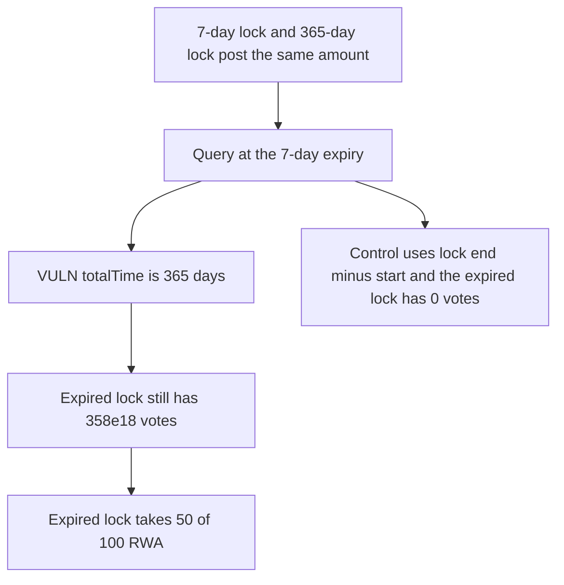

# Regnum Aurum: an expired 7-day lock keeps a year of voting power

> **Vulnerability classes:** `vuln/logic/reward-calculation` · `vuln/logic/incorrect-state-transition`

<!-- non-defihacklabs -->
<!-- source-auditvault: https://github.com/Auditware/AuditVault/blob/main/findings/66162-c-08-incorrect-lock-duration-causes-extended-voting-power-re.md -->
<!-- date: 2025-05 -->

## Key info

| Field | Value |
|---|---|
| **Loss** | The expired minimum lock takes 50 of 100 RWA. Its correct voting power is 0 |
| **Vulnerable contract** | `PowerCheckpoint.getVotingPowerAtBlock` |
| **Attacker EOA** | `0x1111111111111111111111111111111111111111` |
| **Attack contract** | `Exploit` |
| **Attack tx** | `Exploit.run()` |
| **Chain / block / date** | Ethereum model · block 0 · 2025-05 |
| **Compiler** | solc 0.8.27, cancun, via IR |

## TL;DR

`getVotingPowerAtBlock` passes `maxLockDuration` into `calculateExpectedBalanceAfterDecay` as the lock's total time. The report says that argument must be `lock.end - lock.start`. A 7-day lock queried at expiry therefore decays over 365 days, not 7. With both lockers posting 365e18, the expired lock and the year lock each have 358e18 votes, and each receives 50 of a 100 RWA reward. The fixed call returns 0 for the expired lock.

## The vulnerable code

```solidity
uint256 timeElapsed = blockTime - position.start;
uint256 totalTime = MAX_LOCK;
return calculateExpectedBalanceAfterDecay(position.amount, totalTime, timeElapsed, MAX_LOCK); // @> VULN: totalTime is maxLockDuration, not position.end - position.start
```

`MAX_LOCK` is 365 days and `MIN_LOCK` is 7 days, the durations named in the report. Decay is `amount * remaining / maxLock`, and it returns 0 once `timeElapsed >= totalTime`. The fixed function sets `totalTime = position.end - position.start`.

## Root cause

The decay function's second argument is the position's own duration. The call site passes the global maximum instead, so a short lock does not reach zero when its own `end` is reached. `getPastTotalSupply` in the report has the same mistake. This reduction shows it on `getVotingPowerAtBlock`, which is what the reward split reads.

## Preconditions

- One position is locked for 7 days and one for 365 days, for the same amount, from the same start.
- The query time is the short lock's `end`. The function takes that timestamp as an argument, the same way a checkpoint view takes a block time. No clock warp is required.

## Attack walkthrough

1. The attacker locks 365e18 for 7 days. The honest locker locks 365e18 for 365 days.
2. 100 RWA is funded.
3. Both powers are read at t = 7 days.
4. The buggy total time is 365 days, so both powers are 358e18.
5. The fixed total time for the attacker is 7 days, so that power is 0.
6. The reward split pays 50 RWA to the expired lock.

## Diagrams



## Impact

A user whose minimum lock has already ended keeps the voting power of a nearly full-length lock and collects half of a reward that should have gone entirely to the active year lock. The stolen amount in this run is 50 RWA.

## Remediation

Pass `lock.end - lock.start` as `totalTime`, which is the report's diff and the control function. At expiry that power is 0, so the year lock would take the full 100 RWA.

## How to reproduce

```bash
cd 66162-c-08-incorrect-lock-duration-causes-extended-voting-power-re_exp
forge test -vv
```

`test_exploit_expired_min_lock_takes_half_the_reward` asserts a zero fixed power, equal buggy powers, and a 50 RWA payout. `test_control_actual_duration_gives_the_reward_to_the_year_lock` asserts the fixed query is 0 for the short lock.

## Sources

- AuditVault finding: https://github.com/Auditware/AuditVault/blob/main/findings/66162-c-08-incorrect-lock-duration-causes-extended-voting-power-re.md
- Pashov report: https://github.com/pashov/audits/blob/master/team/md/RegnumAurum-security-review_2025-05-06.md
- The call is quoted in the finding. `calculateExpectedBalanceAfterDecay` is not pasted there, so the reduction uses linear decay over `totalTime` scaled by `maxLockDuration`, which is what makes an expired short lock stay nonzero when `totalTime` is the maximum.
