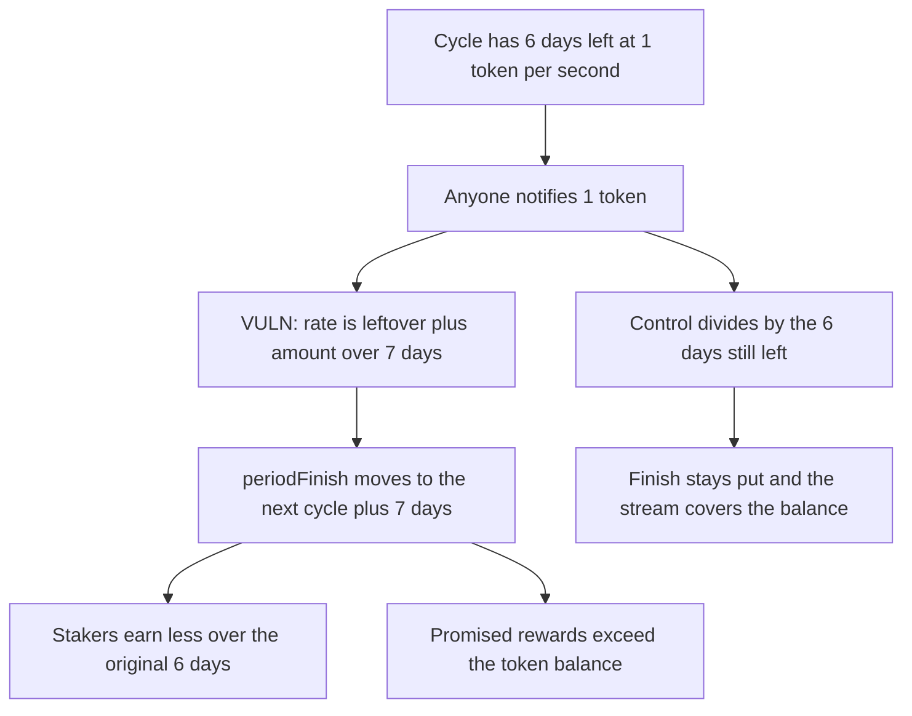

# Regnum Aurum: one token of rewards stretches the gauge cycle

> **Vulnerability classes:** `vuln/logic/reward-calculation`

<!-- non-defihacklabs -->
<!-- source-auditvault: https://github.com/Auditware/AuditVault/blob/main/findings/66163-h-01-malicious-users-can-extend-the-reward-period-pashov-aud.md -->
<!-- date: 2025-05 -->

## Key info

| Field | Value |
|---|---|
| **Loss** | Stakers earn less than 1 token per second over the original 6 days, and the stream promises more than the contract holds |
| **Vulnerable contract** | `GaugeRewardDistributor._handleRewardNotification` |
| **Attacker EOA** | `0x1111111111111111111111111111111111111111` |
| **Attack contract** | `Exploit` |
| **Attack tx** | `Exploit.run()` |
| **Chain / block / date** | Ethereum model · block 0 · 2025-05 |
| **Compiler** | solc 0.8.27, cancun, via IR |
| **Bug class** | Mid-cycle notify divides leftover by a full duration and pushes periodFinish out |

## TL;DR

Anyone may notify rewards. Mid-cycle, the update sets `rate = (amount + leftover) / DURATION` and `periodFinish = getNextCycleStart() + DURATION`. A cycle with 6 days left and a rate of 1 token per second is diluted by a 1-token notify. The rate falls below 1 per second, the finish moves later, and the new rate times the new window is larger than the tokens in the contract.

## The vulnerable code

```solidity
uint256 remaining = rd.periodFinish - timestamp;
uint256 leftover = remaining * rd.rate;
rd.rate = (amount + leftover) / DURATION;
rd.periodFinish = getNextCycleStart() + DURATION; // @> VULN: finish jumps to the next cycle plus a full duration, and the rate above was divided by DURATION rather than the time left
```

`DURATION` is 7 days. The recommended change divides by `remaining` and does not move `periodFinish`.

## Preconditions

- A cycle is already running: rate is 1e18 per second and `periodFinish` is 6 days ahead.
- The contract holds `6 days * 1e18` of the reward token, which is the unstreamed leftover.
- The caller notifies 1e18 more. No role gates the call.

## Attack walkthrough

1. Seed the live cycle. Leftover is 518400e18.
2. Notify 1e18. The else branch runs because `timestamp < periodFinish`.
3. The new rate is `(518401e18) / 7 days`, which is below 1e18 per second.
4. `periodFinish` becomes the next week boundary plus 7 days, later than the old finish.
5. A staker's payout over the original 6 days is `newRate * 6 days`, less than the old 518400e18.
6. `newRate` times the new remaining time is greater than the token balance, so the stream is short.
7. The control divides by the 6 days still left and leaves `periodFinish` unchanged. The rate rises slightly and the obligation matches the balance aside from division dust.

## Diagrams



## Impact

A one-token deposit, which any user can make, cuts the reward rate for the current cycle and extends the period. Stakers receive less per second over the 6 days that were already funded, and the stored rate run out to the new finish accounts for more tokens than the distributor holds.

## How to reproduce

```bash
cd 66163-h-01-malicious-users-can-extend-the-reward-period-pashov-aud_exp
forge test -vv
```

`test_exploit_tiny_notify_dilutes_and_extends` asserts the diluted rate, the longer finish, and the insolvent obligation. `test_control_rate_uses_remaining_time` asserts the finish is unchanged and the rate is leftover plus the new token divided by 6 days.

## Sources

- AuditVault finding: https://github.com/Auditware/AuditVault/blob/main/findings/66163-h-01-malicious-users-can-extend-the-reward-period-pashov-aud.md
- Pashov review: https://github.com/pashov/audits/blob/master/team/md/RegnumAurum-security-review_2025-05-06.md
