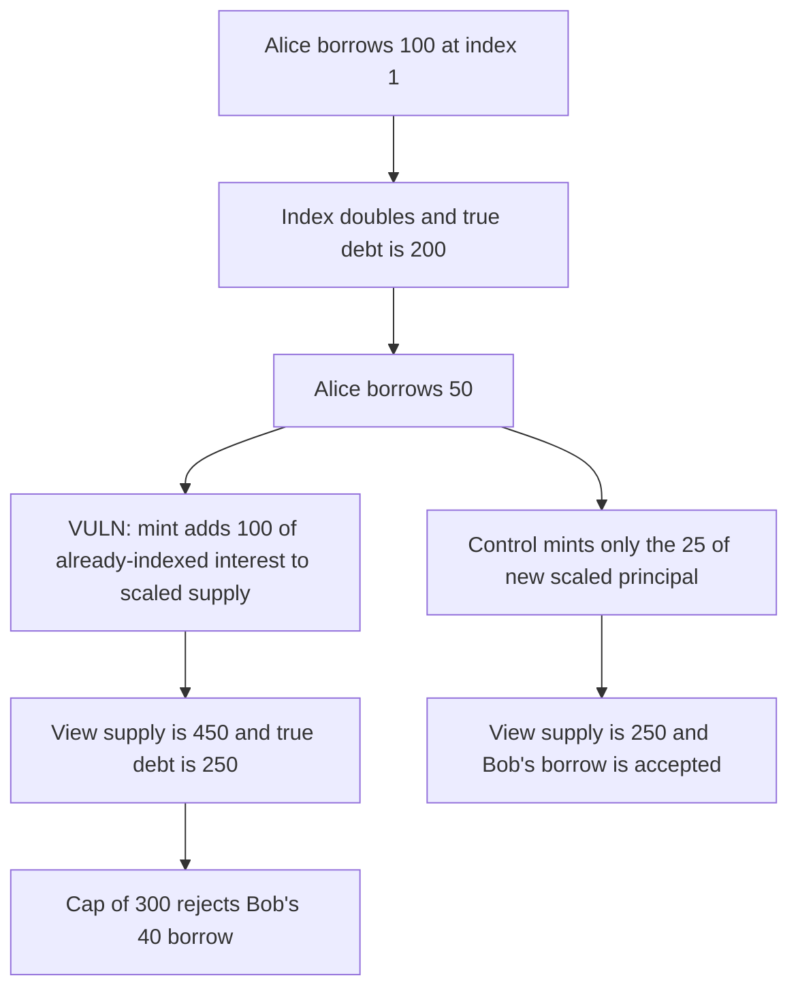

# Regnum Aurum: DebtToken total supply counts interest twice

> **Vulnerability classes:** `vuln/logic/state-update` · `vuln/logic/incorrect-order-of-operations`

<!-- non-defihacklabs -->
<!-- source-auditvault: https://github.com/Auditware/AuditVault/blob/main/findings/66165-h-03-debttoken-total-supply-is-inflated-pashov-audit-group-n.md -->
<!-- date: 2025-05 -->

## Key info

| Field | Value |
|---|---|
| **Loss** | A 40 borrow under a 300 cap is rejected while true debt is 250 |
| **Vulnerable contract** | `DebtToken.mint` and `DebtToken.totalSupply` |
| **Attacker EOA** | `0x1111111111111111111111111111111111111111` |
| **Attack contract** | `Exploit` |
| **Attack tx** | `Exploit.run()` |
| **Chain / block / date** | Ethereum model · block 0 · 2025-05 |
| **Compiler** | solc 0.8.27, cancun, via IR |
| **Bug class** | Interest already scaled by the index is minted into the scaled supply and then scaled again |

## TL;DR

`totalSupply` returns `scaledSupply.rayMul(index)`. `mint` adds `scaledBalanceIncrease`, which is already `rawDebt.rayMul(newIndex) - rawDebt.rayMul(oldIndex)`, on top of the new scaled principal. After a 100 borrow, an index doubling, and a 50 borrow, scaled supply is 225 and the view is 450. True debt is 250. A cap of 300 rejects the next 40 borrow. Minting only the scaled principal leaves the view at 250, and that borrow succeeds.

## The vulnerable code

```solidity
function totalSupply() public view returns (uint256) {
    return rayMul(scaledSupply, pool.getNormalizedDebt());
}

if (storedIndex != 0 && storedIndex < poolUsageIndex) {
    scaledBalanceIncrease = rayMul(rawDebtBalance, poolUsageIndex) - rayMul(rawDebtBalance, storedIndex);
}
uint256 amountToMint = amountScaled + scaledBalanceIncrease; // @> VULN: interest already scaled by the index is added to the scaled supply, and totalSupply rayMuls it again
```

`rawDebtBalance` is the scaled balance. The increase is a token-unit interest amount, not a new scaled principal. The fix mints `amountScaled` only and lets `totalSupply` apply the index once.

## Preconditions

- The usage index starts at 1 ray. Alice borrows 100. Scaled principal minted is 100.
- The index doubles. True debt on that principal is 200.
- Alice borrows 50 more. The cap is 300. Bob then tries to borrow 40.

## Attack walkthrough

1. First mint: increase is 0, scaled supply is 100, view supply is 100.
2. Index doubles. The pool's true-debt tracker becomes 200.
3. Second mint: new scaled principal is 25. The rayMul increase is 100. `amountToMint` is 125. Scaled supply is 225.
4. View supply is `225 rayMul 2 ray` = 450. True debt is 250.
5. Bob's 40 borrow sees `450 + 40 > 300` and is rejected. `250 + 40` is 290 and is under the cap.
6. The control token mints only scaled principal. After the same sequence the view is 250 and Bob's borrow is accepted. True debt becomes 290.

## Diagrams



## Impact

Borrowers who already have debt inflate `DebtToken.totalSupply` the next time interest is minted into the scaled balance. The lending pool's 300 borrow cap then refuses a 40 borrow that the 250 of true debt would still allow. Every other reader of `totalSupply`, including `reserve.totalUsage`, sees the same 450 instead of 250.

## How to reproduce

```bash
cd 66165-h-03-debttoken-total-supply-is-inflated-pashov-audit-group-n_exp
forge test -vv
```

`test_exploit_supply_inflation_blocks_the_next_borrow` asserts view supply 450, true debt 250, and Bob blocked. `test_control_scaled_principal_stays_under_the_cap` asserts view supply 250 and Bob's borrow succeeding.

## Sources

- AuditVault finding: https://github.com/Auditware/AuditVault/blob/main/findings/66165-h-03-debttoken-total-supply-is-inflated-pashov-audit-group-n.md
- Pashov review: https://github.com/pashov/audits/blob/master/team/md/RegnumAurum-security-review_2025-05-06.md
