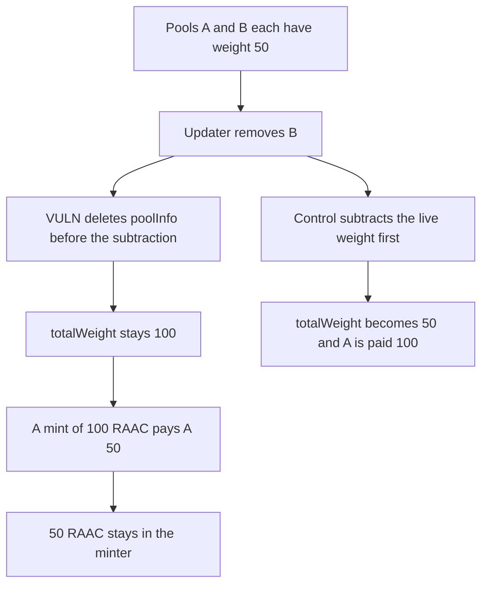

# Regnum Aurum: removing a distribution pool does not reduce totalWeight

> **Vulnerability classes:** `vuln/logic/incorrect-order-of-operations` · `vuln/logic/reward-calculation`

<!-- non-defihacklabs -->
<!-- source-auditvault: https://github.com/Auditware/AuditVault/blob/main/findings/66171-h-09-removing-distribution-pool-in-raacminter-does-not-updat.md -->
<!-- date: 2025-05 -->

## Key info

| Field | Value |
|---|---|
| **Loss** | 50 of 100 minted RAAC stays in the minter. Pool A is paid 50 instead of 100 |
| **Vulnerable contract** | `RAACMinter.removeDistributionPool` |
| **Attacker EOA** | `0x1111111111111111111111111111111111111111` (calls the documented updater removal) |
| **Attack contract** | `Exploit` |
| **Attack tx** | `Exploit.run()` |
| **Chain / block / date** | Ethereum model · block 0 · 2025-05 |
| **Compiler** | solc 0.8.27, cancun, via IR |

## TL;DR

`removeDistributionPool` deletes `poolInfo[pool]` and then subtracts `poolInfo[pool].weight`. The delete has already zeroed the weight, so `totalWeight` does not change. The next mint still divides by the old total. With A and B at weight 50, removing B leaves `totalWeight` at 100. A mint of 100 RAAC pays A 50. The other 50 never leaves the minter.

## The vulnerable code

```solidity
poolInfo[pool].exists = false;
if (fixedMode) {
    totalWeight = totalWeight - poolInfo[pool].weight;
    delete poolInfo[pool];
} else {
    delete poolInfo[pool];
    totalWeight = totalWeight - poolInfo[pool].weight; // @> VULN: the weight just deleted is zero
}
```

The review's fix reads the weight before the delete:

```diff
- delete poolInfo[pool];
  totalWeight = totalWeight - poolInfo[pool].weight;
+ delete poolInfo[pool];
```

## Root cause

`delete` on the struct clears `weight` and `exists`. The subtraction on the next line therefore loads 0. The removed pool's weight stays inside `totalWeight` and shrinks every later share. The pool is also left in `distributionPools`, so the mint loop still visits it and skips it because `exists` is false.

## Preconditions

- Two pools are registered at weight 50. `totalWeight` is 100.
- The updater removes pool B. That is the function's job, not an extra privilege.
- A later mint processes 100 RAAC that already sit on the minter.

## Attack walkthrough

1. The updater calls `removeDistributionPool` on B.
2. `exists` is cleared, then the struct is deleted.
3. `totalWeight` is reduced by 0 and stays 100.
4. `processMintedRewards(100 ether)` pays `100 * 50 / 100` to A.
5. 50 RAAC remains on the minter. `paid` is 50.
6. The control subtracts 50 before the delete. The same mint pays A 100 and leaves the minter empty.

## Diagrams



## Impact

Depositors of the surviving pool receive half of a mint that should have been entirely theirs. The other half is not distributed to any pool. Repeating the removal against a larger set leaves a matching fraction of every later mint undistributed.

## How to reproduce

```bash
cd 66171-h-09-removing-distribution-pool-in-raacminter-does-not-updat_exp
forge test -vv
```

`test_exploit_removed_weight_stays_in_total` asserts `totalWeight` is 100, pool A received 50, and the minter still holds 50. `test_control_subtracts_weight_before_delete` asserts `totalWeight` is 50 and pool A receives 100.

## Sources

- AuditVault finding: https://github.com/Auditware/AuditVault/blob/main/findings/66171-h-09-removing-distribution-pool-in-raacminter-does-not-updat.md
- Same report, duplicate ingestion 66350: https://github.com/Auditware/AuditVault/blob/main/findings/66350-h-09-removing-distribution-pool-in-raacminter-does-not-updat.md
- Pashov review: https://github.com/pashov/audits/blob/master/team/md/RegnumAurum-security-review_2025-05-06.md
