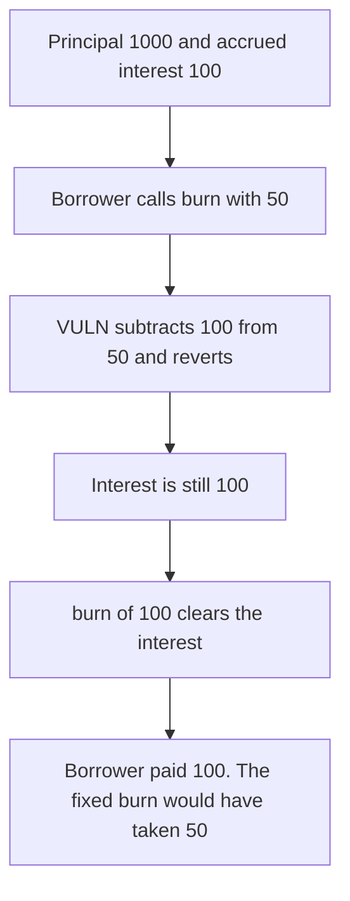

# Regnum Aurum: DebtToken.burn reverts a 50 interest payment and forces the full 100

> **Vulnerability classes:** `vuln/arithmetic/underflow` · `vuln/dos/griefing`

<!-- non-defihacklabs -->
<!-- source-auditvault: https://github.com/Auditware/AuditVault/blob/main/findings/66174-h-12-underflow-forces-full-interest-payment-in-debt-token-pa.md -->
<!-- date: 2025-05 -->

## Key info

| Field | Value |
|---|---|
| **Loss** | A 50-token interest payment reverts. The borrower must pay the full 100 accrued interest |
| **Vulnerable contract** | `DebtToken.burn` |
| **Attacker EOA** | `0x1111111111111111111111111111111111111111` |
| **Attack contract** | `Exploit` |
| **Attack tx** | `Exploit.run()` |
| **Chain / block / date** | Ethereum model · block 0 · 2025-05 |
| **Compiler** | solc 0.8.27, cancun, via IR |
| **Bug class** | Unchecked subtraction of accrued interest |

## TL;DR

`burn` computes `amount - scaledBalanceIncrease` before the branch that should accept a payment smaller than accrued interest. With 100 interest outstanding, a 50 payment underflows and reverts. Paying exactly 100 clears the interest. The fixed burn accepts 50 and leaves 50 of interest.

## The vulnerable code

```solidity
require(asset.transferFrom(msg.sender, address(this), amount), "pay");
// @> VULN: amount - accrued interest underflows when the payment is partial
uint256 amountAfterPaidInterest = amount - scaledBalanceIncrease;
```

The following `else` path, which would set `scaledBalanceIncrease = scaledBalanceIncrease - amount`, is unreachable whenever `amount` is smaller than the interest.

## Root cause

Solidity 0.8 reverts on the subtraction. The partial-interest branch is dead code.

## Preconditions

- Principal is 1000. Accrued interest (`scaledBalanceIncrease`) is 100.
- The caller tries to burn 50, which is less than the accrued interest.

## Attack walkthrough

1. Approve 100 and call `burn(50)`. The call reverts. Interest stays 100.
2. Call `burn(100)`. `100 - 100` is zero, so the remainder branch clears the interest.
3. The debt token holds 100. Principal is still 1000.

## Diagrams



## Impact

The borrower cannot pay interest down partially. Clearing the 100 interest costs 100 tokens in one call. A checked branch takes 50 and leaves `scaledBalanceIncrease` at 50.

## Remediation

Compare `amount` with `scaledBalanceIncrease` before subtracting. If the payment is smaller, reduce the interest and burn no principal.

## How to reproduce

```bash
cd 66174-h-12-underflow-forces-full-interest-payment-in-debt-token-pa_exp
forge test -vv
```

## Sources

- AuditVault finding: https://github.com/Auditware/AuditVault/blob/main/findings/66174-h-12-underflow-forces-full-interest-payment-in-debt-token-pa.md
- Pashov review: https://github.com/pashov/audits/blob/master/team/md/RegnumAurum-security-review_2025-05-06.md
- Reduced source: `test/66174-h-12-underflow-forces-full-interest-payment-in-debt-token-pa.sol`
