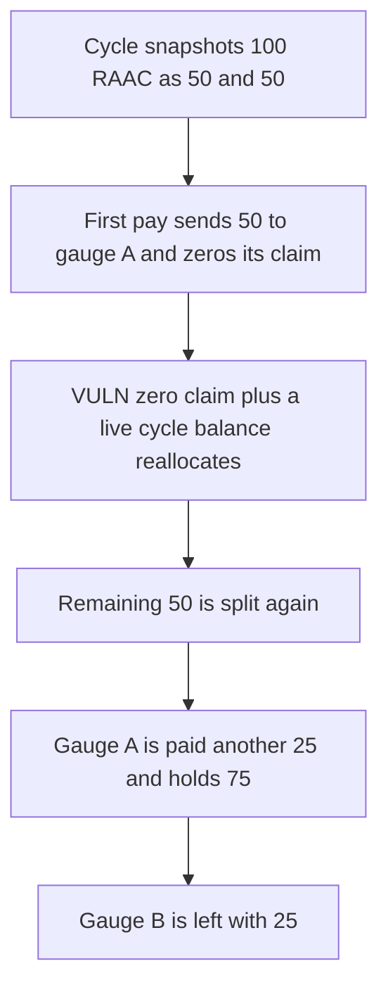

# Regnum Aurum: the same gauge is paid twice in one reward cycle

> **Vulnerability classes:** `vuln/logic/reward-calculation` · `vuln/logic/state-update`

<!-- non-defihacklabs -->
<!-- source-auditvault: https://github.com/Auditware/AuditVault/blob/main/findings/66177-h-15-malicious-users-can-distribute-more-rewards-to-the-same.md -->
<!-- date: 2025-05 -->

## Key info

| Field | Value |
|---|---|
| **Loss** | Gauge A receives 75 of a 100 RAAC cycle. Gauge B is left with 25 |
| **Vulnerable contract** | `GaugeRewardsDistributor.distributeRewards` |
| **Attacker EOA** | `0x1111111111111111111111111111111111111111` |
| **Attack contract** | `Exploit` |
| **Attack tx** | `Exploit.run()` |
| **Chain / block / date** | Ethereum model · block 0 · 2025-05 |
| **Compiler** | solc 0.8.27, cancun, via IR |
| **Bug class** | Clearing `pendingAllocations` makes the next call allocate the gauge again |

## TL;DR

A cycle snapshots 100 RAAC across two gauges, 50 each. Paying gauge A sets its pending claim to 0 but does not consume `distributionCycleBalance`. The next `distributeRewards` for A sees a zero claim and a live cycle balance, recalculates, and pays A another 25 from what was left for B. A ends at 75. B, paid afterwards, gets 25.

## The vulnerable code

```solidity
if (gaugeShare == 0 && distributionCycleBalance[token] > 0) { // @> VULN
    // gauge already in the cycle is not a reason to skip
    _recalculateAllocations(token);
    gaugeShare = pendingAllocations[token][gauge];
}
// later, after a successful pay
pendingAllocations[token][gauge] = 0; // @> VULN
```

The report's fix is to refuse a second distribution to a gauge already paid in the cycle.

## Root cause

`_distributeRewardToGauge` zeros the gauge's pending amount so it cannot be paid twice. `_checkAndAddGaugeToCycle` treats that zero, while `distributionCycleBalance` is still positive, as "this gauge has not been allocated yet" and calls `_recalculateAllocations`. The recalculation overwrites every gauge's claim from the tokens still held, including gauges that were already paid.

## Preconditions

- Two gauges are registered before the cycle starts.
- The distributor holds 100 RAAC. The snapshot splits it 50 and 50.
- Anyone may call `distributeRewards`. No role is required.

## Attack walkthrough

1. The first call starts the cycle and pays A its 50. Pending A becomes 0. Pending B is still 50. The contract still holds 50.
2. The second call for A hits `gaugeShare == 0 && distributionCycleBalance > 0`.
3. Recalculation sets both claims to 25, half of the remaining balance. A is paid 25 more.
4. B's later call pays the rewritten 25. A holds 75. B holds 25.

## Diagrams



## Impact

A caller can move another gauge's unsent rewards onto a gauge of their choice inside the same cycle. Here that is 25 RAAC, a quarter of the cycle, taken from gauge B. The fair split of this cycle was 50 and 50.

## How to reproduce

```bash
cd 66177-h-15-malicious-users-can-distribute-more-rewards-to-the-same_exp
forge test -vv
```

`test_same_gauge_is_paid_twice_in_one_cycle` asserts gauge A holds 75 RAAC and gauge B holds 25.

## Sources

- AuditVault finding: https://github.com/Auditware/AuditVault/blob/main/findings/66177-h-15-malicious-users-can-distribute-more-rewards-to-the-same.md
- Pashov report: https://github.com/pashov/audits/blob/master/team/md/RegnumAurum-security-review_2025-05-06.md
