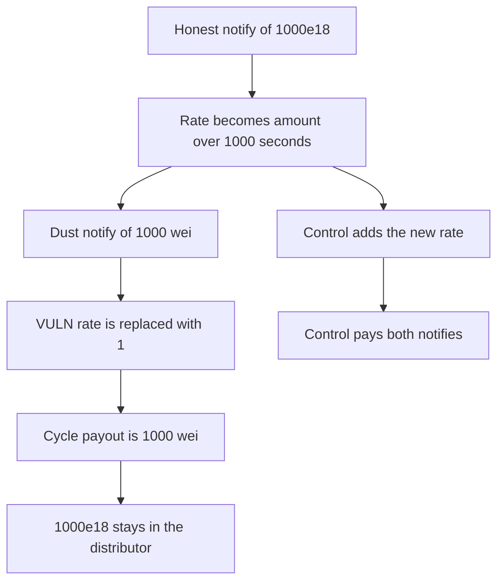

# Regnum Aurum: a second notify in the first cycle replaces the reward rate (66178)

> **Vulnerability classes:** `vuln/logic/reward-calculation`

<!-- non-defihacklabs -->
<!-- source-auditvault: https://github.com/Auditware/AuditVault/blob/main/findings/66178-h-16-reward-rate-can-be-manipulated-in-first-cycle-pashov-au.md -->
<!-- date: 2025-05 -->

## Key info

| Field | Value |
|---|---|
| **Loss** | Distributor holds 1000e18 plus 1000 wei. The cycle pays only 1000 wei, so the 1000e18 is not distributed |
| **Vulnerable contract** | `GaugeRewardsDistributor._handleRewardNotification` |
| **Attacker EOA** | `0x1111111111111111111111111111111111111111` |
| **Attack contract** | `Exploit` |
| **Attack tx** | `Exploit.run()` |
| **Chain / block / date** | Ethereum model · block 0 · 2025-05 |
| **Compiler** | solc 0.8.27, cancun |
| **Bug class** | first-cycle rate is assigned, not accrued |

## TL;DR

Before `firstCycleStart`, every notify sets `rd.rate = amount / firstCycleDuration` and returns. An honest notify of `1000e18` would pay `1e18` per second for 1000 seconds. A following notify of 1000 wei replaces that rate with 1. `cyclePayout` is then 1000 wei. The `1000e18` stays in the distributor. This page is AuditVault 66178.

## The vulnerable code

```solidity
rd.rate = this.quoteRate(amount, firstCycleDuration);
// quoteRate returns amount / duration and does not add to the previous rate
// @> VULN: replaces the rate; prior rewards in this cycle are not accrued
```

Accrue inside the first cycle:

```diff
- rd.rate = amount / firstCycleDuration;
+ rd.rate += amount / firstCycleDuration;
```

## Root cause

The first-cycle branch never adds the new amount onto rewards already notified. `lastUpdateTime` is also moved to now, so the previous rate is not settled before it is overwritten. The stored rate describes only the latest notify.

## Preconditions

- `block.timestamp` is below `firstCycleStart`.
- `getFirstCycleDuration` is 1000.
- The honest amount is `1000e18` and the second amount is 1000 wei.

## Attack walkthrough

1. The honest notify transfers `1000e18` into the distributor.
2. `quoteRate` returns `1000e18 / 1000`.
3. A second notify transfers 1000 wei and `quoteRate` returns 1.
4. `rd.rate` is 1. The earlier rate is gone.
5. `cyclePayout` is `1 * 1000 = 1000` wei.
6. Balance minus that payout is the original `1000e18`.
7. The control adds the two rates and the stored rate is `1e18 + 1`.

## Diagrams



## Impact

Stakers who were owed the `1000e18` notify earn 1000 wei over the whole first cycle. The tokens sit in the distributor and are not claimable at the honest rate. Any later notify before `firstCycleStart` can repeat the wipe. Finding 66178 is this same H-16.

## How to reproduce

```bash
cd 66178-h-16-reward-rate-can-be-manipulated-in-first-cycle-pashov-au_exp
forge test -vv
```

`output.txt` is the captured passing run. The control test checks the recommended fix.

## Sources

- AuditVault finding: https://github.com/Auditware/AuditVault/blob/main/findings/66178-h-16-reward-rate-can-be-manipulated-in-first-cycle-pashov-au.md
- Report: https://github.com/pashov/audits/blob/master/team/md/RegnumAurum-security-review_2025-05-06.md
- Provenance: Pashov Regnum Aurum review 2025-05-06, GaugeRewardsDistributor._handleRewardNotification. The first-cycle branch is quoted in the finding.
