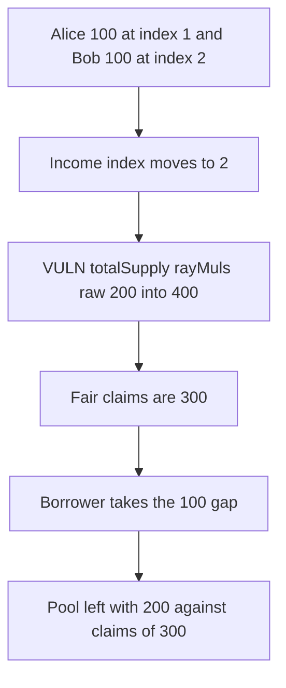

# Regnum Aurum 66179: totalSupply rayMuls raw principal and a borrower takes 100 assets

> **Vulnerability classes:** `vuln/logic/wrong-condition`

<!-- non-defihacklabs -->
<!-- source-auditvault: https://github.com/Auditware/AuditVault/blob/main/findings/66179-h-17-incorrect-totalsupply-calculation-pashov-audit-group-no.md -->
<!-- date: 2025-05 -->

## Key info

| Field | Value |
|---|---|
| **Loss** | 100 assets borrowed against a reported supply of 400. Fair claims are 300. The pool is left with 200 |
| **Vulnerable contract** | `RToken.totalSupply` |
| **Attacker EOA** | `0x1111111111111111111111111111111111111111` |
| **Attack contract** | `Exploit` |
| **Attack tx** | `Exploit.run()` |
| **Chain / block / date** | Ethereum model · block 0 · 2025-05 |
| **Compiler** | solc 0.8.27, cancun, via IR |
| **Bug class** | Raw principal scaled by the current liquidity index |

## TL;DR

Lender balances are raw principal, and each lender has an entry index. Alice deposited 100 at index 1. Bob deposited 100 at index 2. At index 2 their fair claims are 200 and 100. `totalSupply` does `rawSupply.rayMul(currentIndex)` and reports 400. A consumer that treats the gap as borrowable transfers 100 assets out of the 300 that back those claims.

## The vulnerable code

```solidity
function totalSupply() public view override(ERC20, IERC20) returns (uint256) {
    return super.totalSupply().rayMul(ILendingPool(_lendingPool).getNormalizedIncome()); // @> VULN: raw principal supply is scaled by the current index
}
```

The review says the raw balances are not normalized, so multiplying by the index overstates supply. The fix is to store normalized shares and let `totalSupply` be their sum, or to scale each balance by `currentIndex / userIndex` and sum those.

## Root cause

`super.totalSupply()` is the sum of principals. Interest belongs in `currentIndex / userIndex` per account. One global `rayMul` applies Alice's index growth to Bob's principal as well.

## Preconditions

- Alice principal 100 at user index 1e27. Bob principal 100 at user index 2e27.
- `getNormalizedIncome` is 2e27.
- The pool holds 300 underlying, which is the fair claim total.
- A borrower may take `totalSupply() - fairClaims()`.

## Attack walkthrough

1. Mint both principals and move the index to 2.
2. `totalSupply` returns 400. `fairClaims` returns 300.
3. The pool transfers the 100 gap to the caller.
4. 200 underlying remains against 300 of claims.

## Diagrams



## Impact

Every function that treats `totalSupply` as assets owed will be 100 too high in this state. The borrower in this run removes 100 underlying that was backing Alice and Bob. Later withdrawals cannot all pay the fair claim.

This AuditVault id is 66179. The same Pashov H-17 text is also filed under the other id. Both reductions use the quoted `totalSupply` line and the same numbers.

## Remediation

Normalize balances when they are minted, and do not `rayMul` the raw sum by the current index. If a per-user index is the interest model, sum `principal * currentIndex / userIndex` instead.

## How to reproduce

```bash
cd 66179-h-17-incorrect-totalsupply-calculation-pashov-audit-group-no_exp
forge test -vv
```

Captured output is `output.txt`.

## Sources

- AuditVault finding: https://github.com/Auditware/AuditVault/blob/main/findings/66179-h-17-incorrect-totalsupply-calculation-pashov-audit-group-no.md
- Pashov Regnum Aurum review: https://github.com/pashov/audits/blob/master/team/md/RegnumAurum-security-review_2025-05-06.md
- The finding file has no genome frontmatter. The report body says Impact Medium and Likelihood High. AuditVault records impact HIGH.

